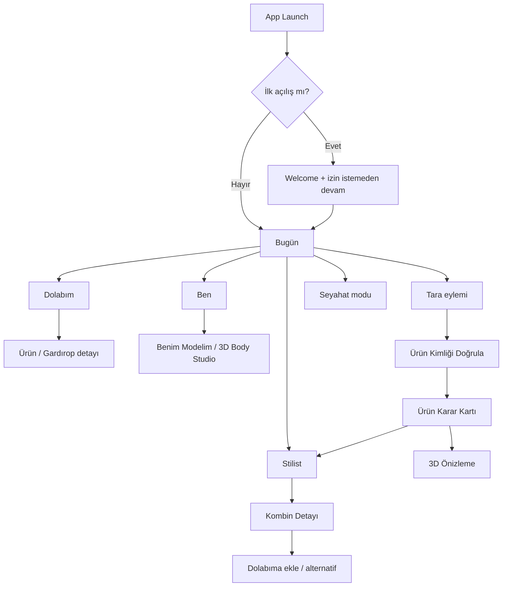

# KABİNSİZ — GOD LEVEL v2.0
## EDITORIAL ATELIER: UI/UX TASARIM ANAYASASI ve GÖRSEL EKRAN ATLASI

**Ürün:** Kabinsiz (önceki teknik kod adı WEARFORM)  
**Belge türü:** Claude Code için uygulanabilir ürün tasarım şartnamesi + Markdown içinde görsel wireframe atlası  
**Tarih:** 03.11.2026  
**Durum:** DESIGN SPEC / UYGULANMADI / ONAYLANMIŞ ÜRÜN-VERİ GERÇEKLİĞİ İDDİASI DEĞİL  
**Hedef:** iOS-first; unisex; üst düzey ama samimi, zamansız, doğal, butik ve modaya ait.  
**Ana kaynak:** `KABINSIZ_GOD_LEVEL_CLAUDE_MASTER_EXECUTION_CONSTITUTION_v1.9.md` ve `gundogandogancan/kabinsiz`.  
**Yeni belge görevi:** v1.9'un ürün, güvenlik, veri ve test değişmezlerini KORUYUP yalnız görsel kimlik, UI/UX, navigasyon ve tasarım uygulama ayrıntılarını somutlaştırmak.

> **Claude'a açık emir:** Bu dosya fotoğraf ya da yüksek çözünürlüklü nihai UI görseli değildir. Aşağıdaki sağ kolonlardaki çizimler *metinsel wireframe*’dir. Bunları çalışan SwiftUI ekranlarına dönüştür; gerçek simülatör/iPhone ekran görüntülerini sen üret, karşılaştır ve kanıtla. Yapay zekâ ile rastgele görsel üretip eksik işlevi gizleme. Kullanıcının paylaştığı referans görselin **anlatım biçimini** (solda açıklama, sağda somut gösterim, ölçek ölçek ilerleme) esas al; referanstaki siyah arka planı veya globe/mekân içeriğini Kabinsiz'e kopyalama.

**BÖLÜM ÖNCELİĞİ:** hukuk, mahremiyet, platform kuralları, doğruluk > v1.9 mimari ve veri sözleşmeleri > bu belgedeki v2.0 tasarım/UI kararı > repo gerçekliği > estetik tercih. Görsel yön konusundaki eski `#283D46` mavi-gri accent ve “serif yasak” yaklaşımının yerini burada tanımlanan sıcak editoryal tipografi/palet alır; güvenlik/erişilebilirlik geri alınmaz.

**Kırmızı çizgi:** Premium = daha fazla efekt değil, daha az sürtünme + kontrollü zanaat + okunabilir karar. Kullanıcı, kaç uzman ajan çalıştığını değil, “Bunu giyebilir miyim? Hangisi daha iyi? Neresi eksik?” sorularının cevabını görür.

## 01 — TASARIMI ÜÇ ÖLÇEKTE SUN: KAVRAM / EKRAN / ATOM

Bu bölüm kullanıcının referansındaki “ölçekler arası anlatı” yönteminin Kabinsiz'e uyarlanmış hâlidir. Her seviyede **sol: neden + davranış**; **sağ: metinsel görselleştirme** bulunur. Bu dosya herhangi bir yeni PNG/JPG/AI görseli üretmez.

### ÖLÇEK 1 — MARKA ve RUH


<table>
<tr>
<th align="left" width="49%">SOL — Amaç, deneyim ve tasarım kararı</th>
<th align="left" width="51%">SAĞ — Metinsel ekran şeması (wireframe)</th>
</tr>
<tr>
<td valign="top"><p>Felsefe: Steve Jobs çizgisinde kökten sade ürün düşüncesi; Steve Wozniak çizgisinde sağlam, anlaşılır, denetlenebilir teknik. Bu bir kişilik taklidi değildir: tasarım ilkelerinin ürüne tercümesidir.</p><p>Estetik: editoryal moda dergisi + özenli terzi atölyesi + doğal İskandinav/Akdeniz dokuları. “Soğuk AI laboratuvarı” ya da “lüks e-ticaret reklamı” değil.</p><p>İnsan odaklı söz: “Taradığın ürün, kendi dolabın, kendi bedenin, kendi kararın.” Yaş, cinsiyet veya ten renginden stil stereotipi çıkarma.</p></td>
<td valign="top"><pre>╭───────────────────────────────╮
│            Kabinsiz           │
│           ATELIER             │
│                               │
│     SANAT  ×  MÜHENDİSLİK     │
│                               │
│  Fildişi zemin                │
│  İnce serif başlık            │
│  Düz, okunaklı gövde          │
│  Kumaşın gerçek dokusu        │
│                               │
│  “Sana ait, sana göre.”        │
╰───────────────────────────────╯</pre></td>
</tr>
</table>

### ÖLÇEK 2 — EKRAN VE KULLANICI KARARI


<table>
<tr>
<th align="left" width="49%">SOL — Amaç, deneyim ve tasarım kararı</th>
<th align="left" width="51%">SAĞ — Metinsel ekran şeması (wireframe)</th>
</tr>
<tr>
<td valign="top"><p>Bir sayfada tek ana hedef. Bugün ekranı “Ne giysem?”, tara ekranı “Ürün nedir?”, karar ekranı “Uyar mı?”, stüdyo “Üzerimde nasıl görünür?” sorusuna cevap verir.</p><p>Sadelik: ekran başına bir güçlü ana eylem; bir yardımcı eylem; geri kalan detaylar ikincil sayfa veya açılır bilgi katmanında.</p><p>Aynı kapak görselini onlarca kartta tekrarlama; gerçek ürün fotoğrafı yalnızca lisanslı veya kullanıcıya ait olduğunda. Veri yoksa kıyafeti uydurma.</p></td>
<td valign="top"><pre>╭────────── iPHONE ─────────────╮
│ Kabinsiz                [Ben]  │
│ Şehir · Hava durumu            │
│                               │
│ BUGÜN İÇİN                    │
│ Dolabından bir kombin         │
│ [ Kombini Gör            → ]  │
│                               │
│ Tara  ·  Seyahat  ·  Stilist   │
│                               │
│ Dolabından öneriler           │
│ [KOMBİN] [KOMBİN]             │
│                               │
│ Bugün  Dolabım  Ben           │
╰───────────────────────────────╯</pre></td>
</tr>
</table>

### ÖLÇEK 3 — BİLEŞEN VE MİKRO ETKİLEŞİM


<table>
<tr>
<th align="left" width="49%">SOL — Amaç, deneyim ve tasarım kararı</th>
<th align="left" width="51%">SAĞ — Metinsel ekran şeması (wireframe)</th>
</tr>
<tr>
<td valign="top"><p>Kullanıcı telefonun kendi doğal hareketlerini hisseder: SwiftUI, native odak, normal tab bar, gerçek sheet ve VoiceOver davranışı.</p><p>Kart görseli güzel olduğu için bilgi kesin değildir. Her fit, kumaş ve hava önerisinin doğrulama/eksik bilgi açıklaması vardır.</p><p>Beden kaydırıcısı güvenilir revizyon, geri al ve onayla sistemine bağlıdır; kaydırma sırasında sahte yüzdeler gösterilmez.</p></td>
<td valign="top"><pre>╭── BİLEŞEN KİTİ ───────────────╮
│                                │
│ [ Kombini Gör            → ]   │
│ [ Ürünü Tara             ▣ ]   │
│ (Günlük) (Özel) (Ofis)         │
│                                │
│ ┌────────────────────────────┐ │
│ │ Ürün kimliği: doğrulandı   │ │
│ │ Kalıp: veri eksik          │ │
│ │ [Kaynağı gör]              │ │
│ └────────────────────────────┘ │
│                                │
│ Bel — [−] ━━━●──── [+]        │
│ [İptal]           [Kaydet]     │
╰────────────────────────────────╯</pre></td>
</tr>
</table>

## 02 — TASARIM FELSEFESİ: "QUIET ATELIER"

### 02.1 Neden bu estetik?

- **Sıcak:** kumaş, ışık, insan ve mevsimle ilişki kurar; klinik mavi, neon ve futuristik hologramlardan kaçınır.
- **Unisex:** görsel dil kadın/erkek kodlu pembeler-maviler yerine doğal tonlar, tipografik zarafet, işlevsel geometri ve farklı bedenlerde gerçek stiller üzerine kurulur.
- **Elit ama dışlayıcı olmayan:** lüks algısı boşluk, tipografi, dokusal doğruluk ve güven ile oluşur; pahalı ürün satın almaya mecbur hissettirmez.
- **Sanatsal ama araç:** editoryal fotoğraf yalnızca bir fikir anlattığında; moda illüstrasyonları bilgi yerine geçmediğinde.
- **Sürekli yaşayan:** günün ışığı, havanın koşulları ve kişinin gardırobu ekranı değiştirir; ancak ana iskelet hep tahmin edilebilir kalır.
- **Zamansız:** modası birkaç ayda geçen 3D ikonlar, yapay parıltılar, bulanık neon tabanlar, metalik degradeler yok.

### 02.2 Yapılmaması gerekenler

İçerikteki tüm AI ajanlarını sekme olarak açma; ana ekrana devasa grafik ve KPI panosu ekleme; her kartı kahverengi çerçeve içine alma; tüm ekranı kahverengiye boyama; marka logosunu veya kumaş ayrıntısını generatif yolla uydurma; kullanıcıyı cinsiyet seçmeye zorlama; bedeni “kusurlu”, “güzel”, “ideal” etiketleriyle yargılama; sırf lüks görünsün diye okunurluğu bozma.

### 02.3 "İnsan ruhunu okuyormuş gibi" hissin gerçek mühendisliği

Önerilerin dili özenli ve kişisel olmalı; “zihnini okuyoruz” gibi iddia olmayacak. Stil profili yalnızca **kullanıcının seçtiği/sildiği tercihler, kombin geri bildirimleri, konfor notları, giyim bağlamı ve kendi dolabından** gelişir. Doğum tarihi/astroloji/numeroloji ancak önceden açıklanmış ve açıkça açılan sembolik ilham katmanıdır; bilimsel uyum veya tıbbi/psikolojik tahmin gibi sunulmaz. Kullanıcı “neden bu kombin?” bilgisini bir dokunuşta görür.

## 03 — KESİN RENK PALETİ VE SEMANTİK TOKEN'LAR

> HEX renkler **tasarım başlangıç tokenlarıdır**, gerçek cihaz üzerinde WCAG kontrast ve Apple Increase Contrast testlerinden geçmeden yayımlanmaz. İhtiyaç olursa sayısal renkler iyileştirilir, görsel kimlik ilkesi korunur.

### 03.1 Light mode — `Atelier Linen`

| Token | HEX | Görsel rol | Kural |
|---|---|---|---|
| `canvas.primary` | `#F8F6F1` | Fildişi, sıcak ana zemin | Ekranların %65–75'inde hakim |
| `surface.primary` | `#FFFCF8` | Kağıt/kart yüzeyi | Ana kart |
| `surface.secondary` | `#F0EAE2` | Keten/görsel arka plan | Seçili küçük blok |
| `surface.sand` | `#E8DED1` | Kum beji | Bazı chip/tab arka planları |
| `border.soft` | `#D9D0C4` | İnce taş kontur | 1 px, yüksek kontrast için değişebilir |
| `text.primary` | `#26221E` | Derin espresso | Ana gövde, yüksek kontrast |
| `text.secondary` | `#5C544C` | Koyu taupe | Yardımcı açıklama |
| `brand.primary` | `#654632` | Ceviz/kahve | Tek birincil CTA, etkileşim |
| `brand.secondary` | `#62684B` | Zeytin | Çok sınırlı stil/rahatlık vurgusu |
| `accent.copper` | `#9C6048` | Mat bakır | Küçük etiket/vurgu, metin kontrastı doğrula |
| `avatar.neutral` | `#A8A49F` | Grafit-gri manken | Beden nötr sunum |
| `status.success` | `#35694B` | Kanıtlı olumlu durum | İkon + metin zorunlu |
| `status.warning` | `#825A1C` | Belirsizlik | “Veri eksik” anlamı |
| `status.danger` | `#9E3B3D` | Hata/iptal | Nadir, anlamlı kullan |

Kontrast için başlangıç kontrolleri (sRGB): `#654632`/`#F8F6F1` yaklaşık **7.85:1**; `#5C544C`/`#F8F6F1` yaklaşık **6.88:1**; `#9C6048`/`#F8F6F1` yaklaşık **4.65:1**. Bu değerler yalnız belirtilen düz arka plan eşleşmesi içindir; yarı saydamlık, resim üzeri metin ve durum etkileri yeniden ölçülür.

### 03.2 Dark mode — `After Hours`

| Token | HEX | Kullanım |
|---|---|---|
| `canvas.primary` | `#151411` | Saf siyah değil, sıcak koyu taş |
| `surface.primary` | `#201D19` | Kart |
| `surface.secondary` | `#2A251F` | Sekonder alan |
| `border.soft` | `#494238` | Ayırıcı |
| `text.primary` | `#F6F0E7` | Sıcak beyaz |
| `text.secondary` | `#C4B9AC` | Açıklama |
| `brand.primary` | `#C99D7A` | Gece modunda açık kahve |
| `brand.secondary` | `#ADB598` | Sakin zeytin |
| `accent.copper` | `#D4A18B` | Kontrollü vurgu |

Sistem açık/koyu ayarına saygı duy. Kullanıcıya uygulama içi ayrı görünüm seçeneği mecburi değil. Asset Catalog `Any/Dark`, gerekirse `High Contrast` varyantları üret; `Color` sabitleri yerine semantic asset adlarıyla çağır. iOS güncellemelerindeki sistem tab bar / Liquid Glass değişiklikleriyle çelişen custom opak tab bar çizme.

### 03.3 Renk kullanım oranları

- **%70:** kağıt/fildişi boşluk ve zemin; **%20:** doğal koyu tipografi + düşük kontrastlı yüzey; **%8:** aksesuar/ürün renkleri; **%2:** aktif durum/vurgu. Bu yüzdeler matematiksel UI zorunluluğu değil, tasarım disiplini için yön.
- Sponsorlu kartlar ayrı ve açık `Sponsorlu` etiketiyle; renk hilesiyle “en iyi öneri” gibi görünmeyecek.
- Fotoğraf arka planında yeterli okunurluk için sabit opak metin yüzeyi veya ölçülmüş scrim; beyaz metni resme rastgele koyma.

## 04 — TİPOGRAFİ, TİPOLOJİ VE DİL

### 04.1 Font ailesi kararı

1. **Editoryal başlık:** Apple sistem serif seçeneği (New York ailesini sistem API üzerinden, SwiftUI `.system(..., design: .serif)`) — yalnız kısa başlıklar, marka havası ve birkaç kahraman metin.
2. **İşlevsel gövde:** iOS sistem sans (SF Pro) — her ölçü, fiyat, açıklama, buton, yardım, tab ve durum.
3. **Hizalı sayılar:** `.monospacedDigit()` veya sistemin uygun tabular numeric yüzü — cm, beden karşılaştırması, fiyat, tarih.
4. **Dil:** Türkçe İ/ı/ğ/ş/ç/ö/ü, farklı kullanıcı dil seçenekleri ve uzun marka adları font testine girecek. Harfleri otomatik all-caps yapma; uppercase yalnız 1–3 kelimelik küçük görsel üst etikette sınırlı.
5. **Lisans:** Üçüncü taraf font için lisans, bundle hakkı ve maliyet kanıtı yoksa yüklenmez; asla font dosyası kopyalama/dağıtma.

### 04.2 Tipografik ölçek (başlangıç, Dynamic Type ile ölçeklenecek)

| Stil | Semantik SwiftUI | Temel pt | Ağırlık | Kullanım |
|---|---|---:|---|---|
| `display` | `.largeTitle` + `.serif` | 34 | Regular/medium | Hoş geldin, “Bugün” kapak başlığı |
| `screenTitle` | `.title` + `.serif` | 28 | Semibold | Ürün ve stil ekranı |
| `sectionTitle` | `.title2` + `.serif` | 22 | Medium | Kart grubu |
| `cardTitle` | `.headline` (sans) | 17 | Semibold | Ürün isimleri, görev kartları |
| `body` | `.body` | 16–17 | Regular | Açıklamalar ve form |
| `secondary` | `.subheadline` | 15 | Regular | Kaynak, kısa neden |
| `caption` | `.footnote` | 13 | Regular | Kaynak ve sınır |
| `eyebrow` | `.caption` | 12 | Medium | “BUGÜN İÇİN”, 1–3 sözcük |

Sıkıştırılmış font, 9 pt legal footer, uzun italik paragraf, tüm kartlarda serif veya 2 satırlık zorla kısaltılmış buton yasak. **Dynamic Type için `.fixedSize(horizontal: false, vertical: true)` ve uygun layout dönüşümü** denenecek. Erişilebilirlik metinlerinde ana CTA küçük gözükmeyecek.

### 04.3 Ürün dili — UX yazım sistemi

| Yanlış | Doğru |
|---|---|
| “AI personalizes your aura” | “Tarzına göre bir kombin hazırladık.” |
| “%97 kesin sana olur” (kanıt yok) | “Beden önerisi için ürün ölçüsü eksik.” |
| “Vücudundaki kusurları gizle” | “İstersen daha dökümlü bir kesim deneyelim.” |
| “Doğum haritana göre bu renk zorunlu” | “Sembolik ilham açık; bu renk sana ilham verebilir.” |
| “Kabinleri ortadan kaldırdık” | “Mağazada ön kararını kolaylaştır.” |
| “Marka kesin %100 pamuk” (kanıtsız) | “Kumaş içeriği doğrulanamadı.” |
| “Bedenin yanlış” | “Bu ürünün kalıbı istediğin gibi oturmayabilir.” |

Kullanıcının zihninde üç ses: **özenli stilist** (yaratıcı), **dürüst terzi** (ölçüm sınırlarını bilir), **güvenilir teknisyen** (ne olup olmadığını açıklar). Gereksiz sıcaklık, yapay övgü, cinsiyetçi veya yaşçı söylem yok.

## 05 — GEOMETRİ, IŞIK, İKON, FOTOĞRAF VE HAREKET

| Parametre | Tasarım kararı | Gerekçe |
|---|---|---|
| 4pt grid | 4 / 8 / 12 / 16 / 20 / 24 / 32 / 40 | Tutarlı ritim |
| Screen gutter | 20 pt (dar cihazda 16–20) | Fotoğraf nefes alır |
| Card padding | 16–20 pt | Bilgi rahat okunur |
| Min tap | 44×44 pt, bağlama göre daha büyük | Parmak/VoiceOver |
| Radius | 8 küçük; 14 chip; 20 kart; 24 hero | Moda editoryal, oyuncak değil |
| Shadow | Az, açık ton, gerekli yerde | Aşırı kabartma yok |
| Borders | 1 px ince ayırıcı | Sınır ihtiyaç olduğunda |
| Icon | SF Symbols, tutarlı 19–22pt | Yerel hız, aygıt uyumu |
| Animation | 160–220 ms mikro; 240–360 ms durum | Akıcı, sabırlı |
| 3D | Etkileşimde öncelik ve cihaz bütçesi | Güç/ısı için yönetilen degrade |
| Skeleton | Statik/düşük enerjili | Sürekli shimmer yok |

### 05.1 Fotoğraf ve gerçek içerik yönetimi

- Yapay plastik cilt, aşırı rötuş, algoritmik moda klişeleri yok. Yumuşak gün ışığı, gerçek tekstil yüzeyleri, somut malzeme, doğal pozlar, hareket ve gerçek bağlam.
- Unisex: değişik yaşlar, bedenler, stiller ve kültürel giyim seçenekleri; “erkek sert, kadın zarif” gibi sabit tarz şablonu oluşturma.
- Ürün kanıtı: kamera taramasında **gerçek ürün görüntüsü**, katalog fotoğrafı ise hak sahibi/izinli varlık; olmayan logosu, dikişi, yaka formunu uydurmak yasak.
- Her tasarım gerçek fotoğraf olmadan **offline ve placeholder ile de iyi görünmeli**. Fotoğraf olmadığı durumda moda sahnesi uydurmak yerine tipografi/kategori silueti.
- Ürün fotoğrafları dikey 3:4, outfit fotoğrafları 4:5; geniş hero için iyi yazı alanı doğrulanmış kompozisyon; kırpma her cihazda test.

### 05.2 Hareket ve haptik

- Scan başarı: tek hafif haptic; hatalı barkod: tekrar tekrar titreme yok.
- Kart açılışı content transition; modal içinde başka modal yığma yok.
- `Reduce Motion` etkinse sürekli parallax, 3D otomatik dönme ve geçişli zum KAPALI.
- 3D avatar slider'ı gecikmesiz **önizleme hedefi**; cihaz termali yükselirse görüntü kalitesi düşebilir, kullanıcı sonucu ve sınırı görür.
- Başarı animasyonu 200ms gibi hedeflenir; performans sayıları ölçülmeden kanıtlanmış denmez.

### 05.3 Ses ve duyusal his

Ses varsayılan kapalı; kullanıcı izin verirse hafif erişilebilir ses işareti. Uygulama bir “oyun” değil, profesyonel stil aracı. Takvim/seyahat bildirimi izinsiz açılmaz.

## 06 — BİLGİ MİMARİSİ ve NAVİGASYON KARARI

**P0 (repo uyumu, güvenli ilerleme):** `Bugün | Dolabım | Ben` olmak üzere **3 ana sekme**; `Tara` sekme değil, ana ekranda görünür birincil buton ve gerektiğinde global toolbar eylemi; `Stilist`, `3D Deneme`, `Seyahat`, `Keşfet`, `Mağaza` ikincil rotalar. **P1**: Kullanıcı araştırması, analitik ve kullanılabilirlik testi gösterirse `Stilist` dördüncü sekme olur. Açık navigasyon denemesi olmadan 5 tab'a geçilmez.

Bu ayrım Apple'ın sekme çubuğunu **gezinme** için, toolbar kontrolünü **eylem** için kullanma ilkesine uygundur. 



**Navigation state contract:** her sekme kendi scroll/route konumunu korur; global `Tara` kapatıldığında önceki sayfaya döner; veri yüklenemediğinde geriye dönüş her zaman mümkündür; `3D` geç açılırsa kullanıcı beklemeden ölçü veya ürün bilgisine ulaşabilir. Native iOS navigation/sheet, safe-area ve status bar kullanılacak.

## 07 — EKRAN ATLASI: SOLDA YAZI, SAĞDA GÖRSEL ŞEMA

Aşağıdaki ekran tasvirlerinde çizimler gerçek iOS piksel ekran görüntüsü değil, **uygulanması gereken görsel hiyerarşinin mekânsal rehberidir**. Terminal/Claude ortamında Markdown olarak okunur; GitHub üzerinde iki kolon halinde görüntülenebilir. Çizimler küçük cihazda yatay genişliğe birebir uymaz; gerçek implementation responsive olacaktır.

### UI-00 — NATIVE LAUNCH + İLK KARŞILAMA


<table>
<tr>
<th align="left" width="49%">SOL — Amaç, deneyim ve tasarım kararı</th>
<th align="left" width="51%">SAĞ — Metinsel ekran şeması (wireframe)</th>
</tr>
<tr>
<td valign="top"><p>Statik markalama: sıcak fildişi zeminde koyu Kabinsiz yazısı; ekranı süsleyen ağır animasyon yok.</p><p>İlk açılışta yalnızca üç değer: dolabını tanı, ürünü dene, sana göre kombin. İlk ekranda galeri/konum/doğum tarihi isteme.</p><p>Ana eylem “Hemen başla”; “Nasıl çalışır?” ikinci eylem. Hesapsız ve fotoğraf yüklemeden devam edilebilir.</p></td>
<td valign="top"><pre>╭────────── 9:41 ───────────────╮
│                               │
│                               │
│            Kabinsiz           │
│       Giyinmenin yeni yolu    │
│                               │
│      ◇  Dolabını tanı         │
│      ◇  Ürününü keşfet        │
│      ◇  Kendine göre giyin    │
│                               │
│                               │
│   [ Hemen başla          → ]  │
│          Nasıl çalışır?       │
╰───────────────────────────────╯</pre></td>
</tr>
</table>

### UI-01 — ANA EKRAN / BUGÜN


<table>
<tr>
<th align="left" width="49%">SOL — Amaç, deneyim ve tasarım kararı</th>
<th align="left" width="51%">SAĞ — Metinsel ekran şeması (wireframe)</th>
</tr>
<tr>
<td valign="top"><p>Bu ekran uygulamanın gerçek kalbi. Ana soru “Bugün ne giysem?”; yanında mağazanın ana eylemi “Ürünü tara”. İkisi de ilk ekranda görünür.</p><p>Üstte makul boyda logotype + avatar/gizlilik; küçük satırda şehir ve hava **yalnız veri varsa**. Ana hero bir kişiselleştirilmiş kombin + neden + bir güçlü CTA. Yoğun mağaza reklamı yok.</p><p>Hero altında kısa yollar: Tara, Stilist, Seyahat. Hemen sonra “Dolabımdan” öneriler. “Giydim” durumu ve “Yarın” sekonder kartı, scroll içinde.</p><p>Dolabı boş kullanıcıda önceden yapay gerçek dolap gösterme; boş-state CTA “İlk kıyafetini ekle”. Fotoğraf yoksa güçlü tipografi ve kategori simgesiyle aynı kaliteli görünüm.</p></td>
<td valign="top"><pre>╭────────── 9:41 ───────────────╮
│ Kabinsiz           ◯ Profil   │
│ İstanbul • Hava: veri yok     │
│───────────────────────────────│
│ BUGÜN SENİN İÇİN              │
│                               │
│ ╭───────────────────────────╮ │
│ │ [KOMBİN / ÜRÜN GÖRÜNÜMÜ] │ │
│ │                           │ │
│ │ Sakin ama karakterli      │ │
│ │ • Dolabındaki 3 parça     │ │
│ │                           │ │
│ │ [ Kombini Gör         → ] │ │
│ ╰───────────────────────────╯ │
│                               │
│ [▣ Tara] [◇ Stilist] [✈ Gezi] │
│                               │
│ DOLABINDAN                →   │
│ [Kombin A]    [Kombin B]     │
│                               │
│ Yarın ne giymek istersin?   → │
│───────────────────────────────│
│ ● Bugün    Dolabım     Ben    │
╰───────────────────────────────╯</pre></td>
</tr>
</table>

### UI-02 — ANA EKRAN / YENİ KULLANICI BOŞ DURUM


<table>
<tr>
<th align="left" width="49%">SOL — Amaç, deneyim ve tasarım kararı</th>
<th align="left" width="51%">SAĞ — Metinsel ekran şeması (wireframe)</th>
</tr>
<tr>
<td valign="top"><p>Bilinmeyeni gerçekten bilinmeyen göster. Kullanıcının dolabını çekmeden “dolabında mevcut” yazma.</p><p>Yalnız bir görev: hızlı ekleme. Dört izin ekranını peş peşe açma. Fotoğraf seçici, manuel giriş ve kamerayla ekleme seçenekleri tek sheet içinde.</p><p>Kişiye ilk kez bir başarı hissi ver: 1 kıyafet eklendiğinde uygulama 1 kombin alternatifi önerir ama veri eksiğini söyler.</p></td>
<td valign="top"><pre>╭────────── BUGÜN ──────────────╮
│ Kabinsiz                      │
│                               │
│ Dolabın seninle başlıyor.     │
│                               │
│    [ küçük askı sembolü ]     │
│                               │
│ İlk parçayı ekle; sana uygun  │
│ eşleşmeler hazırlayalım.     │
│                               │
│ [ İlk kıyafetimi ekle    → ]  │
│                               │
│ Fotoğraf seç · Kamera · Elle │
│                               │
│ Hesapsız devam edebilirsin.  │
│───────────────────────────────│
│ ● Bugün    Dolabım     Ben    │
╰───────────────────────────────╯</pre></td>
</tr>
</table>

### UI-03 — MAĞAZADA TARA / KAMERA


<table>
<tr>
<th align="left" width="49%">SOL — Amaç, deneyim ve tasarım kararı</th>
<th align="left" width="51%">SAĞ — Metinsel ekran şeması (wireframe)</th>
</tr>
<tr>
<td valign="top"><p>Gerçek kamera önizlemesi. Merkezde geniş tarama çerçevesi; tek alt bilgi satırı “Etiketi veya barkodu göster”.</p><p>Barkod bulunduğunda hemen **aday ürün kimliği**; belirsizse iki varyantı açık seçimle göster. Arka planda tüm galeriye erişim yok.</p><p>Flash, galeriden fotoğraf seç, manuel kod girişi ve erişilebilir açıklama. Yükleniyor anında sonsuz spinner değil; durum ve iptal.</p><p>Kamera izni reddedilirse elle ürün kodu; internet yoksa daha önce doğrulanmış cache veya “şu an bulamadık” mesajı.</p></td>
<td valign="top"><pre>╭────────── ÜRÜNÜ TARA ────────╮
│ ‹ Geri              ⚡  ?     │
│                               │
│ ╭───────────────────────────╮ │
│ │                           │ │
│ │    ╭────────────────╮     │ │
│ │    │ KAMERA / ETİKET│     │ │
│ │    │ ÜRÜN CANLI    │     │ │
│ │    ╰────────────────╯     │ │
│ │                           │ │
│ ╰───────────────────────────╯ │
│                               │
│ Etiketi veya barkodu göster. │
│                               │
│ [Fotoğraf]   ◎   [Kod yaz]    │
│                               │
│ Ürün bulursak kimliği         │
│ onaylamanı isteyebiliriz.     │
╰───────────────────────────────╯</pre></td>
</tr>
</table>

### UI-04 — ÜRÜN KİMLİĞİ VE GERÇEKLİK KARTI


<table>
<tr>
<th align="left" width="49%">SOL — Amaç, deneyim ve tasarım kararı</th>
<th align="left" width="51%">SAĞ — Metinsel ekran şeması (wireframe)</th>
</tr>
<tr>
<td valign="top"><p>Ürün görseli ve marka yalnız katalog/etiketten doğrulanmışsa yer alır. Ürün adının hemen altında doğrulama düzeyi: “Marka kataloğu”, “Etiketten okundu”, “Kullanıcı girdi”, “Doğrulanamadı”.</p><p>Malzeme, kumaş karışımı, kalıp, boy ve bakım talimatı ayrı alanlar. Birisi eksikse “Veri yok”; **sırf moda dergisi gibi duruyor diye bilgi üretme.**</p><p>Önce ürün kimliğini doğrula, sonra bedene geç. “Bu markanın M bedeni” ile “gerçek giysi genişliği” birbirine karıştırılmaz.</p><p>Ana eylem “Bana uyumunu gör”; ikinci eylem “Dolabımdan kombinle”. Sponsor etiketleri ayrıdır.</p></td>
<td valign="top"><pre>╭────────── ÜRÜN ───────────────╮
│ ‹ Geri             Kaynak ⓘ   │
│ [Gerçek ürün fotoğrafı]      │
│                               │
│ MARKA  ·  ürün adı            │
│ ✓ Varyant kimliği eşleşti     │
│                               │
│ ───────────────────────────── │
│ Renk            Mavi          │
│ Kumaş           Veri eksik    │
│ Kalıp           Regular       │
│ Beden           M             │
│ Kaynak          Üretici / ... │
│ ───────────────────────────── │
│                               │
│ [ Bana uyumunu gör       → ]  │
│    Dolabımdan kombinle        │
╰───────────────────────────────╯</pre></td>
</tr>
</table>

### UI-05 — BEDEN / BÖLGESEL UYUM


<table>
<tr>
<th align="left" width="49%">SOL — Amaç, deneyim ve tasarım kararı</th>
<th align="left" width="51%">SAĞ — Metinsel ekran şeması (wireframe)</th>
</tr>
<tr>
<td valign="top"><p>Sahte %94 uyum skoru yok. Geçmiş prova ve doğrulanmış ölçüler varsa “Omuz rahat”, “Bel muhtemelen dar” gibi kanıta dayalı ifadeler; aksi hâlde bilinmiyor.</p><p>Karar yüzeyi “1 önerilen beden + en fazla 1 alternatif”. Bölgesel sonuçlar omuz, göğüs, bel, basen, kol, boy şeklinde. Her satırın yanındaki “Neden?” kaynağı açar.</p><p>İsteğe bağlı tek eksik ölçü iste: “Bel çevreni girersen daha iyi kıyaslayabiliriz”; hassas veriyi mağazaya göndermeden.</p><p>Bilgi yetersizse “Kesin beden öneremiyorum; mağazada dene” demek başarısızlık değil güvenilir bir ürün davranışıdır.</p></td>
<td valign="top"><pre>╭────────── BEDEN UYUMU ───────╮
│ [ÜRÜN] Marka / Model / Renk   │
│                               │
│ BEDEN ÖNERİSİ                │
│ M?  Yeterli ölçü yok          │
│                               │
│ Omuz      Bilinmiyor       ⓘ │
│ Göğüs     Rahat olabilir   ⓘ │
│ Bel       Ölçü gerekli     ⓘ │
│ Basen     Bilinmiyor       ⓘ │
│ Kol boyu  Veri eksik       ⓘ │
│                               │
│ Neden? Ölçüm + kaynak detayı  │
│                               │
│ [ Bel ölçümü ekle        → ]  │
│    Görünüm önizlemesi         │
╰───────────────────────────────╯</pre></td>
</tr>
</table>

### UI-06 — 3D DENEME — CANLI BEDEN STÜDYOSU


<table>
<tr>
<th align="left" width="49%">SOL — Amaç, deneyim ve tasarım kararı</th>
<th align="left" width="51%">SAĞ — Metinsel ekran şeması (wireframe)</th>
</tr>
<tr>
<td valign="top"><p>Beden modeli mat nötr gri, mahremiyet odaklı. Sahte gerçekçi çıplaklık yok; silüet çizimi sadece kullanıcının kontrolü.</p><p>Ön/yan/arka perspektif, pinch/rotate, Reset, geri al. Omuz, göğüs, bel, basen, kol, bacak ve boy kontrolleri ince ayar alt paneline bölünür; iPhone ekranında **tüm sliderlar ve tam vücut aynı anda sıkıştırılmaz**.</p><p>Ekranın üst %60 civarı 3D viewport; altta açılıp kapanan “Beden ayarları” bottom sheet. Kaydırıcı anlık görsel revizyon üretir, “Kaydet” tekil onaydır.</p><p>Kıyafetin 3D varlığı bilinmiyorsa yalnız “Genel silüet önizlemesi” göster, ürünün özgün kesim/logo/kumaşını uydurma.</p></td>
<td valign="top"><pre>╭────────── 3D DENEME ─────────╮
│ ‹ Geri        Karşılaştır  ⓘ  │
│                               │
│ ╭───────────────────────────╮ │
│ │      NÖTR 3D AVATAR      │ │
│ │                           │ │
│ │         [ 3D ]            │ │
│ │         [MODEL]           │ │
│ │                           │ │
│ │   Ön    Yan    Arka       │ │
│ ╰───────────────────────────╯ │
│                               │
│ ┌─ BEDEN AYARLARI ───────────┐│
│ │ Bel      −  ━━━●━━  +     ││
│ │ Basen    −  ━━●━━━  +     ││
│ │ Omuz     −  ━━━●━━  +     ││
│ │ Tüm ayarları gör       ⌄  ││
│ └────────────────────────────┘│
│ [Kaydet]      [Ürünü dene →]  │
╰───────────────────────────────╯</pre></td>
</tr>
</table>

### UI-07 — STİLİST / BUGÜN NE GİYMELİ?


<table>
<tr>
<th align="left" width="49%">SOL — Amaç, deneyim ve tasarım kararı</th>
<th align="left" width="51%">SAĞ — Metinsel ekran şeması (wireframe)</th>
</tr>
<tr>
<td valign="top"><p>Kişiye tek cümlede ifade edilebilir anlamlı bir kombin: iş, hava, konfor, bütçe ve kişisel zevk. Hangi parçanın dolapta bulunduğu açık.</p><p>Üç farklı yön: “Sade”, “Karakterli”, “Cesur”. Bunlar cinsiyet değil stil enerjisi seçenekleridir. “Bana uygun” ifadesi kesin psikolojik içgörü değil kullanıcının tercih verilerine dayanır.</p><p>Fotoğraf olmadan da kıyafet listesi ve stil kartlarıyla çalışır. “Neden?” paneli renk/katman/bütçe/etkinlik için açıklama verir.</p><p>Ana CTA “Kombini Kaydet”, ikincil “Alternatif gör”. Kullanıcı beğenmediğinde tek geri bildirimle öğrenme.</p></td>
<td valign="top"><pre>╭────────── STİLİST ────────────╮
│ Bugün nasıl hissetmek istersin?│
│ (Sade) (Karakterli) (Cesur)   │
│                               │
│ ╭───────────────────────────╮ │
│ │  [KOMBİN ÖNİZLEME]       │ │
│ │  Sakin, hafif, özgün      │ │
│ │  3 parça dolabında        │ │
│ ╰───────────────────────────╯ │
│                               │
│ Neden önerdim?             ⓘ │
│ ◇ Katman dengesi              │
│ ◇ Etkinliğe uygun             │
│ ◇ Bütçe: satın alma yok       │
│                               │
│ [ Kombini Kaydet         → ]  │
│       Alternatif gör          │
╰───────────────────────────────╯</pre></td>
</tr>
</table>

### UI-08 — MAĞAZADA KOMBİN TAMAMLA / GELİR YÜZEYİ


<table>
<tr>
<th align="left" width="49%">SOL — Amaç, deneyim ve tasarım kararı</th>
<th align="left" width="51%">SAĞ — Metinsel ekran şeması (wireframe)</th>
</tr>
<tr>
<td valign="top"><p>Şeffaf seçim: `Dolabımdan` (varsayılan) → `Bu mağazadan` → `Diğer markalar`. İlk seçenek kullanıcının kendi eşyasından değer üretir; ticari gelir organik öneriyi bozamaz.</p><p>Kişinin eksik bir parçası varsa bütçe aralığı içinde doğrulanmış ürün öner; boy, kalıp, kumaş ve mevsim koşullarını hesaba kat. Kaynak/fiyat güncelliği belirtilir.</p><p>Sponsorlu ürünler asla bilimsel fit sıralamasını yükseltmez; açık etiketli ve ayrılmış reklam slotu. Komisyon verisi özel beden verisine erişmez.</p><p>Ürün bağlantısı yoksa “Bu mağazada doğrulanmış ürün bulunamadı” yaz; sahte fırsat/fiyat görseli yok.</p></td>
<td valign="top"><pre>╭─────── KOMBİN TAMAMLA ───────╮
│ Taradığın ürünü tamamlayalım │
│                               │
│ [Dolabımdan] Bu mağaza Diğer │
│                               │
│ ╭───────────────────────────╮ │
│ │ [GÖMLEK] Elinde var       │ │
│ │ Neden: renk/kalıp dengesi │ │
│ │ [Kombine ekle]           │ │
│ ╰───────────────────────────╯ │
│                               │
│ Gerekirse satın al           │
│ [Ürün] [Ürün]              → │
│ Bütçen: 1.000–2.000 TL       │
│                               │
│ Sponsorlu içerikler ayrı     │
│ gösterilir.                  │
╰───────────────────────────────╯</pre></td>
</tr>
</table>

### UI-09 — DOLABIM / DÜZEN / TEMİZLİK


<table>
<tr>
<th align="left" width="49%">SOL — Amaç, deneyim ve tasarım kararı</th>
<th align="left" width="51%">SAĞ — Metinsel ekran şeması (wireframe)</th>
</tr>
<tr>
<td valign="top"><p>Koleksiyon bir alışveriş kataloğu değil, kişinin gerçek gardırobu. Grid ve liste görünümü, kategori filtreleri ve arama.</p><p>“Temiz”, “Giyildi”, “Yıkamada”, “Bilinmiyor” durumları açık etiketli. Dün giyildiği için otomatik “kirli” hükmü yok.</p><p>Hızlı kıyafet ekleme: kamera/fotoğraf/elle. Ürün kimliği eksikse eşleşen benzer ürün uydurma; kişi düzeltmesi üstün.</p><p>Dolaptaki gerçek varlıkları takip eden envanter; her kart fotoğrafsız da anlaşılır.</p></td>
<td valign="top"><pre>╭────────── DOLABIM ────────────╮
│ ▣ 24 parça         + Ekle    │
│ [Ara: kumaş, renk, marka...] │
│                               │
│ (Hepsi) (Üst) (Alt) (Ayakkabı)│
│                               │
│ [TRİKO]  [PANTOLON]           │
│ Temiz    Giyildi              │
│                               │
│ [CEKET]  [GÖMLEK]             │
│ Bilinm.  Yıkamada             │
│                               │
│ [ Kombin oluştur         → ]  │
│───────────────────────────────│
│ Bugün     ● Dolabım     Ben   │
╰───────────────────────────────╯</pre></td>
</tr>
</table>

### UI-10 — SEYAHAT STİLİSTİ


<table>
<tr>
<th align="left" width="49%">SOL — Amaç, deneyim ve tasarım kararı</th>
<th align="left" width="51%">SAĞ — Metinsel ekran şeması (wireframe)</th>
</tr>
<tr>
<td valign="top"><p>Hedef: “5 gün, nereye, ne yapacağım?” sorusunu yanıtlamak. Şehir, tarihler, plan ve valiz tercihi basit wizard. Varsayılan otomatik konum isteme.</p><p>Gün gün kombin ve valiz listesi: kullanıcının sahip oldukları öncelikli; hava verisi tahmin ufkunun dışındaysa “tahmin yok”; mevsimsel bilgi varsa ayrı.</p><p>Yerel kültür varsayımları yapma, resmî veya kullanıcının belirttiği etkinlik giyim kuralını açıkça göster.</p><p>Valizi optimize et ama kullanıcı kilitlemiş olduğu parçaları izinsiz çıkarma.</p></td>
<td valign="top"><pre>╭────────── SEYAHAT ────────────╮
│ Nereye gidiyorsun?           │
│ [ Paris                    ⌄ ]│
│ [ 12 Kas – 16 Kas           ]│
│                               │
│ 5 günlük gardırop            │
│ [1] [2] [3] [4] [5]          │
│                               │
│ 1. Gün — Yolculuk            │
│ [Kombin] 3 parça              │
│                               │
│ Valiz listesi                │
│ ☑ Üstler: 3                  │
│ ☐ Altlar: 2                  │
│ ☐ Ayakkabı: 2                │
│                               │
│ [ Valizi hazırla         → ] │
╰───────────────────────────────╯</pre></td>
</tr>
</table>

### UI-11 — BENİM MODELİM / KİŞİSEL VERİ


<table>
<tr>
<th align="left" width="49%">SOL — Amaç, deneyim ve tasarım kararı</th>
<th align="left" width="51%">SAĞ — Metinsel ekran şeması (wireframe)</th>
</tr>
<tr>
<td valign="top"><p>Avatar nötr ve güven veren; fotoğraf veya beden ölçüsü zorunlu değil. Kullanıcı hangi veriyi ne için verdiğini anlar.</p><p>Beden, tercihler, Fit Passport, renk paletleri, isteğe bağlı sembolik ilham, cihazda tutulan veriler ayrılmış.</p><p>“Verilerim bu cihazda”, “Ölçülerimi düzelt”, “Fit geçmişini sil”, “Fotoğraf seçme izni” kontrolleri anlaşılır.</p><p>Kullanıcı profilinde “%84 güzel/ideal” gibi beden veya karakter skoru kesinlikle yok.</p></td>
<td valign="top"><pre>╭────────── BEN ────────────────╮
│ Benim Modelim                │
│ [ NÖTR 3D SİLUET ]          │
│ [ Bedenimi düzenle       → ] │
│                               │
│ Stil tercihlerim             │
│ Beden deneme hafızam          │
│ Renkler ve konfor            │
│                               │
│ Gizlilik                     │
│ ✓ Veriler cihazımda          │
│ Fotoğraflarım / İzinler      │
│ Verilerimi dışa aktar        │
│ Tüm verilerimi sil           │
│───────────────────────────────│
│ Bugün      Dolabım    ● Ben  │
╰───────────────────────────────╯</pre></td>
</tr>
</table>

### UI-12 — VERİ YOK / İNTERNET YOK / DÜŞÜK GÜVEN


<table>
<tr>
<th align="left" width="49%">SOL — Amaç, deneyim ve tasarım kararı</th>
<th align="left" width="51%">SAĞ — Metinsel ekran şeması (wireframe)</th>
</tr>
<tr>
<td valign="top"><p>Tek, yeniden kullanılabilir StateKit. İskelet (loading), empty, error, permission denied, no catalog, ambiguous product, offline, thermal fallback, low-confidence.</p><p>“Aradığını bulamadık” gibi çıkışsız duvar yerine bir mantıklı sonraki adım: kod yaz, fotoğraf değiştir, alternatif seç, daha sonra dene.</p><p>Sonuç için doğruluk yetersizse kullanıcıyı aldatacak yüksek kesinlik görseli yok; güven durumu cümleyle anlaşılır.</p><p>İnternetsiz gardırop, yerel avatar ve kayıtlı kombinler kullanılmaya devam eder.</p></td>
<td valign="top"><pre>╭────────── SONUÇ ───────────────╮
│ Ürün bulunamadı               │
│                               │
│     ◇  Etiketi okuyamadık     │
│                               │
│ Bu ürünün katalog bilgisine  │
│ şu anda ulaşamadık.          │
│                               │
│ [ Kodu elle yaz          → ] │
│ [ Yeni fotoğraf çek       ]  │
│                               │
│ Gizli beden verilerin         │
│ mağazaya gönderilmedi.       │
╰───────────────────────────────╯</pre></td>
</tr>
</table>

### UI-13 — FİT PASSPORT / GERÇEK DENEME ÖĞRENMESİ


<table>
<tr>
<th align="left" width="49%">SOL — Amaç, deneyim ve tasarım kararı</th>
<th align="left" width="51%">SAĞ — Metinsel ekran şeması (wireframe)</th>
</tr>
<tr>
<td valign="top"><p>Kişinin gerçekte denediği ürünü sonra kaydetmesi. Çok kısa: beden, oldu/dar/bol, hangi bölgede, konfor ve isteğe bağlı yorum.</p><p>Oturma/günlük hareket veya kumaş gerilim deneyimi yalnız kullanıcının geri bildiriminden; yanlış varsayımı sessizce otoriteye çevirme.</p><p>Bu kaydı düzenle/sil; sonraki öneride etkisi hemen geri alınmalı. Tek sonuçtan genel marka kalıp yargısı oluşmaz.</p></td>
<td valign="top"><pre>╭──────────── DENEDİM ──────────╮
│ Ürün: marka / model          │
│ Denediğin beden: [  M   ⌄ ]  │
│                               │
│ Nasıl oldu?                  │
│ (Tam)  (Dar)  (Bol)          │
│                               │
│ Hangi bölgede?               │
│ ☐ Omuz   ☐ Bel  ☐ Basen     │
│ ☐ Kol     ☐ Boy              │
│                               │
│ Bu bilgi sadece cihazda.     │
│                               │
│ [ Denememi kaydet       → ]  │
╰───────────────────────────────╯</pre></td>
</tr>
</table>

### UI-14 — ALTERNATİF KIYAFET / KOMBİN KARŞILAŞTIRMA


<table>
<tr>
<th align="left" width="49%">SOL — Amaç, deneyim ve tasarım kararı</th>
<th align="left" width="51%">SAĞ — Metinsel ekran şeması (wireframe)</th>
</tr>
<tr>
<td valign="top"><p>Aynı vücut ve aynı kamera açısında 2 beden veya 2 farklı ürün kıyaslaması. Farklı poz/ışıkla adaletsiz görsel kıyaslama yapma.</p><p>Karşılaştırma aynı kanıt seviyesiyle yapılır; bir üründe 3D diğerinde 2D varsa açıkça gösterilir.</p><p>Kullanıcı seçim yapmadan hiçbir ürün satın alma yönlendirmesiyle akışın sonuna sürüklenmez.</p></td>
<td valign="top"><pre>╭────────── KARŞILAŞTIR ───────╮
│ Aynı model, iki seçenek       │
│                               │
│   [BEDEN M]    [BEDEN L]     │
│   [GÖRÜNÜM]   [GÖRÜNÜM]     │
│                               │
│ Omuz     M: yakın  L: rahat   │
│ Bel      M: bilinm. L: bilinm.│
│ Kumaş    aynı                  │
│ Kaynak   ürün varyantı         │
│                               │
│ [ Seçili bedeni kaydet    ]  │
╰───────────────────────────────╯</pre></td>
</tr>
</table>

## 08 — EKRANLARDA GÖRSEL HİYERARŞİ ve GERÇEK ÖLÇÜLENDİRME

### 08.1 Ana ekran hiyerarşisi (kompozisyonun kabul sözleşmesi)

1. `SafeArea header` 44–64pt içerik yüksekliği: wordmark 26–30pt, bir veya iki küçük sağ aksiyon.
2. `ContextLine` 24–36pt: hava + şehir yalnız açık kaynak verisi varsa. Çok veri yoksa yer kaplamaz; “hava yok” detayda, ana ekranda zorunlu chip değil.
3. `TodayHero` öne çıkan bileşen: 260–340pt **cihaza göre**; görsel yoksa stil tipografisi + 3 ürün ikon kartı. Tek ana CTA.
4. `QuickActions` en çok 3 görünür; varsa diğerleri overflow/next section. Ekrana 5 büyük kare kartı sıkıştırma.
5. `WardrobePairings` yatay, 2–3 küçük kart, gerçek ürünler.
6. `Tomorrow/Travel` bir kompakt satır. `Shopping` yalnız kullanıcı tarama yolculuğuna girdiğinde.
7. `NativeTabBar`: üç bölüm P0; `Tara` tab bar action değildir. Küçük iPhone, landscape ve accessibility size testleri yapılır.

### 08.2 Tasarım yoğunluğu: premium olanın kuralı

- **Above the fold**: bir güçlü cevap (kombin), bir açık birincil eylem (Tara veya Kombini Gör), bir ipucu. İlk ekranda 10 CTA yok.
- Kaynak/kanıt detayını saklama, ama bilgi mimarisinde `ⓘ Kaynak` ve `Neden?` ile açılabilir yap.
- Bir bileşenin görselle metin oranı onu izleyecek insanın kararına hizmet etmeli. Premium editorial dergi düzeninde sayfa sıcak, ancak tarama/beden kararında yoğunluk daha fonksiyonel.
- Ürün kararı akışı için öncelik sırası: kimlik → kanıt → beden → kumaş → 3D → stil alternatifleri → satın alma; diğer düzenler test gerektirir.

### 08.3 Modal/sheet politikası

`Scanner` tam ekran; `Body editor` tam sayfa + native bottom sheet; `Evidence details` medium sheet; `Feedback` compact sheet; `Delete` native confirmation dialog. Bir akışta 2'den fazla üst üste modal yasak; kritik geri dönüş her zaman bulunur.

## 09 — COMPONENT KIT / TASARIM ATOMLARI

| Bileşen ID | Adı | Görünüm | Davranış / test |
|---|---|---|---|
| `K-001` | `AtelierWordmark` | Serif, koyu espresso | Türkçe harf, overflow, tek satır zorlaması yok |
| `K-002` | `PrimaryAction` | Dolu kahve, beyaz açıklama | Disabled/loading, 44pt+, VoiceOver |
| `K-003` | `SecondaryAction` | İnce border, koyu metin | Dokunma alanı net |
| `K-004` | `EditorialHeading` | Sınırlı serif | Dynamic Type, max lines yoksa dinamik genişlik |
| `K-005` | `FashionPhotoCard` | 3:4 medya, 20pt radius | Lisanslı gerçek görsel; fallback |
| `K-006` | `TodayHero` | Tipografi + ürün/kompozisyon | Kişisel veri izin yokken boş state |
| `K-007` | `ContextChip` | Hafif yüzey, düz ikon | Hava kaynağı + zaman damgası |
| `K-008` | `TrustBadge` | Metin + ikon | Veri düzeyi (`VERIFIED`, `ESTIMATED`, `UNKNOWN`) |
| `K-009` | `ProductFactRow` | Etiket / değer / kaynak | Nil = “Bilinmiyor” |
| `K-010` | `FitZoneRow` | Bölge + sonuç + neden | Yalancı yüzde yasak |
| `K-011` | `BodySlider` | `− / slider / +` | Slider semantiği, undo/redo, haptic |
| `K-012` | `PreviewViewport` | Nötr mat 3D | Ön/yan/arka, düşük güç fallback |
| `K-013` | `WardrobeTile` | Görsel/ikon + durum | Clean/worn/unknown metni |
| `K-014` | `OutfitReasonChip` | Renk/katman/ortam | Açıklanabilir veri |
| `K-015` | `PartnerProductTile` | Ürün, bütçe, kaynak | Sponsor etkisi ayrı |
| `K-016` | `StatePanel` | Dürüst durum + çözüm | Empty/offline/blocked/broken |
| `K-017` | `NativeTabScaffold` | 3 tab, native | App state preservation |
| `K-018` | `AtelierSheet` | İlgili odak ve eylem | VoiceOver focus, close |
| `K-019` | `ShimmerlessSkeleton` | Hafif nötr placeholder | Reduce Motion ve cihaz bütçesi |
| `K-020` | `SourceDisclosure` | “Kaynağı gör” | Tarih, veri hakları, güven sınıfı |

### 09.1 Bileşen anatomisi: ProductFactRow

```text
┌────────────────────────────────────────────┐
│ Kumaş bileşimi          %98 pamuk, %2 ...   │
│                           Üretici verisi ⓘ│
└────────────────────────────────────────────┘
```

**Kabul kuralı:** bilgiler doğrulanmadan yüzde/santimetre bastırma. Bilinmeyeni boş gizlemek yerine “Bilgi henüz yok” ve uygunsa “Etiketten ekle” aksiyonu.

### 09.2 Bileşen anatomisi: kombin kartı

```text
┌─────────────────────────┐
│ Gerçek outfit / parçalar│
│                         │
│ Sakin şehir             │
│ Dolabından 3 parça      │
│ [Neden?]          [→]   │
└─────────────────────────┘
```

*“Kişisel Stil DNA” etiketi kullanıcı görsel ön yüzünde zorunlu değil; kullanıcı “Stil tercihlerin” olarak görür. İç motor güvenlik ve kaynaklar için teknik adı korunabilir.*

## 10 — DESIGN TOKEN DOSYA SÖZLEŞMESİ ve SwiftUI İSKELETİ

**Beklenen hedef klasörler** (repo incelenerek güncellenecek):

```text
apps/ios/Kabinsiz/
  DesignSystem/
    AtelierTokens.swift
    AtelierTypography.swift
    AtelierComponents.swift
    Theme.swift                 # migrasyon/adaptor
    Assets.xcassets/
      AtelierCanvas.colorset/
      AtelierSurface.colorset/
      AtelierInk.colorset/
      AtelierInkSecondary.colorset/
      AtelierBrand.colorset/
      AtelierBorder.colorset/
      AtelierAvatar.colorset/
      ...
  Features/
    Today/TodayView.swift
    Scan/ScanView.swift
    Profile/MyModelView.swift
    Wardrobe/WardrobeView.swift
    Stylist/
    TryOn/
    Travel/
    DesignPreview/
      AtelierComponentCatalogView.swift
  UITests/
    AtelierVisualAcceptanceTests.swift

docs/design/
  DESIGN_DECISIONS_v2.0.md
  SCREEN_CONTRACTS_v2.0.md
  COLOR_CONTRAST_REPORT.md
  SCREENSHOT_REGISTER.md
  DESIGN_REFERENCE_ATLAS_v2.0.md   # bu belge bağlantısı
```

**Tek doğru kaynak:** Renk ve corner/space tipleri `AtelierTokens.swift` ve `Assets.xcassets`. Ekranlara rastgele `Color(hex:)` veya kendi radius değerlerini serpiştirme. Var olan `Theme.swift` ve component API'yı kaynakta uyarlama yap; gereksiz global rewrite yasak.

Örnek tipografi API yaklaşımı (derlenmiş kod değil, sözleşme yönü):

```swift
import SwiftUI

enum AtelierType {
    static let display: Font = .system(.largeTitle, design: .serif, weight: .regular)
    static let section: Font = .system(.title2, design: .serif, weight: .medium)
    static let card: Font = .headline
    static let body: Font = .body
    static let detail: Font = .footnote
}

// Renkler Asset Catalog semantik isimlerinden çağrılır;
// light/dark/increased contrast varyantları ayrı test edilir.
// Sabit .font(.system(size: 12)) ile Dynamic Type bozma.
```

**Kaynak varsayımları:** Apple yerel SF sistem ailesi ve serif tasarım kullanımı lisans nedeniyle ayrı font varlığı taşıma gerektirmez. Alt sistem API'lerinde destek ve gerçek Türkçe glif gösterimi cihazda doğrulanmalıdır.

## 11 — EKRAN SÖZLEŞMELERİ (VERİ → İŞLEM → HATA → KANIT)

| Screen | Kullanıcı işi | Veri girişi | Ana çıkış | Fail-closed / empty | UI kanıtı |
|---|---|---|---|---|---|
| `UI-01 Today` | Bugünün kombinini görmek | Gardırop, isteğe bağlı şehir/hava | Outfit + kısa neden | Dolap boş, hava eksik | Screenshot + UI test |
| `UI-03 Scan` | Ürün taramak | Kamera/etiket/SKU | Ürün adayları | İzin red, belirsiz, offline | Kamera mock + device |
| `UI-04 Identity` | Doğru ürünü seçmek | Variant key, katalog provenance | Verified/unknown identity | Varyant yanlışsa blok | Çift varyant testi |
| `UI-05 Fit` | Beden kararı | Body rev, cut, dimensions, fit history | Bölgesel fit | Eksik veri → abstain | Golden fixture |
| `UI-06 TryOn` | Avatar görmek | Body mesh, garment asset, visual tier | Fidelity etiketli görünüm | Cihaz sıcak → 2D fallback | 3D screenshot / perf |
| `UI-07 Stylist` | Kombin oluşturmak | Kullanıcının seçtiği tercih, gardırop, olay | 3 farklı makul öneri | Çok az veri → açıklamalı öneri | UX senaryosu |
| `UI-08 Complete` | Eksik parçayı bulmak | Owned-first, bütçe, izinli feed | Organik öneri / reklam ayrı | Feed yok → kendi dolabı | Sponsor invariance |
| `UI-09 Wardrobe` | Dolabı yönetmek | Fotoğraf/elle, kullanıcı durumu | Owned inventory | Empty, dirty unknown | Privacy/UI |
| `UI-10 Trip` | Valizi hazırlamak | Şehir, gün, plan | Liste + gün gün outfit | Hava yok, kültür bilinmiyor | Offline + TZ |
| `UI-11 Me` | Kontrol ve silme | Preferences/body/consent | Şeffaf ayarlar | Izin yok, load failed | Deletion/VoiceOver |

**UI = sistem sonucu:** UI “verified” etiketi yalnız `DecisionEnvelope` üzerinden doğrulanmış kanıta dayanabilir. Veri modelini UI için yeniden uydurma. Sponsorlu işaret, model truth tier, hava freshness ve ürün kimliği tek sözleşmeyle gelir.

## 12 — BİRİNCİL 8 GÖREVİN MİKRO-DENEYİMLERİ

**Görev A — 8:00 evden çıkıyor:** Uygulama açıldı → Bugün ekranı son geçerli gardırop ve konfor tercihlerini gösterdi → hava güncelse not → “Kombini Gör” → “Giydim”. Veri eksikse hava tahmini icat etmez.

**Görev B — mağazada pantolon:** Tara → kamera ile etiket → GTIN/model/beden ayrımı → doğrulanmış kimlik → ölçü karşılaştırması → veri varsa 3D fidelity katmanı → “Dolabımla kombinle” → gerekirse affiliate. Her kritik aşamada güven seviyesi farklı olabilir.

**Görev C — kamera yok:** İzin red → kod gir / seçilen fotoğraf → ürün bulunmazsa kullanıcıyı geri yollar, sahte “en benzer model aynısıdır” vermez.

**Görev D — beden kaydırıcısı:** Benim Modelim → Bel slider → mesh revizyonu → Ön/Yan gör → önceki sürümle karşılaştır → Kaydet → local vault → zorla kapat/aç kalıcılık.

**Görev E — 5 günlük tatil:** şehir/tarih → gündelik plan → ilk kapsül → valiz listesi → değişen hava → replanning diff → kullanıcı kilitlerini koru.

**Görev F — bütçesiz alışveriş:** kullanıcı yeni ürün aramaz; kendi dolabından “bende var” alternatifleriyle stil oluşturur. Gelir yerine kullanıcı değerini öncele.

**Görev G — sembolik ilham:** varsayılan kapalı → gizlilik metni okunur → kullanıcı açar → yalnız stil metaforu/ilhamı → kullanıcı kapatır → geçmiş sembolik veri silinebilir.

**Görev H — küçücük ekran + büyük metin:** tüm ekranda metin kesilmeden kartlar dikey dizilir; slider ve 3D tek kolon; buton erişilebilir. Premium his sekmesel yoğunlukla değil doğru hiyerarşiyle korunur.

## 13 — REFERANS GÖRSELİ UYGULAMA KURALLARI (CLAUDE'A)

Bu dosya **tek başına referans** olarak gönderilebilir. Kullanıcının paylaştığı ekran örneğinde üç yatay blok vardır: solda açıklama, sağda görsel. Kabinsiz için aynı metin+görsel yaklaşımını `docs/design/` içinde screenshot'larla yeniden inşa et:

1. **1. seviye: kimlik.** Solda marka DNA, sağda gerçek SwiftUI Launch/Welcome screenshot.
2. **2. seviye: günlük deneyim.** Solda tek bakışta karar, sağda Today + Wardrobe screenshot.
3. **3. seviye: alışveriş.** Solda ürün tanıma/fit doğruluk, sağda Scan + Product + Fit screenshot.
4. **4. seviye: beden.** Solda 3D kontrol mantığı, sağda Body Studio screenshot (gerçek RealityKit render; yoksa açık 2D fallback).
5. **5. seviye: stil ve gelir.** Solda kombin gerekçesi, sağda Stylist + Complete Outfit screenshot.
6. **6. seviye: seyahat ve mahremiyet.** Solda valiz/izinler, sağda Trip + Privacy screenshot.

**ÖNEMLİ:** Bu sağ kolonlar yalnız gerçek uygulamadan üretilmiş `SIMULATOR_ONLY` / `DEVICE_VERIFIED` screenshot olabilir; harici AI mockup’ı “çalışan ekran” diye sunma. İlk iterasyonda screenshot yoksa mevcut metin wireframe'leri kullanılabilir. Ayrı klasörde kullanıcı kendi referans resimlerini eklerse hakları doğrula; görseller sadece yön referansıdır, üstüne birebir kopya üretme.

## 14 — CLAUDE TASARIM EKİBİ, ROLLER VE KALİTE KAPILARI

| Rol | Görev | Somut çıktı | Bağımsız red koşulu |
|---|---|---|---|
| Product Design Director | 3 ekran ölçeği, bilgi mimarisi | IA, tasarım kararı kaydı | Kullanıcı işi bulunmuyor |
| Editorial Art Director | Foto/negatif alan/marka dili | Fotoğraf kullanım yönergesi | Generatif olmayan gerçek ürün uyduruluyor |
| Typography Designer | Serifsiz/serif ölçek, tr karakterleri | Typography token + font test | Küçük/büyük metin taşması |
| iOS UX Architect | Native navigation/safe area | Route + sheet sözleşmeleri | Tab bar eylem olarak kullanılmış |
| SwiftUI Design System Engineer | Asset token, kart, button, chip | Derlenen SwiftUI component gallery | Token hard-coded / erişilemez |
| Motion & Haptic Engineer | Motion, Reduce Motion | Animasyon timing + cihaz testleri | Isınma/ghost haptic |
| Accessibility Auditor | VoiceOver, Dynamic Type, contrast | A11y matris + ekran kanıtları | 44pt altı, erişim kapalı |
| Product Truth Auditor | Fit/scan/brand güven etiketleri | Copy audit, mismatch test | Sahte kesinlik/görsel gerçeklik |
| Independent UX Reviewer | Cihaz boyutu ve kullanıcı görevleri | 1 sayfalık red-team raporu | Hero gösterişli ama sonuç veremiyor |

Her ajan için `INPUT`, `OUTPUT`, `OWNERSHIP`, `STOP_THE_LINE`, `TEST`, `REVIEWER` kartı. “Tasarım” adına 8 ayrı kod yazan ajan gereksiz; tek implementer, ayrı reviewer. Görevler mevcut `.claude/agents` rollerine önce eşlenir; eksik rol gerektiğinde eklenir. Claude ajanların gerçekten çağrıldığını loglayabilir; mevcut olmayan aracı var gibi göstermez.

### 14.1 Test ve kabul listesi

- `UI20-T-001`: iPhone küçük/orta/büyük ekranlar; clipping ve yatay scroll yok.
- `UI20-T-002`: Dynamic Type normal ve Accessibility XXL; başlık, buton, ürün adı okunuyor.
- `UI20-T-003`: Light/Dark/Increase Contrast; manuel WCAG ölçümü; her renk rolüne kaynak.
- `UI20-T-004`: VoiceOver mantıklı sıra, slider value, scan view açıklaması, dinamik durum anonsu.
- `UI20-T-005`: Reduce Motion; 3D preview otomatik dönmüyor.
- `UI20-T-006`: Ana ekran tek baskın CTA, erişilebilir Tara eylemi.
- `UI20-T-007`: Tab bar yalnız navigation; scan aç/kapat sonrası durum korunur.
- `UI20-T-008`: İlk açılışta zorunlu galeri/konum/kamera izni yok.
- `UI20-T-009`: Dolap boşken “dolabında var” veya fiktif ürün yok.
- `UI20-T-010`: Ürün bulunamazsa marka ve kumaş uydurulmaz.
- `UI20-T-011`: Düşük güven fit sonucunda uydurma yüzde yok; abstain görünür.
- `UI20-T-012`: 3D varlık yoksa kullanıcıya “ürüne özel prova” denmez.
- `UI20-T-013`: BodySlider VoiceOver artı/eksi + geri alma.
- `UI20-T-014`: Termal degrade için UI fallback ve sakin hareket.
- `UI20-T-015`: Aynı ekran gerçek verili/eksik/offline/loading/permission-denied halleri.
- `UI20-T-016`: Sponsorlu öneri açıklaması net; organik sıralamayı değiştiremez.
- `UI20-T-017`: Kombin bileşenleri gerçek gardırop envanteriyle eşleşiyor.
- `UI20-T-018`: Marka logosu ancak hakları ve gerçek asset varsa doğru gösterilir.
- `UI20-T-019`: Seyahatte hava tahmini yoksa uydurma sıcaklık gösterilmiyor.
- `UI20-T-020`: Profil silme/izin iptali arayüz ve testte eksiksiz.
- `UI20-T-021`: Her screenshot için commit SHA, cihaz modeli, iOS sürümü, theme ve data source kaydı.
- `UI20-T-022`: Screenshot görsel diff sonucu yalnız tasarım uyumu, işlev kanıtı yerine geçmez.
- `UI20-T-023`: Simülatörde anlık hızlı görünüm, fiziksel cihazdaki performans ayrı doğrulanıyor.
- `UI20-T-024`: Sembolik ilham varsayılan OFF ve “Neden?” detayında açıklanıyor.
- `UI20-T-025`: “Stilist” alternatifleri gerçekten farklı silüet/katman veya aksesuar kararı veriyor; aynı kombine üç başlık basma yok.
- `UI20-T-026`: Gerçek boyutlandırma/tek kolon: tarama, 3D ve fit verisi küçük ekrana sıkıştırılmıyor.
- `UI20-T-027`: Tüm eylemler ağ offline, iptal ve hata döngüsünde geri dönüş içeriyor.
- `UI20-T-028`: Renk bağımlı durumlarda ikon+metin birlikte; screen reader anonsları semantik.
- `UI20-T-029`: Ürüne karşılaştırma aynı kamera/asset fidelity tarafsızlığıyla yapılır.
- `UI20-T-030`: Hafıza, fotoğraf ve ölçüm izinleri kişisel/mağaza katmanlarından ayrıdır.

**Çıkış kapısı:** Kod + başarılı build/test + ekran görüntüsü + a11y + tasarım fark raporu + kaynak/izin kanıtı + bağımsız onay. “Tasarımsal olarak bitti” demek yeterli değil.

## 15 — 10 İŞ PAKETİ: CLAUDE İLK NE YAPACAK?

| WP | İş | Bağımlılık | Teslim |
|---|---|---|---|
| `UI20-WP01` | Repo + mevcut ekran snapshot gerçeği | — | SHA, test, ekran listesi |
| `UI20-WP02` | Design token migration ADR | WP01 | Old→New token map; dark/high contrast |
| `UI20-WP03` | Typography system + component catalog | WP02 | 20 atom preview |
| `UI20-WP04` | Native tab/sheet/CTA information architecture | WP03 | UI navigation tests |
| `UI20-WP05` | Today/empty/fallback gerçek SwiftUI | WP03,04 | 3 farklı tema screenshot |
| `UI20-WP06` | Scan + Product/Fit truth UI | WP03,04 | Verification states, copy audit |
| `UI20-WP07` | Body/3D studio responsive shell | WP03,04 | Slider + visual fallback |
| `UI20-WP08` | Stylist + Shopping Outfit cards | WP03,05,06 | Owned-first, sponsor separation |
| `UI20-WP09` | Travel, wardrobe, privacy polish | WP03,05 | UI screenshot set |
| `UI20-WP10` | Independent UX, a11y and device review | WP05–09 | Red-team, diff, blocked map |

**Öncelik:** Yeni tasarım, güvenlik/vault/egress ve gerçek beden motorunun kodlanmasına bağımlı olduğunda sahte tamamlanmış gösterilmez. Layout shell sentetik fixture ile yapılabilir; gerçek kaynak etiketli olmalıdır. Mevcut repo `main` dalını izinsiz bozma; ayrı branch üzerinde ilerle ve gerçek test kanıtıyla sun.

## 16 — CLAUDE'A DOĞRUDAN YAPIŞTIRILACAK UYGULAMA TALİMATI

> **KABİNSİZ DESIGN CONSTITUTION / v2.0 — BAŞLA**
>
> `KABINSIZ_GOD_LEVEL_CLAUDE_MASTER_EXECUTION_CONSTITUTION_v1.9.md` ve bu `KABINSIZ_GOD_LEVEL_v2.0_EDITORIAL_ATELIER_UI_UX_SCREEN_ATLAS.md` dosyalarını birlikte oku. Mevcut `gundogandogancan/kabinsiz` main commit SHA, test ve ekran gerçekliğini doğrula. Güvenlik, özel beden verisi, ürün kimliği, kumaş doğruluğu ve müşteri hakları kurallarını asla gevşetme. Ama marka/UI tasarımında eski soğuk mavi-gri token, tümü sans başlık ve düz kutular yerine v2.0 **Quiet Atelier / Atelier Linen** görsel dili kullan. Önce design tokens, sistem serif + okunaklı sans tipografi ve responsive component catalog kur; sonra Bugün/boş durum/Tara/Ürün kararı/3D stüdyo/Stilist/Gardırop/Seyahat/Ben ekranlarını bu dokümandaki sol açıklama + sağ wireframe şemalarına göre üret. Her ekranda veriler yetkili veya sentetik etiketli olsun; sahte marka ve beden kesinliği yok. Ekranların gerçek SwiftUI screenshot'larını küçük/orta/büyük iPhone simülatöründe ve açık/koyu/Yüksek kontrast varyantlarında çıkar. VoiceOver, Dynamic Type, Reduce Motion ve 44×44 dokunma testlerini yap; 3D/marka verisi olmayan senaryoyu fail-closed göster. Çalışmayan şeyi TESTED deme; test, commit, ekran görüntüsü ve bağımsız UX review kanıtı kaydet. Bütün ekranları bir defada bitmiş gibi göstermeden küçük uçtan uca dilimler halinde geliştir. İlk teslim: design system + çalışan Today ekranı + gerçek screenshot + UX20-T-001..010 sonuçları + açık engeller.

### Claude'dan cevabını istediğim 12 denetim sorusu

1. Reponun son SHA'sı, gerçek UI/test baseline'ı nedir?
2. Mevcut `Theme.swift` ve `Components.swift` v2.0 semantic token'lara nasıl güvenli göç edecek?
3. iOS mevcut navigation shell P0 3 tab + scan eylemini destekliyor mu?
4. İlk açılışta izinsiz/kayıtsız user journey nasıl doğrulandı?
5. Metinsel wireframe'lerden hangi SwiftUI view component'lerine mapping yaptın?
6. Serifsiz (body) ve serif (heading) karışımı Türkçe ve Dynamic Type'ta test edildi mi?
7. Bir resim yokken premium UI nasıl bozulmadan kalıyor?
8. Fit/ürün kartı neden “kanıtlı” dediğinde kaynak gerçekten var mı?
9. 3D slider alanında minimum iPhone genişliğinde başvuru/önizleme çakışıyor mu?
10. Cihaz termali veya Reduce Motion UI'yı nasıl sadeleştiriyor?
11. Tasarım screenshot'larını hangi cihaz/tema ve hangi commit için sakladın?
12. Hangi kritik UX problemi çözülemedi ve hangi kabul kapısından dolayı BLOCKED?

## 17 — RESMÎ REFERANSLAR ve KAYNAK SINIRI

- Apple Human Interface Guidelines — design principles: https://developer.apple.com/design/human-interface-guidelines/design-principles/
- Apple HIG — Tab Bars (2026): https://developer.apple.com/design/human-interface-guidelines/tab-bars
- Apple HIG — Dark Mode: https://developer.apple.com/design/human-interface-guidelines/dark-mode
- Apple HIG — Color: https://developer.apple.com/design/human-interface-guidelines/color
- Apple WWDC26 — Communicate your brand identity on iOS (SF Pro / New York / Dynamic Type): https://developer.apple.com/videos/play/wwdc2026/251/
- Apple Developer — Fonts: https://developer.apple.com/documentation/technologyoverviews/fonts
- Repo: https://github.com/gundogandogancan/kabinsiz

Bu kaynaklar **platform/UI kararı** için kullanılır; bir ürünün gerçek kumaşını, marka anlaşmasını veya sistemin başarılı çalıştığını kanıtlamaz.

---

**Son tasarım ilkesi:** “Yapay zekâ görünmez; özen görünür. Lüks görünmez; kalite hissedilir. Kişi ürüne uyum sağlamak zorunda değil, ürün kişiye uyumunu kanıtlamalı.”

