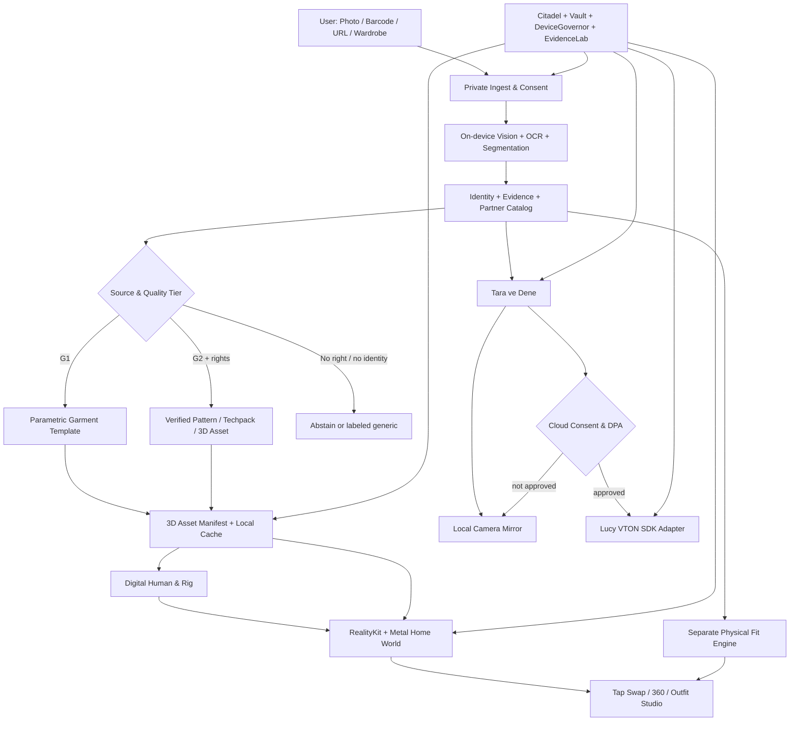

# KABİNSİZ — GOD LEVEL v2.7
## TRUE 3D DIGITAL TWIN · GARMENT RECONSTRUCTION · LIVING WORLD · TARA & DENE · LIVE MIRROR
### Claude Code için kanıta dayalı, uygulanabilir mühendislik, yapay zekâ, tasarım ve entegrasyon anayasası

**Tarih:** 3 Kasım 2026  
**Repo:** `https://github.com/gundogandogancan/kabinsiz`  
**Denetlenen son `main` commit:** `30ed2ef9ab38db939ca4faf2b098f83fe256e23a` (Claude iş başında yeniden doğrulayacak)  
**Durum:** `SPEC / AUDIT` — bu dosya yeni kodun yazıldığı, modellerin eğitildiği, MCP'lerin kurulduğu veya imzaların atıldığı anlamına gelmez.  
**Bağlayıcı üst metin:** v2.6 tam ana anayasa + v2.7 daha yeni ve açık kararlar. Eski güvenlik/doğruluk şartları düşürülemez.  
**Kullanıcının tek cümlelik hedefi:** “Kendi yüzüm, saçım ve bedenime benzeyen 360° 3D modelimi, şehrimin gerçekçi yağmurlu/güneşli sokağında bugünün gerçek gardırop kıyafetlerini giymiş görmeliyim; üstündeki her parçaya dokunup anında değiştirmeliyim; fotoğraflarım, barkodlar ve izinli e-ticaret ürünleri otomatik 3D kıyafete dönüştürülmeli; mağazada aynı ürünü canlı kamerada kendim üstümde denemeliyim.”

> **Kırmızı çizgi:** “Tamamen 3D görünen nesne” ile “gerçek markanın o SKU'sunun ölçülmüş fiziksel dijital ikizi” birbirinden farklıdır. Tek fotoğraftan gerçek kalıp, arka taraf, lif yüzdesi, fiziksel oturuş, logonun gizli yüzü ve doğru beden **garanti edilemez**. Yaklaşık 3D model izinlidir ama `TAHMİNİ 3D` etiketlidir. Gerçek model `ÜRÜNE ÖZEL DOĞRULANMIŞ 3D` olmak için daha güçlü kanıt ister. Bulut video VTON ayrı moddur ve 3D CAD/beden doğruluğu sağlamaz.

## 0. CLAUDE'A YÖNETİM EMRİ — ÖNCE BUNU OKU

1. Önce güncel HEAD/branch, geçen testler, dosyalar, cihaz/Simulator, Xcode, bellek ve kullanım izinlerini kaydet. Bu belgedeki eski SHA'yı bugünkü gerçekmiş gibi kullanma.
2. `CLAUDE.md`, `docs/constitution/...v2.1`, v2.2–v2.6 ve bu v2.7 arasında **çelişki matrisi** çıkar; `CLAUDE.md` hâlâ v2.1'i kanonik gösteriyorsa güncel kanonik yolunu ADR ile düzelt.
3. **Çalışan sistemin doğruluğunu bozma:** Vault, Citadel egress gate, Fit Passport, test altyapısı, VoiceOver, SDK lisans kontrolleri ve mevcut 360° döndürme kodları korunacak.
4. Önce **tek gerçek uçtan uca ürün parçasını** kanıtla: seçilen fotoğraf -> yerel kıyafet algılama -> onay -> dolap -> belirgin 3D giysi (ilk aşamada kalıba göre yaklaşık) -> giyinik avatar -> 360° -> üstü değiştir -> geri al -> kayıt/geri yükleme. Daha sonra barkod/web ve Live Mirror. Büyük kâğıt planını çalışır iş sanma.
5. Gerekli uzman ajan ve skill'leri tanımla, fakat her uzmanı ayrı ağır yapay zekâ modeli ve sürekli açık ayrı süreç haline getirme. Tek cihazda güç/termal/mahremiyet bütçesine uy.
6. Her modülde `CODED`, `UNIT_TESTED`, `SIMULATOR_VISUAL_VERIFIED`, `REAL_DEVICE_VERIFIED`, `HUMAN_STYLE_VALIDATED`, `PARTNER_DATA_VERIFIED`, `BLOCKED_EXTERNAL` ve `UNKNOWN` ayrımı zorunlu.
7. Ücretli hesap, sözleşme, DPA, veri aktarımı, model ağırlığı lisansı, App Store dağıtımı, gerçek kullanıcı fotoğrafının dışarı gönderilmesi ve ticari anlaşma yalnız **yetkili insanın açık onayı** ile olabilir. Claude sözleşme imzalamaz, otomatik ücretli işlem başlatmaz.

## 1. GERÇEK EKRAN DENETİMİ — BEŞ FOTOĞRAFTA NE YANLIŞ?

Aşağıdaki PNG'ler kullanıcı tarafından gönderilen mevcut uygulama görüntüleridir; **hedef tasarım değil, başarısızlık başlangıç görüntüsü / baseline** kabul edilir. Dosyalar bu MD ile aynı ZIP'in `screenshots/` klasöründedir.

| Mevcut görüntü | Kanıtlanan sorun | Düzeltilmiş davranış | Öncelik |
|---|---|---|---|
|  | `Benim Modelim` ekranı gerçek kişinin yüzü-saçı yerine “nötr başlangıç modeli oluştur” formu; profil, fit ve gizlilik aşırı yer kaplıyor. | Profilde üstte kişiye benzeyen model + fotoğraf/ölçü düzenle; ayrıntılı ayarlar gizlilik bölümüne taşınsın. | P0 |
|  | Model başı, yüzü, elleri, anatomisi ve kıyafet yapısı oyuncak/eklemli manken gibi; gerçek insan hissi yok. | Anatomisi tutarlı, cilt/saç/göz/gerçekçi poz ve kıyafet yüzeyine sahip rig'li kişisel avatar. | P0 |
|  | Kıyafet üstündeki kişi arkadan; çok büyük kontrol hapları modeli örter; şehir/hava yok; bilgi tipografisi ve kontrast dengesiz; sentetik kombin. | Avatar önden/3⁄4 açıdan, sahne odaklı, geriye çekilebilir akıllı kontroller, günün doğrulanmış kombin verisi. | P0 |
|  | Şehir sahnesi çok stilize/low-poly; avatar arkası dönük, yüz yok; arayüz taşmaları ve buton katmanları; gerçek atmosfer/ışık ve premium editoryal bütünlük eksik. | Özgün/lisanslı Galata/Barcelona seti, gerçekçi PBR malzeme, yağmur/ıslak zemin, önden avatar, ekran ölçülerine uyumlu kontroller. | P0 |
|  | Fotoğraflardan otomatik dolap, kamera taraması, 3D giysi önizlemeleri ve düzenleme kuyruğu görünmüyor; sentetik dolap CTA'sı ürünün vaadini karşılamıyor. | “Fotoğraflarımdan bul”, “Kıyafeti çek”, “Barkod / web ürün ekle”; **3D döndürülebilir nesne kartları**, onay kuyruğu. | P0 |

**Kalite kapısı:** Bu beş mevcut görüntü yeni cihaz/simülatör görüntüleriyle **yan yana** karşılaştırılmalı. Ekranda kendi modeline benzeyen yüz, saç ve giydirilmiş ürün **gerçekte yoksa** pazarlama maketiyle `PASS` yazma. Kullanıcının zevk kararını sahte bir “%98 kalite” puanına indirgeme; gerçek UI test + bağımsız insan değerlendirmesi iste.

## 2. TEK ÜRÜN, İKİ DİJİTAL İKİZ, İKİ PROVA KANALI

- **Human Digital Twin:** kişisel yüz/baş/saç/cilt/vücut mesh'i, skeleton, ölçü provenansı, gizlilik koruması.
- **Garment Digital Twin:** gerçek dünyadaki bir kıyafetin kategori, kalıp, paneller, dikiş, ölçüler, kumaş, PBR materyal, renk, desen, logo ve beden varyasyonlarıyla eşlenen sürümlenmiş 3D temsili.
- **Home World 3D Studio:** iki dijital ikizi aynı gerçek zamanlı sahnede birleştirir; hava/şehir ve kombin kararını yönetir.
- **Local Mirror:** kişinin kamera görüntüsü üzerine doğrulanmış/uygun yerel 3D giysi overlay'i. Tracking/occlusion olanakları sınırlıysa **sınırlamayı gösterir**.
- **Cloud AI Mirror:** izinli opt-in, Decart Lucy VTON benzeri sunucu tabanlı fotogerçekçi video denemesi. `G3 GENERATED VIDEO`; fiziksel beden ölçüsü kanıtı değildir.

`Tara` ve `Ayna` iki ayrı ürün silo'su OLMAYACAK: **TARA VE DENE** tek kullanıcı yolculuğu; akışta `3D Modelimde Gör` ve `Canlı Aynada Dene` iki görünüm anahtarı. Hemen tanınamayan ürünü doğruymuş gibi modelde gösterme.

## 3. GÖRSEL GERÇEKLİK, FİZİKSEL GERÇEKLİK VE DOĞRULAMA KATMANLARI

| Katman | Neden gerekir | Minimum veri | UI doğruluk etiketi |
|---|---|---|---|
| ID0 | Fotoğrafta yalnız sınıf tanıma | cropped image + class | “Benzer kıyafet — marka bilinmiyor” |
| ID1 | Barkod/URL aday eşleştirmesi | GTIN/SKU/URL, varyant adayları | “Ürün kimliği doğrulanıyor” |
| ID2 | Marka+katalog doğrulaması | lisanslı catalog + style/color/size/revision | “Ürün kimliği doğrulandı” |
| G0 | 3D yok, karar kartı var | katalog / fotoğraf | “3D model henüz yok” |
| G1 | Kategori kalıbından 3D yaklaşık | sınıf + siluet + renk + boyut tahmini | “Tahmini 3D görünüm” |
| G2 | Ölçülü ürünün doğrulanmış 3D'si | marka CAD/tech-pack veya çoklu foto + modelist QA + ölçü | “Ürüne özel 3D (kaynağı belirtilir)” |
| G3 | Canlı üretken video | ayrı izin + servis + oturum | “AI video provası; ölçü değil” |
| F0 | Beden bilgisi yok | — | “Beden öneremiyoruz” |
| F1 | Bölgesel tahmin | insan ölçüsü + beden tablosu | “Tahmini beden uyumu” |
| F2 | Fiziksel fit kanıtı | bitmiş ürün ölçüsü + beden ölçüsü + gerçek prova doğrulaması | “Ölçülere dayalı uyum” |

**Önemli:** G2 (ürüne özgü görsel doğruluk) bile F2 (üzerine nasıl oturacağı) değildir. Güven puanları ayrı tutulur: `identityConfidence`, `garmentGeometryConfidence`, `fabricConfidence`, `regionalFitConfidence`, `visualRealismConfidence`. Tek büyülü “%97 uyuyor” sayısı YOK.

## 4. TEK FOTOĞRAFI ÜRÜNE ÖZEL 3D SANMA — GERÇEK REKONSTRÜKSİYON HATTI

```text
Fotoğraf/barkod/URL/marka feed'i
    -> Hak/izin/kaynak sınırı -> Ürün kimliği + varyant çözümü
    -> Giysi segmentasyonu + kenar + kategori + siluet + desen + renk
    -> Ürün ölçüleri + marka tech pack + kalıp panel bilgisi araması
    -> [CAD var] doğrudan pattern-to-mesh ve kaynak doğruluğu
       [CAD yok] sınıf şablonu -> yaklaşık pattern parametreleri
       [birden fazla görünüm] ek siluet/doku kısıtları
    -> Blender offline/asset-worker: topology -> UV -> dikiş -> materyal -> LOD
    -> Rig/body retarget -> motion/pose/swap test
    -> USDZ / uyumlu import -> RealityKit PBR + cloth approximation
    -> G0 / G1 / G2 etiketli cihaz yerel önbelleği
```

**Giysi mesh'i:** üst/alt/dış katman/etek/elbise/ayakkabı/çanta/kemer/takı için ayrı doğru topology; eğri şerit tek parça gibi davranmaz. Giyilebilir kıyafetin yaka, kol ağzı, koltuk altı, pantolon ağ/zincir, paça, fermuar, cep, kemer halkası, çanta askısı, taban ayrı fiziksel/rig davranışı ister. Dikiş yönü, fold map ve material roughness/normal ile gerçek kumaş hissi. Gerçek marka logosu için hak + doğru SVG/texture placement + render test.

**Kalıp ve ölçü:** `BODY_SIZE_CHART` kullanıcı ölçüsüyle kıyaslanan marka beden tablosudur, `FINISHED_GARMENT_MEASUREMENTS` ürünün bitmiş ölçüleridir; iki alan aynı sınıf/ünitelerde karıştırılmaz. Stretch/elastic recovery, kumaş ağırlığı, drape, baskı ve ütü/yıkama sıcaklıkları ayrı metadata. Kumaş kompozisyonu fotoğraftan **uydurulmaz**; etiketten OCR ile veya marka feed'inden kanıtlı alınır.

**Giydirme:** ortak `AvatarSkeletonV1`; category-specific anchors; upper body, lower body, shoes ve accessories katmanları için çarpışma/occlusion sırası ve clipping düzeltmesi. Yağmurluk ile tişört, çanta askısı ile palto ve uzun saçla yüksek yaka testleri ayrı.

**Üretim hatları:** 
- **G1 hızlı 3D:** sınıf bazlı insan eliyle hazırlanmış parametric garment template; yalnız ölçüleri izinli/spec varsa ayarla; uygunsuz varsayımlar UI'da açıklanır.
- **G2 kaliteli:** marka ile anlaşmalı DXF/OBJ/FBX/USD/CAD/size grading, teknoloji paketi, materyal referansı, insan modelist onayı. Görsel ve ölçü doğruluğu için gerekli asıl kaynak budur.
- **Araştırma:** fotoğraftan AI 3D araçları, 3D reconstruction modelleri, PBR texture synthesis; ticari lisans/kalite/iPhone performans denetimi geçmeden ürün temelinde kullanılamaz.

## 5. YÜZÜ, SAÇI VE BEDENİ GERÇEKTEN KULLANICIYA BENZEYEN MODEL

### 5.1 Avatar oluşturma akışı
1. Kullanıcı `Modelim → Bana benzet` seçer. Görüntü/ölçü paylaşma **zorunlu değildir**; nötr modeli kullanabilir.
2. İsteyen kullanıcı kamerayla önden, sağ/sol 3⁄4, isteğe bağlı yan/profil yüz görüntüsü sağlar; ayrıca boy, omuz, göğüs, bel, kalça, iç bacak gibi ölçülerini doğrular. Fotoğraf sahibinin kendisi olduğu ayrıca beyan/onaylanır.
3. Cihaz içi Vision/ARKit ve özel Core ML özellik algılayıcıları, yüz *anahtar noktaları* ve baş/beden oranları çıkarır. Özel görüntüler varsayılan olarak cihaz dışına gönderilmez.
4. Parametric head mesh + blendshape + ten/cilt tonu + göz/kaş/dudak/burun/çene varyasyonları, **fotoğrafı düz kesip yapıştırmadan** 3D yüzün geometrisini değiştirir. Yüz dokusu fotoğraftan üretilecekse yalnız izinli yerel materyal/doku olarak uygulanır; 3D geometri yokmuş gibi fotoğraf billboard'u OLMAZ.
5. Saç: kısa, uzun, dalgalı, kıvırcık, toplu ve dokusal gruplar için rig'li 3D `hair cards`/strands/mesh; yalnız bir saç fotoğrafından arkası kesin olarak bilinmez. Kullanıcı saç rengini, ayrımını, uzunluğunu ve hacmi düzeltebilir.
6. Gövde `BodyProfileV2` ölçülerinden doğru büyür; aşırı idealize edilmez; kilo, cinsiyet, etnisite veya yaş hakkında gizli çıkarım yapılmaz.
7. 360° ön/yan/arka; yakınlaştırma; kıyafetin ciltle clipping yapmaması; özel yüz/saç verileri **şifreli kasa**, iptal ve silme garantisi.
8. Son onay: `Bana benziyor / benzemiyor`; düzeltme döngüsü. İnsan kendisini tanımadan “foto-gerçek kişisel avatar tamam” denmez.

### 5.2 Mühendislik sınırları
- ARKit face tracking **yüz hareketini izler**, doğrudan fotoğraftan kişiye benzeyen tam 3D baş yaratmaz.
- ARKit body tracking **vücut pozu verir**, giysi pattern mesh'i, kişiye ait beden ölçüsü ve gerçekçi yüz/saç otomatik vermez.
- Tek selfie ile başın arkası/saç volumetrisi ve tam gövde ölçüleri kesin bilinmez.
- Tam vücut Live Mirror için cihazın kişinin tamamını görebileceği konum/mesafe/ışık gerekir; selfie ön kamerada baş ve gövde tamamını her durumda yakalamayabilir. Telefon standı/uzaktan çekim ipuçları UI'da gösterilmeli.
- Klinik/kimlik doğrulama biyometrisi yapılmaz. Yüz benzerliği tahminini pazarlama/kimlik analizi için kullanma.

### 5.3 Kalite kapısı
`avatarUserRecognizability` kullanıcı doğrulaması, ölçülü referansa göre body cross-section, yüz 3⁄4 ve profil kontrolü, hair silhouette/occlusion, skin tone lighting consistency, pose retarget, hareket FPS/termal ve farklı cilt/saç türlerinde manuel uzman panel. Hiçbir etnisite veya vücut tipi üzerinde sistematik başarısızlık gizlenmez.

## 6. TEK MOTOR MU BLENDER MI UNITY Mİ?

| Teknoloji | Kabinsiz'deki kararı | Neden |
|---|---|---|
| **Blender** | **ZORUNLU offline asset factory** | Avatar/giysi/şehir modelleme, rig, topology, UV, PBR, bake, LOD, USD export; telefonda Blender motoru çalışmaz. |
| **SwiftUI** | **ZORUNLU uygulama/UI kabuğu** | Native iOS navigasyon, erişilebilirlik, izin/ayar, fotoğraf ve ödeme arayüzü. |
| **RealityKit** | **ZORUNLU birincil 3D runtime** | Döndürme, USDZ/asset yükleme, sahne/ışık/hit-test ve animasyon. |
| **Metal / MetalFX** | **Ölçülen darboğazda özel render** | Saç kartı, giysi deformasyonu, ön/arka occlusion, yağmur/zemin ve görüntü birleştirme; doğrulanmadan custom engine inşa edilmez. |
| **Apple Vision + Core ML** | **ZORUNLU cihaz içi görüntü zekâsı** | OCR, barkod, yüz/beden anahtar noktaları, özel kıyafet modeli. |
| **ARKit + AVFoundation** | **ZORUNLU kamera/izleme** | Gerçek video, poz takibi, uygun donanımda yüz/body anchor. |
| **CLO 3D / Marvelous Designer veya benzeri** | **İSTEĞE BAĞLI pattern/fabric authoring** | Fiziksel drape için kalıp hazırlama; maliyet/lisans ve personel becerisiyle pilotta değerlendir. |
| **Unity** | **ŞİMDİLİK YOK** | Native iOS ile ikinci runtime, app boyutu/termal/sürüm bakımını arttırır. RealityKit ölçülmüş ihtiyacı karşılamazsa dar PoC + ADR ile kıyasla. |
| **Unreal Engine** | **ŞİMDİLİK YOK** | Hedef basit iPhone native app; büyük runtime maliyeti ve entegrasyon. |

**Karar değişikliği kapısı:** RealityKit testinde 3D garment skinning, custom cloth, 30 FPS veya entegre frame pipeline hedefleri ardışık iki optimizasyondan sonra ölçülebilir biçimde geçmiyorsa, aynı içerikle Unity proof-of-concept yap; toplam indirme boyutu, açılış, batarya, gizlilik, accessibility ve üretilen kaliteyi yan yana ölç. Başarısızsa Unity alma.

## 7. İLK ZORUNLU GERÇEK KULLANICI YOLCULUĞU — FOTOĞRAF → DOLAP → 3D

**UX:** Dolabım → “Fotoğraflarımdan kıyafetleri bul” → iOS sistem fotoğraf seçici → cihaz içinde kırpma/segmentasyon → nesne tanıma/renk/doku → benzer/aynı ürün kümeleri → **“Bu gerçekten sana ait mi?”** → onay kuyruğu → `3D model önizlemesini oluştur` → parametric garment mesh → 3D item thumbnail + kendi modelinde giydirme.

**Görüntü kaynakları:** tek ürün fotoğrafı; kıyafetin kişi üzerindeki fotoğrafı; dolap/askı fotoğrafı; satış e-ticaret ürünü; barkod/etiket. Bir fotoğraftaki birden fazla kıyafeti farklı objeler olarak segment et; başka kişinin giysisini otomatik kullanıcıya ait sayma. Dışarıdan tanımadığın fotoğrafları yüz tanıma ile kullanıcı eşleştirmeye çalışma.

**PhotoKit ve PhotosPicker:** seçili fotoğraflar için önce sistem `PhotosPicker` / `PHPicker`; geniş arşiv taramasında ayrı *açık* PhotoKit yetkisi ve kapsam yönetimi. `limited` erişimi otomatik tam erişime yükseltme. İzin reddi = manuel yükleme devam. Arka planda tüm galeriyi kendiliğinden indeksleme yok.

**ML pipeline:** görüntü boyutu/EXIF yönlendirme → kalite/blur/fail → kişi-garment segmentation → category multi-label → garment instance embeddings → color/pattern/style & logo candidate → OCR (visible text only) → dedup perceptual+embedding + farklı renk varyantları ayırma → kullanıcı onayı → local encrypt. Core ML model türü ve ağırlık lisansı/model kartı belirlenmeden “kuruldu” denmez.

**Onay kartı:** kesilmiş nesne *kanıt fotoğrafı* kısa gösterilebilir; ana dolap deneyiminde **3D asset görüntüsü** birincil olmalı. Çözünürlüğü düşük/arka görünüm eksik ise G1 model varsayımsaldır. Kullanıcı `yeniden fotoğraf çek` ile daha çok açı sağlarsa modele güncelleme yapılır.

**Görev dayanıklılığı:** 100+ fotoğrafta kademeli on-device iş kuyruğu, iptal/kaldığın yerden devam, ısınma azaltma, fotoğrafların artıklarından yüz/özel içerik ayrıştırma; iş bitiminde geçici görüntüleri sil; thumbnail ve 3D varlıklar şifreli veya kontrollü yerel cache.

## 8. MAĞAZADA TARAMA — BARCODE + ETİKET + KAMERA + ÜRÜN KİMLİĞİ

`Tara ve Dene` tek entry point; dört sekmeli küçük seçim: `Barkod`, `Fotoğraf`, `Ürün bağlantısı`, `Dolabımdan`. İlk gösterim canlı barkod kamerası; gerekirse ürünün askıdaki görüntüsüne dön.

1. `AVFoundation` veya `VisionKit DataScannerViewController` destek koşulları kontrol edilerek `EAN-13`, `EAN-8`, `UPC-A`, `Code128`, `QR` okutulur. Manuel kod giriş her zaman alternatif.
2. GTIN checksum ve format doğrulanır; görüntüdeki marka logo OCR yalnız aday kanıtıdır.
3. `Verified by GS1` GTIN'in varlığı/sahibini **sınırlı** doğrulayabilir. GS1 herkese tam kumaş, beden, stok ve CAD verme garantisi **yoktur**.
4. `CatalogGateway` yalnız yetkili feed'e sorar: `gtin → brand ID → style code → color → size → revision → product variant`.
5. SKU/ürün ailesi ayrımı: aynı GTIN bazen ambalaj/renk/beden varyantını, bazen ürün grubunu temsil edebilir; marka verisiyle çözülecek. Belirsizse varyant seçtir.
6. Kanıtlı model varsa 3D G2; yoksa şablon G1 ve görünür uyarı; doğru kimlik yoksa “benzer sınıf” tahminini ürünün aynısı sanarak giydirme.
7. Aynı ekranda `Modelimde Gör` / `Canlı Aynada Dene` / `Dolabıma Ekle` / `Neyle kombinlerim?`.
8. Mağazaya ait özel ürün fotoğrafı ve tasarım dosyaları için erişim/asset hakkı kaydı tutulur.

**Ürün için olmazsa olmaz kanıt alanları:** `GTIN` / `merchantSKU` / `brandStyleCode` / `productVariantID` / `catalogRevision`, `colourway`, `sizeLabel`, `sizeSystem`, `composition`, `careEvidence`, `sizeChart`, `finishedMeasurements`, `garmentAssetID`, `assetRights`, `styleConfidence`, `stockUpdatedAt`. Bilinmeyen alanı `UNKNOWN`/`nil` bırak.

## 9. INTERNET SİTESİNDEN ÜRÜNÜ AL, MODELİMDE GÖSTER

**Tek tuş yolculuk:** Safari/alışveriş uygulamasının paylaş menüsünden Kabinsiz `Share Extension` hedefi → güvenli URL normalize → alan adı allowlist/izin hakları → bilinen mağazanın resmî product feed/API'si veya sayfanın izinli yapılandırılmış verisi → varyant seç → 3D asset uygunluğu kontrol → `Tara ve Dene`.

**Öncelikli kaynaklar:** mağaza ortaklığıyla ürün feed'i/commerce API (en güvenilir), markanın izinli katalog/tech pack portali, Shopify Storefront API (yalnız o mağazanın yetkili token'ı veya izin verdiği public erişim), JSON-LD/schema.org Product bilgileri (hak/robots/hız sınırı uygun olduğunda), kullanıcıdan ekran görüntüsü (yalnız görsel aday tespiti). Resmî API kullanımı **her mağazanın tüm verilerini otomatik kullanma hakkı vermez**.

**Güvenlik:** URL SSRF engeli (localhost/private IP/file:///redirect), kimlik bilgisi/top-level DOM kopyalamama, rate limit, XSS/HTML escaping, reklam/affiliate etiketi, marka asset lisansı; sitenin login/DRM/anti-bot engelini aşma. Gerekirse kullanıcı fiyatı ve fotoğrafı manuel doğrular.

**İki mağaza stratejisi:** Türkiye'de satış yapan tüm markaları kapsayabilecek **evrensel şema**, fakat ürün doğrulaması için kademeli ortaklıklar; küresel en çok satan markalar için aynı adapter. “Tüm markaları ilk sürümde eksiksiz tanıyoruz” gibi iddia yasak. Apple Maps/şehir asset lisansı da mağaza fotoğraflarından ayrıdır.

## 10. 3D KIYAFETİN GERÇEK KESİMİ / MATERYALİ / LOGOSU NASIL ÜRETİLİR?

### 10.1 Geometri ve fiziki parçalar
- **Jacket:** collar/lapel, placket/buttons, side seam, shoulder pad, sleeve cap, cuffs, pockets, hem, lining, interlining, outer material.
- **Trousers:** waist/rise/thigh/knee/hem, inseam/outseam, crotch curve, belt loops, pockets, crease, waistband.
- **Dress/Skirt:** waistline, dart, pleat, ease, hem, lining, bias and flare.
- **Shirts/Knit:** yarn/knit type metadata where known, rib trim, sleeve cuff, yoke, seam placement.
- **Shoes:** last-derived shape if license provided, toe box, outsole, heel height, instep, ankle clearance; no single texture onto feet.
- **Bag/Accessory:** 3D handle/strap, buckles, drape/contact with shoulder/hip, collision order.

### 10.2 Fizik ve animasyon
Gerçek-time cloth sim'i her hareket ve her cihaz için tam fiziksel doğrulukta çalıştırmak pahalıdır. **LOD kalite piramidi:**
- `CLOTH-0`: rig + shape keys + no cloth dynamics, hızlı fallback.
- `CLOTH-1`: kurallı deformasyon + baked secondary motion, çoğu cihaz için hedef.
- `CLOTH-2`: sınırlı etek/kol/kemer/şal/saç dinamikleri; cihaz termal bütçesi uygunsa.
- `CLOTH-3`: pattern/fabric calibrated physical simulation (yüksek güç/asset gerektirir; araştırma kapısı).

**Süreklilik:** kullanıcı vücudu döndürdüğünde arka yüz boşluk olmamalı; ayakkabı zemine basmalı; palto pantolonun içine gömülmemeli; aksesuar el/kol ya da kumaşa nüfuz etmemeli; logo aynalanmamalı; çapraz kemer / çanta askısı katman sırası bozulmamalı.

### 10.3 Blender Asset Factory işlevleri
`garment.extract_pattern` (lisanslı CAD/techpack varsa), `template.fit`, `seam_map`, `generate_lod`, `uv_bake`, `material_pbr`, `rig_to_body`, `collision_proxy`, `logo_placement`, `preview_360`, `export_usdz`, `mesh_validate`, `asset_licence_check`, `diff_previous_revision`. Her adım hash + input rights + output quality + tester bilgisiyle loglansın; Blender MCP gerçek kullanıcı fotoğraflarına veya API anahtarlarına erişmesin.

**Araç kararı:** Blender'a gömülen `bpy` ile deterministic Python batch üretim hattını ana çözüm yap; genel amaçlı Blender MCP'yi sadece editör/uzman çalışma alanı için kısıtlı izinle aç. Otomatik kod çalıştıran MCP sahte güvenlik adımına dönüşmesin.

## 11. HOME WORLD — CANLI ŞEHİR, YAĞMUR, MODEL, KOMBİN

**Ana ekran bir 3D moda sahnesidir.** Kullanıcı şehir seçerse veya konuma izin verirse sahne bağlamı değişir. İstanbul için özgün/lisanslı Galata çevresi estetiği; Barcelona için gerçek şehir dokusuna saygılı sıradan sokak. Harita SDK'dan izinsiz 3D bina mesh'i kopyalama veya başkalarının fotoğrafını scene asset'i sanma.

**Sahne katmanları:** `SceneEnvironment` (street mesh/static background), `LightingRig` (günün saati/weather), `WeatherFX` (rain particle + wet ground decals + puddle roughness + soft fog), `Avatar` (user rig), `GarmentStack` (category ordering), `InteractionHotspots` (hit-test), `AccessibilityControls` (eşdeğer butonlar), `HUD` (şehir/saat/kanıt).

**Yağmur** fiziksel hissi: damlalar hava katmanından iner, zemine temas/splash/ıslak PBR; fakat bütün şehirde gerçek sıvı simülasyonu yerine GPU instancing/particles, doku animasyonu ve yerel ground decals. Kamera hareketi/animasyon sırasında HUD sabit kalır. `Reduce Motion`, düşük güç ve cihaz ısınmasında yağmur sayısı/kalite kademe kademe düşer veya kapatılır.

**Gündelik kombin** önceden hazırlanmış 3D asset kombinasyonlarıyla **anlık değişir**. Her sabah Blender yeniden render etmez. Zamanlayıcı/yerel gün değişiminde küçük `OutfitPlanSnapshot` güncellenir; cihaz arka planda sınırlı çalışıyorsa önceden hazırlanan adaylar bir sonraki açılışta hesaplanır. Gerçek cihazda uygulamanın her sabah tam saatinde arka planda render çalışacağı garanti edilemez.

**Etkileşim:** avatar drag 360°, pinch zoom, double tap ön görüş, üst/alt/ayakkabı/çanta/kemer/takıya mesh hit test, yakın parçalar için category picker; alt panel 3D garment thumbnail carousel; tek dokunuş swap; undo/redo; “Yeni Kombin Üret” aynı sahne içinde outfit state'i günceller. 3D asset yoksa sahte kıyafet görünümü yerine etiketli G1 ya da eksik asset uyarısı.

## 12. “TARA VE DENE” — CANLI AYNA TAM SİSTEM

### 12.1 Birleşik navigasyon (tek tab / tek eylem)
- Kullanıcı “Tara ve Dene” açar. Barkod, foto, web link, dolaptaki mevcut ürün hızlı seçimi gösterilir.
- Ürün belirlenince aynı sayfanın merkezinde kullanıcı kendi 3D avatarını veya canlı kamera görünümünü seçer.
- İki segmente ayrılır: `3D Modelimde` (tamamen yerel) / `Canlı Ayna` (gerçek kişinin kamerası).
- `Canlı Ayna` altında **yerel overlay** veya açık/ayrı opt-in **AI video**. Mod farkı gizlenmez; hangisi çalışmıyorsa dürüstçe açıklanır.
- Beden tavsiyesi ayrı, her zaman kanıtlı; AI video beden garantisi değildir.

### 12.2 LocalMirror
`AVCaptureSession` + `VisionPose/PersonSegmentation` + garment anchor/deformation + occlusion mask + compositor (`Metal` / RealityKit). Ön/arka kamera koşulları ve cihaz desteği en başta kontrol. Kişi dönünce tracking kayboluyorsa “Şu açı için canlı prova desteklenmiyor”; kötü hizalanmış giysi görüntüsünü doğruymuş gibi gösterme.

### 12.3 CloudAIMirror / Decart
Resmî `DecartAI/decart-ios` Swift SDK; model listesi sürümlü, müşteri SDK sürümü sabit, `lucy-vton-3.6` yalnız güncel ürün/doküman uyumu doğrulandıktan sonra; `Anywear` ayrı bir marka/tüketici deneyimidir, Kabinsiz'e gömülen SDK değildir. Video **sunucuya gider**. `CloudMirrorEnabled=false` üretim varsayılanı, **yazılı ticari izin + DPA + veri kullanımı sınırlaması + onaylı maliyet + gerçek cihaz testi** olmadan açılmayacak.

**Decart sözleşme uyarısı:** kamuya açık consumer/API şartlarının sözleşme kapsamları ve versiyonları ayrı doğrulanır; üretim videoları için training/promotional use, retention, deletion, subprocessor, processor/controller roles, cross-border transfer, purpose restriction ve veri haklarını avukat/DPO inceleyecek. Claude bunların karşılandığını varsayarak sözleşme onaylayamaz. `docs/commercial/DECART_DPA_DUE_DILIGENCE.md` doldurulacak, `HUMAN_LEGAL_APPROVAL` olmadan kullanıcı görüntüsü gönderilmeyecek.

**Güvenli anahtar:** kalıcı servis anahtarları iOS binary'de yok; server'da tutulan provider credential -> oturumla sınırlı kısa ömürlü access token -> kullanıcıya görünen oturum süre/fiyat üst limiti. `Kill Switch`, kullanıcı iptali, otomatik camera stop, silme ve oturum faturası kaydı. Kontrol uçları en az veri içerir; 3D avatar yüz mesh'i buluta gönderilmez.

**Ayna testleri:** kullanıcı halihazırda kırmızı ceket giyiyorken seçtiği mavi ceket üstünde belirmeli; saç, yüz, eller gerçek görünümünden mümkün olduğunca korunmalı; kıyafet organik olarak kolları/gövdeyi takip etmeli, ama modelin logosu/dikişi değişmişse “üretken yorum” etiketiyle gösterilmeli; delayed frames > eşik durumunda canlı değil gecikmeli gösterilmeli.

## 13. PERSONAL STYLE DNA VE STİLİST ORDUSU

“Ruhunu okuyor gibi” hedefinin mühendislik karşılığı **kalibre edilmiş tercihi öğrenme ve kanıtlı stil gerekçesi**: daha önce giydiği/kaydettiği kombinler, istemediği kesimler, sevdiği palet, poz/ortam/hava/işlev, bütçe, dolap temizlik durumu, tekrar sıklığı, kendi puanları ve dönüşümler. Kullanıcı bunları kolayca düzeltebilir/kapatabilir.

**Sıralama:** önce sert uygunluk filtreleri (mevcut gerçek ürün, iklim/etkinlik, mahremiyet), sonra regional fit belirsizliği, palette/shape harmony, silhouette/texture contrast, accessory layering, user preference, budget/cost-per-wear, originality. Sponsor gelir etkisi **ayrı etikete** bağlanır; temel kalite puanına gizlice katılmaz.

**Çıktı:** aynı avatar üzerinde 3 farklı editoryal seçenek: `Zamansız`, `Karakterli`, `Cesur`; gerekçeli “neden iyi”; eksik parça varsa önce dolaptan alternatif, sonra doğru izinli mağaza ürünü. Astroloji/numeroloji yalnız opt-in yaratıcı sembolik tema; insan kişiliği/beden/sağlık/para uyumu gibi bilimsel iddia ve ölçülü fit kararına karıştırılamaz.

## 14. ON-DEVICE OCTOPUS — AI ORDUSU NASIL GERÇEKTEN ÇALIŞIR?

**32 uzman modül = 32 eşzamanlı büyük LLM DEMEK DEĞİL.** `WorkOrder` ile görev DAG'ı, `DeviceBudget` ile kaynak yetkisi, tek paylaşılmış Core ML yükleyici, OCR/embedding/segmentation modeli kısmi yükleme ve on-device SQLite/şifreli vault. Üst düzey koordinatör deterministik Swift + sınırlı yerel model kullanır. Kural motorları net iş için modelden önce.

| No | Uzman görevi | İcra türü | İzin/veri |
|---|---|---|---|
| RT-01 | Fotoğraf seçimi / erişim | PhotoKit adapter | seçilen görüntü kapsamı |
| RT-02 | Kıyafet nesnesi segmentasyonu | Core ML | transient pixels |
| RT-03 | Üst/alt/dış/ayakkabı sınıflaması | Core ML | garment crops |
| RT-04 | Renk/desen/siluet özniteliği | Vision + ML | garment crops |
| RT-05 | Aynı ürün kümeleri | embeddings + kural | private garment features |
| RT-06 | Logo adayı / OCR | Vision+ML | image crop |
| RT-07 | Ürün kimliği kanıt birleştirme | Swift evidence gate | read-only evidence |
| RT-08 | GTIN checksum / decode | Vision+Swift | barcode |
| RT-09 | Katalog varyant çözümü | partner adapter | izinli SKU/GTIN |
| RT-10 | HTML/URL normalize | strict parser | allowlisted URL |
| RT-11 | Fabric label parser | OCR + typed parser | readable label |
| RT-12 | Beden ve bitmiş ürün ölçüsü doğrulama | deterministic | cm/mm / source |
| RT-13 | Kullanıcı avatarı parametreleri | local geometry | biometric private vault |
| RT-14 | Yüz şekli / benzerlik düzeltmesi | on-device landmark/mesh | biometric isolated |
| RT-15 | Saç mesh / material seçimi | 3D asset retarget | hair choices |
| RT-16 | Garment template parametreleri | local template morph | G1 estimation |
| RT-17 | G2 asset / lisans ve cache | rights gate + file IO | signed assets |
| RT-18 | Skinning / LOD / occlusion | RealityKit/Metal | device only |
| RT-19 | 360° avatar interaction | RealityKit | touch input |
| RT-20 | Scene & light selection | offline template | chosen city |
| RT-21 | Weather & thermal context | WeatherKit gated | coarse city only |
| RT-22 | Outfit composer | local constrained optimizer | wardrobe/profile |
| RT-23 | Style DNA / preferences | local vector + feedback | private vault |
| RT-24 | Budget / affiliate neutrality | deterministic policy | commerce records |
| RT-25 | Mirror camera / permission | AVFoundation | ephemeral frames |
| RT-26 | Local pose / overlay | Vision/Metal | camera-only |
| RT-27 | Cloud VTON adapter | disabled opt-in service | explicit consent only |
| RT-28 | Truth/evidence labels | provenance validator | all outputs |
| RT-29 | Privacy/Citadel policy | deny-by-default policy | all egress |
| RT-30 | Runtime resource scheduler | DeviceGovernor | heat/battery/FPS |
| RT-31 | Review queue / human corrections | UI state | user-approved edits |
| RT-32 | Final orchestration/rollback | Octopus coordinator | revisioned work orders |

**Kısıt:** her modül `manifest.json`: `module_id`, `contract_version`, `inputs`, `outputs`, `sensitive_fields`, `side_effects`, `egress_whitelist`, `max_memory`, `timeout`, `fallback`, `quality_tests`, `owner_agent`. Bir modül internet izni almadan hiçbir URL çağırmaz. Tek turda tüm uzmanları çalıştırma; en küçük gereklilik altgrafı seç. Aynı görüntüyü 32 kez kopyalama.

## 15. SERVİS, API VE MODEL YETKİLERİ — KURULACAKLARIN NET ENVANTERİ

| Sınıf | Teknoloji / Resmî kaynak | Üründeki görev | Gerçek durum / izin |
|---|---|---|---|
| iOS UI | SwiftUI `developer.apple.com/documentation/swiftui` | Home/wardrobe/mirror UI | mevcut kaynak kod; yeni ekranlar CODED değil |
| 3D runtime | RealityKit `developer.apple.com/documentation/realitykit` | avatar + outfit + world | neutral model var; giysi tam yok |
| GPU | Metal `developer.apple.com/metal` | cloth/particles/composite | gelecekte test |
| camera | AVFoundation, VisionKit | barcode + mirror | gerçek scan henüz repo'da yok |
| gallery | PhotosPicker / PhotoKit | yerel dolap çıkarımı | yeni geliştirme |
| on-device vision | Vision / Core ML | OCR, pose, CV, garment segmentation | özel ağırlıklar ve doğruluk seti gerekir |
| face/body | ARKit face/body tracking | avatar ifadesi, mirror pose | hardware capability gated |
| weather | WeatherKit | şehir/meteoroloji | repo adapter var; entitlement/onay bekleyebilir |
| GTIN | GS1 Verified by GS1 / GS1 Türkiye | kimlik/sahip doğrulama | erişim kotaları ve ürün kapsaması sınırlı |
| Shopify | `shopify.dev/docs/api/storefront` | **izinli mağaza** product variant/feed | satıcı yetkisi yoksa varsayma |
| Brand feed | merchant CSV/API/CAD/DXF | gerçek SKU/fabric/measurements/G2 | B2B insan sözleşmesi gerekir |
| 3D CAD authoring | Blender `blender.org` | karakter/kıyafet/şehir asset pipeline | kullanıcı Mac'inde kurulu beyan, sürüm yeniden teyit |
| optional pattern | CLO/Marvelous Designer | pattern/grading/fabric | ücret/lisans ve uzman gerektirir |
| VTON optional | `github.com/DecartAI/decart-ios` | bulut canlı video | ticari/DPA/mahremiyet onayı yok; varsayılan disabled |
| Catalog rights | asset licence manifest | logo/texture resale/display | partner-specific |
| Business income | approved affiliate feed | eksik parçayı satın alma | komisyondan bağımsız öneri sıralaması |

**Model adayları konusunda kural:** FASHN VTON 1.5 tek kare üretir, hareketli 3D runtime değildir; boru hattının tüm bağımlılıklarının ticari lisansları ayrı kontrol edilir. Mobile-VTON, CatVTON gibi NC ağırlıkları ticari uygulamaya gizlice gömme; SMPL-X default akademik lisanslıdır. `Meta MHR`, `Anny/MakeHuman` veya başka ticari avatar tabanları ancak **repo kodu, ağırlık, derivative asset ve output lisansı** ayrı ayrı onaylandıktan sonra kullanılabilir. “GitHub'da açık” = “ticari kullanım izni var” değildir.

## 16. MCP — CLAUDE GELİŞTİRME ARAÇLARI (RUNTIME DEĞİL)

> **MCP = Claude'un geliştirme araçlarına erişmesi.** MCP tek başına iPhone içinde 3D model üretmez, ürün bulmaz, canlı kamera yapmaz; bunlar Swift/ML/3D kodu ve API'lerle yapılır. Her MCP kurulumunu kullanıcı Mac'inde Claude yapmalı ve **kanıt dosyası** bırakmalı. Burada hiçbir sunucunun kurulu olduğu iddia edilmiyor. Gereksiz MCP yüklemek yerine görev bazlı aç-kapat.

| İsim / kaynak | Ne yapar? | Önerilen güvenlik / yükleme politikası | Öncelik |
|---|---|---|---|
| **MobileBuildMCP** — `https://www.mobilebuildmcp.com/docs/clients` | Xcode build, Simulator, screenshot, UI automation, gerçek cihaz build/test | `claude mcp add MobileBuildMCP -- npx -y mobilebuildmcp@latest mcp`; ortamda sürüm **pinle**, otomatik son sürüm üretimde kullanma; özel test verisini loglama. Eski adı XcodeBuildMCP, **2026'da MobileBuildMCP**. | P0 |
| **GitHub MCP / bağlı GitHub** — `https://github.com/github/github-mcp-server` | repo, PR, issue, commit ve CI kanıtı | mevcut erişim ilk tercih; yalnız repo-scope token, write/merge ayrı onay | P0 |
| **Blender MCP** — `https://github.com/ahujasid/blender-mcp` | Blender'da mesh, scene, rig, asset incelemesi / düzenleme | Üçüncü taraf ve Blender içinde **Python kodu çalıştırabilir**; `BLENDER_MCP_SAFE_MODE=1`, `DISABLE_TELEMETRY=true`, izinli çalışma klasörü, internet kapalı, hassas foto yok, sürüm pin + kod review; otomatik üretimde mümkünse deterministic `bpy` script | P1, güvenlikten sonra |
| **Decart docs MCP** — `https://docs.platform.decart.ai/mcp` | API / Swift SDK dokümanlarını Claude'a aratır | sadece **doküman**; kredi kartı/sözleşme/onay yerine geçmez; sağlayıcı gizlilik şartı aşamasında yalnız public docs | P1 |
| **Filesystem MCP** — resmî `@modelcontextprotocol/server-filesystem` | docs, assets, benchmark klasörlerini okuma | yalnız repo içi docs/assets/output; yüz fotoğrafı/vault/Keychain ve cihaz depolaması hariç; repo local araç yeterliyse gerekmez | P1 optional |
| **Playwright MCP** — `https://github.com/microsoft/playwright-mcp` | kendi merchant portalı, storefront UI ve izinli QA | login/robots/anti-bot aşma yok; e-ticaret toplu gizli scrape amacıyla kullanma | P2 |
| **Brand Feed MCP** — Kabinsiz kendi MCP'si | yalnız anlaşmalı marka feed'ini read-only sorgulama | DPA/contract/license expiry + audit + TTL; üretim iOS ile karıştırma | P2 |
| **EvidenceLab MCP** — Kabinsiz kendi MCP'si | görüntü karşılaştırma, LOD, fit benchmark raporlarını sorgulama | kişisel yüz/video dışarı verilmez; ölçülen metrik + cihaz + commit | P1 |

**Doğrulanmış araç değişimi:** Eski dokümanlardaki XcodeBuildMCP komutları yeni MobileBuildMCP sürümüyle uyumlu değildir. Başlamadan `node --version`, `xcodebuild -version`, `claude mcp list`, `npx --package mobilebuildmcp@<PINNED_VERSION> mobilebuildmcp-doctor` çıktısını al. Resmî sürüm numarasını güncel kurulum anında sabitle; burada rastgele sayıya sabitlenmiş gibi davranma. Kullanıcının ortamında `uv`/Homebrew yoksa Blender MCP'yi zorlayarak kurma.

**Olası setup komutları — kullanıcı Mac'inde yetki kontrolünden sonra:**

```bash
# 1. Önce yerel ortamda destek ve versiyonu doğrula.
node --version
xcodebuild -version
claude mcp list

# 2. Xcode/Simulator ajanı; ilk keşiften sonra sürüm sabitle.
claude mcp add MobileBuildMCP -- npx -y mobilebuildmcp@latest mcp

# 3. Decart sadece dokümantasyon; API anahtarı gerektirmez.
claude mcp add --transport http decart-docs https://docs.platform.decart.ai/mcp

# 4. Blender MCP ancak Python execution tehdidi incelendikten sonra.
# Kurulum anında repo tag/commit pin + safe-mode/telemetry policy uygulanmalı.
# Örnek: BLENDER_MCP_SAFE_MODE=1 DISABLE_TELEMETRY=true ...
```

**`MCP_CONNECTED` kanıtı:** kuruluş/versiyon, `list_tools`, iki yetkili tool call, bir engellenen yol testi, artefakt ve uninstallation/rollback dosyası. Kuramadıysan `NOT_INSTALLED`, bağlayamıyorsan `BLOCKED_TOOLING`; varsayım değil.

## 17. CLAUDE GELİŞTİRME AJANLARI — UZMAN ROLÜ ve AYRILMIŞ İNCELEME

Agent dosyaları `.claude/agents/` altında; gerekli olmayanları çoğaltma, mevcut ajanları yeniden kullan. Bir ajan kendi değişikliğinin bağımsız son onayı olamaz.

| Rol ID / önerilen agent | Sahip olduğu çıktılar | Zorunlu inceleyen |
|---|---|---|
| DA-01 `product-journey-owner` | 3 ana yolculuk, kabul kriteri, ekran state'leri | UX reviewer |
| DA-02 `editorial-art-director` | sıcak Quiet Atelier görsel kimlik, şehir atmosferi, kumaş estetiği | independent UI reviewer |
| DA-03 `swiftui-scene-architect` | navigasyon, page layouts, sheets, erişilebilirlik | a11y + iOS review |
| DA-04 `realitykit-metal-engineer` | render, hit-test, skinning, 360°, scene graph | perf reviewer |
| DA-05 `character-digital-twin-engineer` | head mesh, hair rig, body retarget, shape blend | human recognizability reviewer |
| DA-06 `patternmaking-garment-engineer` | garment templates, cut, seam, collision, size grading | **gerçek modelist** |
| DA-07 `fabric-material-scientist` | composition evidence, PBR material, stretch/drape model | **gerçek tekstil uzmanı** |
| DA-08 `blender-asset-pipeline-engineer` | bake, UV/LOD/USDZ pipeline, reproducible builds | supply-chain reviewer |
| DA-09 `on-device-cv-ml-engineer` | PhotoKit segmentation/classification/logo/dedup pipeline | model QA |
| DA-10 `retail-gtin-catalog-engineer` | barcode, GTIN, SKU/variant, partner feed, URL parser | rights and data reviewer |
| DA-11 `stylist-outfit-researcher` | style DNA/fit/occasion/budget outfit candidates | blind human panel |
| DA-12 `live-mirror-vision-engineer` | local overlay, body tracking, cloud adapter | privacy + device reviewer |
| DA-13 `privacy-biometric-security-engineer` | face vault, egress, consent, key, scope | independent red team |
| DA-14 `model-licence-legal-auditor` | code+weights+datasets+commercial rights+DPA matrix | authorized legal/human |
| DA-15 `mobile-performance-engineer` | Instruments, FPS/latency/heat/memory/size | independent QA |
| DA-16 `independent-visual-truth-gate` | screenshot diff, fixture audits, fail/abstain | ayrı agent + kullanıcı |

**Yapı:** `issue → specialized plan → contract → implementation → automatic test → screenshot/device → independent reviewer → human gate`. Paralel yalnız bağımsız işleri çalıştır; 16 ayrı ajan yazdırmak 16 ayrı modellerin eğitildiği anlamına gelmez. Eşzamanlı merge kaynaklı conflict oluşturma; her paketin owner/branch/ADR kaydı olsun.

## 18. CLAUDE SKILL ENVANTERİ — HER BİRİ TEKRARLANABİLİR İŞ AKIŞI

Mevcut `.claude/skills/` altında `swiftui-patterns`, `swift-concurrency-6-2`, `swift-actor-persistence`, `swift-protocol-di-testing`, `design-motion-principles`, `audit-context-building`, `differential-review`, `spec-to-code-compliance`, `sharp-edges` ve a11y/tasarım araçlarını koru. Yeni skill'ler en az aşağıdaki kapsamda olsun; her skill `SKILL.md`, izinli tool listesi, çalışma örneği ve negatif test içerir:

| Skill | Görev / kabul çıktısı |
|---|---|
| `true-3d-avatar-capture` | self-photo/multi-view/measure → parametrik baş+saç/gövde asset; consent/eval |
| `face-and-hair-realism-gate` | front/45°/side/back test, uncanny errors, true 3D vs billboard |
| `garment-from-photo-3d-truth` | 2D crop -> G1 approx / G2 verified ayrımı, yanlış kesinlik engeli |
| `pattern-cut-and-size-grading` | blouse/trouser/coat pattern topology, tech pack, finished garment measurements |
| `pbr-fabric-and-logo-qa` | knit/denim/leather/silk roughness/normal/UV and logo correct |
| `body-garment-rigging-and-clipping` | skinning collision, layer order, pose regression |
| `photo-wardrobe-privacy-ingest` | selected assets, batch cancellation, local classification, dedup, review |
| `barcode-variant-identity` | GS1 GTIN, SKU, size/color, rights, unknown/ambiguous branch |
| `retail-url-and-catalog-contracts` | share extension + authorized source + SSRF negative |
| `home-world-weather-and-ui` | scene theme, particles, safe areas, motion/fallback |
| `live-mirror-camera-and-vton` | local camera pipeline, explicit cloud consent, stop/cost/latency |
| `on-device-devicebudget-profiling` | model cost, GPU/ANE/RAM/thermal matrix + fallback |
| `visual-differential-screenshot-review` | baseline vs actual sim/device with measured blocking defects |
| `independent-truth-and-evidence-gates` | no fake fit; test evidence and stopline |

Skill transfer = Claude'un davranışı; Core ML model indirme, servis aboneliği veya cihazda çalışır özellik olduğu anlamına gelmez. En az bir olumsuz örnekle test etmeden yeni skill `VERIFIED` sayılmaz.

## 19. İŞİN GERÇEK MİMARİSİ: MODÜL/SÖZLEŞME/FİZİKSEL DOSYA HARİTASI



### Önerilen yeni/yenilenen Swift package'ler

```text
Packages/KabinsizCore/Sources/
  PhotoWardrobeIngest/        # permission-scoped images; cancel; crops
  GarmentVision/              # segmentation, garment class, logo, embeddings
  WardrobeIdentity/           # dedup, ownership review, canonical item
  ProductCatalogGateway/      # GTIN, SKU, brand rights, URL, partner feeds
  Garment3DContracts/         # asset provenance, G0..G2, rig, mesh size
  AvatarIdentity/             # consented head/hair/body parameters
  GarmentDressState/          # layers, garments, animation, swap, undo
  TodayOutfitEngine/          # weather + style + wardrobe + scheduling
  StyleAtelier/               # alternatives and missing items
  SceneContext/               # city/weather/light scene plan
  MirrorProductBridge/        # selected product -> local/cloud mirror spec
  DeviceVisualBudget/         # model/camera/3D resource governors
  TruthGate/                  # evidence/fit/visual label audit
  Vault/                      # REUSE existing crypto and migration
  SystemContracts/            # REUSE WorkOrder/EgressIntent/DecisionEnvelope
  LiveMirror/                 # REUSE existing state machine/contracts

apps/ios/Kabinsiz/
  App/KabinsizApp.swift        # one prominent Tara ve Dene route
  Features/HomeWorld/HomeWorldView.swift
  Features/HomeWorld/AvatarSceneView.swift
  Features/HomeWorld/GarmentSwapDrawer.swift
  Features/HomeWorld/WeatherCityStage.swift
  Features/AvatarStudio/CaptureWizard.swift
  Features/AvatarStudio/FaceHairEditor.swift
  Features/Wardrobe/PhotoImportView.swift
  Features/Wardrobe/ReviewQueueView.swift
  Features/Wardrobe/Garment3DDetailView.swift
  Features/TryAndScan/TryAndScanView.swift
  Features/TryAndScan/BarcodeCameraView.swift
  Features/TryAndScan/ProductSourcePickerView.swift
  Features/TryAndScan/LocalMirrorView.swift
  Features/TryAndScan/CloudMirrorOptInView.swift
  Features/StyleAtelier/OutfitEditorView.swift
  DesignSystem/AtelierTokens.swift  # REUSE; fix layout typography
  Assets/Scenes/               # rights-reviewed scene templates
  Assets/Avatars/              # licensed neutral base rig
  Assets/Garments/             # approved placeholder families only

Tools/AssetFactory/
  blender_scripts/            # deterministic bpy (pin Blender version)
  validators/                 # mesh, rights, bounding, UV, clipping
  fixtures/                   # synthetic product & rig assets

Tests/
  Unit/  Security/  Visual/  Offline/  Performance/  E2E/  Accessibility/

docs/
  decisions/  evidence/  quality/  legal/  assets/  partner-contracts/
```

**Migration:** `TodayView` ve `ScanView` kodunu silip başlamadan yeni ekranları mevcut uygulama modelleri ve `RootView` ile bağla; eski feature route'larını testler geçince değiştiren ADR yaz. Aynı test fixture'ları yıllarca biriktiren sözleşmeleri bozma. Mevcut `LiveMirror` durum makinesi ve `BodyModel3DView` gerçekten var: bunları genişlet; yeni `MirrorStateMachine2` gibi kopyalar oluşturma.

### Zorunlu türler (örnek sözleşme; mevcut karşılıkları varken çoğaltma)

```swift
struct PersonalAvatarManifestV1: Codable {
    let id: UUID
    let bodyRevision: Int
    let headRevision: Int?
    let hairAssetID: String?
    let sourceConsentID: UUID?
    let topologyVersion: String
    let meshSHA256: String
    let visualFidelity: String // neutral / personalized-approx / user-confirmed
}

enum GeometryTruthTier: String, Codable {
    case none, classApproximation, reconstructedMultiView, partnerVerified
}

struct Garment3DManifestV1: Codable {
    let productVariantID: String?
    let canonicalWardrobeItemID: UUID?
    let geometryTier: GeometryTruthTier
    let templateID: String?
    let meshAssetID: String?
    let sizeLabel: String?
    let materialSource: String?
    let revision: Int
    let licenceID: String?
    let rightsExpiry: Date?
    let sourceEvidenceIDs: [String]
    let assetSHA256: String?
}

struct OutfitSceneSnapshotV1: Codable {
    let sceneID: String
    let avatarRevision: Int
    let garmentAssetRevisions: [String: Int]
    let date: Date
    let cityID: String?
    let weatherEvidenceID: String?
    let selectedGarmentIDs: [String]
    let styleRationaleIDs: [String]
}
```

**Mevcut tipleri kullan:** `BodyProfileV2`, `VisualTryOnV1`, `MirrorSessionSpec`, `EvidenceRecord`, `CatalogRightsV1`, `EgressIntent` zaten repo'da görülmüş tiplerdir. Claude önce bunların şema/kullanım uyumunu doğrular, sonra gerekirse migration ile genişletir; shadow type açılmaz.

## 20. UI/UX — QUIET ATELIER × IMMERSIVE 3D WORLD / KESİN TASARIM ANAYASASI

### 20.1 Sanat yönetimi
**İki ayrı görsel katman vardır:** (A) Tam ekrana yakın gerçekçi şehir/3D insan moda sahnesi; (B) onun üzerine yerleşen *aşırı sade* premium tipografi/komutlar. Oyun hissi **doğrudan fiziksel etkileşimden** gelir, parlayan oyun HUD'larından değil. Unisex, sanatsal, doğal, warm premium. Oyuncak manken, parlak plastik, neon/glass spam, generik alışveriş ızgarası ve avatarı örten geniş gri kontrol hapları YASAK.

| Token | Açık tema | Koyu tema | Kullanım |
|---|---|---|---|
| `canvas` | `#F8F6F1` | `#211B18` | sayfa yüzeyi |
| `surface` | `#FFFCF8` | `#302821` | sheet/kart |
| `sand` | `#E8DED1` | `#4A3B32` | ikincil doku |
| `stone` | `#D9D0C4` | `#6C6058` | ayırıcı |
| `ink` | `#26221E` | `#F8F2E8` | yüksek kontrast metin |
| `brand` | `#654632` | `#CAA586` | ana CTA, seçili durum |
| `olive` | `#62684B` | `#B0B69B` | yardımcı vurgu |
| `copper` | `#B77449` | `#D8A57D` | nadir küçük işaret |

**Font:** UI metinleri için SF Pro sistem fontları, editoryal bölümler için Apple New York / sistem serif; Dynamic Type; Türkçe karakterleri mükemmel göster; tüm rakam/ölçüler tabular; tam serifi tek başına tüm ekranda kullanma. Satır arası metin minimum okunabilir. İkon SF Symbols veya aynı çizgi/kalınlıkta lisanslı özgün set. Renkli badge yalnız gerçek dikkat/uyarı için; normal bilgide sakin etiket.

**Boyut:** telefonda yatay 16/20 pt safe gutter, erişilebilir minimum 44×44 pt touch target, 12–16pt köşe/32 hero, yalnız birincil aksiyona güçlü vurgu, sahnenin yüzde 55–75'ini avatar + gerçekçi çevreye bırak. Ekran 320pt en, iPhone SE, dinamik yazı büyüklüğü, notch/island, küçük-büyük ekran, light/dark ve Reduce Motion'la doğrula. Sayfanın altındaki TabBar/gesture bar avatarın ayağını kesmemeli.

**Gerçekçi kent arka planı:** fiziksel kamera/ışık/gölge uyumu; İstanbul Galata'ya benzeyen **hakları temiz özgün/lisanslı scene**, Barcelona sokak varyasyonu. “Harika fotoğraf koydum” yaklaşımı reddedilecek; arka plan 2D stock değil 3D/LOD'lu katmanlar ve gerçek sahne hissi, low-end fallback etiketli render. 3D görünüme dair yapay ekran görseli fiziksel scene tamamlandığı anlamına gelmez.

### 20.2 Ana sayfa kesiti — solda açıklama, sağda önerilen gerçek etkileşim

<table>
<tr><th align="left" width="49%">Tasarım kararı / davranış</th><th align="left" width="51%">Ekran şeması (metinsel)</th></tr>
<tr>
<td valign="top"><b>01. HOME WORLD / BUGÜN</b><p>İlk açılışta avatar <b>önden veya hafif 3/4</b> görünür. Kişinin yüzü, saçı, beden oranları ve günlük kombin görünür; şehir perspektifli sokak, hava koşuluna uygun çevre. Sol tarafta devasa kontrol listesi yok; kıyafete dokunmak birincil etkileşim, alt küçük kategori şeridi erişilebilir alternatif.</p><p>Yeni kombin üret, aynı sahnede giysi mesh'lerini değiştirir; sahne yeniden yüklenmez. “Canlı Aynada Dene” ve “Tara ve Dene” birbirine bağlanmış tek akış olur. 3D veriler bilinmiyorsa belirsizliği saklama.</p></td>
<td valign="top"><pre>
┌──────────── iPhone ────────────┐
│ Kabinsiz       İstanbul · 12° │
│ [Yağmur tahmini] [Bugün]       │
│                                │
│  GALATA / 3D SOKAK / YAĞMUR    │
│                                │
│          ( 3D SEN )            │
│        YÜZ + 3D SAÇ            │
│      CEKET + TRİKO + ALT       │
│     AYAKKABI + AKSESUAR        │
│                                │
│        ↶ 360° sürükle          │
│                                │
│  [Üst] [Alt] [Ayakkabı] [•••]  │
│  [  Yeni Kombin Üret        ]  │
│  [  Tara ve Dene             ] │
│                                │
│ Bugün neden?  [hava · stil]    │
│ Bugün  Dolabım  Dene  Ben      │
└────────────────────────────────┘</pre></td>
</tr>
<tr>
<td valign="top"><b>02. KATEGORİ SWAP</b><p>Kullanıcı avatar üzerindeki cekete dokununca ceket çok hafif çerçevelenir; arka sahne ve avatar olduğu yerde kalır. Alttan tek bir sheet açılır; 3D giysi nesnesinin döndürülebilir küçük önizlemeleri, mevcut dolap önceliği. Sekme <i>Dolabımdan / Mağazadan</i>; kimin malı, hangi kalite tier'i olduğu görünür. Yalnız değişen garment revision'ı yükle; undo.</p></td>
<td valign="top"><pre>
┌────────── Home World ──────────┐
│   [3D avatar, ceket seçili]    │
│   [Aynı sokak, aynı poz]       │
├─────── ÜST GİYİM ──────────────┤
│ [Dolabımdan]  Mağazadan        │
│ [3D ceket] [3D ceket] [3D üst] │
│  Mevcut      Mevcut    Tahmini │
│ [Geri al]           [Uygula]   │
└────────────────────────────────┘</pre></td>
</tr>
<tr>
<td valign="top"><b>03. TARA VE DENE</b><p>Tüm ürün girişleri tek kapı: barkod, fotoğraf, internet linki, dolap. Seçimden sonra tekrar ayrı “Ayna” menüsüne gitme gereği yok; ekran <i>3D Modelimde / Canlı Ayna</i> anahtarını gösterir. Ürün gerçekten tanınmadıysa doğru varyantı seçtir.</p></td>
<td valign="top"><pre>
┌───────── TARA VE DENE ─────────┐
│ [Barkod] [Foto] [Link] [Dolap] │
│                                │
│          KAMERA / ÜRÜN          │
│          ┌─────────┐           │
│          │ [EAN 13]│           │
│          └─────────┘           │
│                                │
│  Bulunan: marka/model/varyant  │
│ [3D Modelimde] [Canlı Ayna]    │
│        [Dene]  [Dolaba ekle]   │
└────────────────────────────────┘</pre></td>
</tr>
<tr>
<td valign="top"><b>04. CANLI AYNA</b><p>Ekranda kullanıcı kendi <b>gerçek canlı kamera görüntüsünü</b> görür. Üzerinde seçilen üst, alt veya ceket görsel olarak değişir. Siluet/poz ve maskeye göre örtüşme, saç/ellerin doğru ön planda kalması, giriş ürün kaynak ve fiyat belirsizliği. Bulut varsa görünür izin ve süre sayacı; yoksa yalnız local overlay veya açıkça kamera-only.</p></td>
<td valign="top"><pre>
┌──────── CANLI AYNADA ──────────┐
│ [Yerel]     AI · isteğe bağlı │
│ [Kamera gerçek kullanıcı]      │
│ [Üzerinde seçili mavi ceket]   │
│ [Yüz/saç/eller gerçek]         │
│                                │
│  [Ürünü değiştir] [Durdur]     │
│  G1 3D önizleme · Fit kanıtı   │
│  değil                         │
└────────────────────────────────┘</pre></td>
</tr>
</table>

### 20.3 Tam ekran atlası: her ekran için kesin etkileşim sözleşmesi

**SCREEN-01 | İlk açılış / özel veriler olmadan Home World**  
Modeli olmayan kullanıcı için boş beyaz ekran veya tek başına `Nötr model oluştur` düğmesi yok. Sahnede zarif nötr 3D avatar ve “Kendine benzeyen modeli oluştur” tek güçlü CTA; demo kıyafetler varsa **örnek/sentetik** etiketi. Bir sonraki adım olarak “Fotoğraflarımdan bul / Kendi dolabımdan başla” göster. Hava bilinmiyorsa güneş/yağmur uydurma; yerel varsayılan hava-neutral sahne.

**SCREEN-02 | Kişisel avatar kurma sihirbazı**  
`Bedenim` → `Yüzüm` → `Saçım` → `Benzerlik onayı`. İlerleme minimal. Kullanıcı farklı açılardan fotoğraf ve ölçü ekleyebilir, `Atla` her adımda görünür; hangi verinin cihazda tutulduğu açık. Kullanıcıya “Gönder” veya “Bana benzet” dediğinde yüzün bir yere upload edildiği izlenimini verme; yerel processing/gizlilik açıklaması. Güven/görsellik sorguları ayrı.

**SCREEN-03 | Avatar Atelier / 360°**  
Model sahnenin merkezinin ≥%60'ında; ön/yan/arka, serbest döndür, yakınlaştır, yüz/saç/malzeme seçimi; ölçek/drape değişiminde snapshot. `Nötr`, `Kişiselleştirilmiş Tahmini`, `Kullanıcı Onaylı` statü. Yüzde moda fotoğrafı sticker'ı değil 3D mesh geometri.

**SCREEN-04 | Bugünün kombini / Home World**  
Özellikle referans `03_home_white_scene.png` ve `04_home_city_scene.png` ile yan yana kıyasla. İlk frame'de avatar **önden** ve kıyafetli; kullanıcı şehir, gün, hava verisi kaynağını görür; yağmur/ıslak sokak/ışık atmosferi; elbise katmanı çatışması yok. Butonlar 3D dokunma yüzeyini kesmez. Kategori rail'i alt drawer ile açılır; `Yeni Kombin Üret` poz/şehir değiştirmeden outfit'i değiştirir. Gerçek veri yoksa `Örnek` etiketi sessizce ama okunur.

**SCREEN-05 | Parça seç / 3D swap drawer**  
Üst/alt/dış/ayakkabı/çanta/kemer/takı kategorileri; her kartın üzerinde gerçekten **3D garment mesh** döner. 3D yoksa “Görsel 3D hazır değil” durumu; fotoğrafı 3D gibi gizleme. Ürün varyantı, beden ve kaynağı; `Önizle`, `Uygula`, `Geri al`. Alternatifleri dolabımdan önce göster; sponsor ayrı.

**SCREEN-06 | Dolabım — ilk durum / fotoğraftan dolap**  
Gönderilen `05_wardrobe_empty.png` yerine ana CTA: `Fotoğraflarımdan kıyafetleri bul`; alternatif `Kıyafetin fotoğrafını çek`, `Barkodla ekle`, `Web bağlantısından ekle`, `Manuel ekle`. Fotoğraf yetkisi yoksa sistem hâlâ çalışır. `Örnek dolabı yükle` yalnız DEBUG/test/demo menüsünde, ana ekranın önüne geçmez.

**SCREEN-07 | Fotoğraf tarama kapsam seçimi**  
Sistem PhotosPicker, seçili fotoğraf/albüm; geniş arşiv taraması yalnız açık izin ve kademeli analiz; yüz/başkası girdileri erişim scope ile korunur. İlerleme sayacı, durdur/iptal, termal bekleme durumu, tekrar çağırınca devam; CPU/ML batarya notu. Kullanıcının izin verdiğinden fazlası analiz edilmez.

**SCREEN-08 | Gardırop doğrulama kuyruğu**  
Her önerilen kıyafet crop/photo evidence + önerilen 3D silhouette (G1/G2), marka/renk/kalıp güven etiketleri. `Benim`, `Benim değil`, `Aynı ürün`, `Düzenle`, `Diğer fotoğrafı da ekle`. Otomatik tam onay yapılmaz; kullanıcı başka kişiye ait kıyafetleri eler. Duplicates different colour ayrılır.

**SCREEN-09 | 3D kıyafet detay kartı**  
`Garment detail`: büyük 360° mesh, yakınlaştırılmış texture, dikiş ve logo kontrolü; gerçek ürünün marka/model/beden/kompozisyonu yalnız doğrulanmış veri. `Kaynaklar`, `Tahmini/Doğrulanmış 3D`, `Kalibrasyon iste`, `Modelimde dene`. Fotoğraf kanıtı ayrı açılır ama birincil deneyim düz 2D resim değildir.

**SCREEN-10 | Tara ve Dene — barkod/fotoğraf**  
Kamera merkezi; net scan reticle, manuel fallback; gölgeli mağaza koşullarında flash, izin reddi, başka markalı ambalaj, yanlış ürün/double SKU branch. Ürün bulununca ürün identity/source/varyant kartı; tek dokunuş `3D Modelimde` veya `Canlı Ayna`. `Ayna` diye başka tab gerekmiyor: tek `Dene` tab veya güçlü CTA.

**SCREEN-11 | Web paylaşımı / link kartı**  
Safari/mağazadan `Kabinsiz'de Dene` share; güvenli URL çözümleme; ürün seçenekleri ve lisans durumu; mağaza feed’i yoksa “Fotoğrafı inceleyebilirim, kesin ürün bilgisi yok” dürüstlüğü. Neden bir sitede sonuç tam diğerinde tahmin olduğu görünür.

**SCREEN-12 | Fit ve kumaş analizi**  
`Modelde nasıl görünüyor` ile `gerçekte nasıl olur` birbirine karıştırılmaz. Bölgesel omuz/göğüs/bel/kalça/kol/paça kartları; gerçek veri varsa ölçü değeri ve kaynağı. Kumaş lif oranı, sıcaklık/nefes alma, bakım ve mevsim alanları ayrı. Marka kataloğu yoksa bilgi uydurma.

**SCREEN-13 | Live Mirror — izin / hazırlık / canlı**  
Cihaz aynaya dönüşür; kamera önde, kullanıcının yüzü-saçı gerçek görüntüsü bozulmaz, seçilen kıyafet yansıtılır. Ekran süresi/masraf (bulutsa), tracking kalite ve `Durdur` her zaman ulaşılabilir. Kişi kadraj dışı veya örtüşme kötü → “poz algılanmadı, uzaktan tekrar dene”; sistem sessizce yanlış giysi göstermez.

**SCREEN-14 | Stilist / kombin adayları**  
Yorum/filtre dolu chatbot değil, aynı 3D modelin üzerinde 3 farklı hazır giyim. `Zamansız`, `Karakterli`, `Cesur`; her biri gerçek dolap items, hava, etkinlik, kullanıcı tercihi, bütçe ve `Eksik parça / Dolap alternatifi` açıklaması. Kaydet/geri al; affiliate ayrı işaretli.

**SCREEN-15 | Gizlilik, veri kasası, model sınırları**  
Kendi bedenimi/yüzümü ve fotoğraflarımı yönet → incele/iptal/sil; kamera erişimini kapat; yerel/bulut modu özetle; training rights, retention ve subprocessors onayı açık. Bulut video verileri local gibi anlatılmaz. Kullanıcı modeli silerse cache/model/derived embeddings ve oturum anahtarları da senkron silinir.

**SCREEN-16 | Hata, düşük güç, çevrimdışı durumlar**  
Cihaz aşırı ısındığında geçiş `3D high → 3D low → silhouette` açıkça gösterilir; ürün kimliği belirsizliği, lisans yokluğu, katalog çevrimdışı, kamera izni eksik, fotoğraf import iptali ve eksik modelde UX donmaz. Her durumda kullanıcının gardırobuna erişme ve ürünü elle işaretleme alternatifleri vardır.

### 20.4 Navigasyon kararı
`Bugün / Dolabım / Dene / Ben` **4 ana sekme** öneriyorum. `Stilist` ana ekranın güçlü `Kombin Oluştur` eylemi veya modal; `Tara` ile `Ayna` ayrı sekme olmayacak. Önceki 3-tab sözleşmesi v2.7'de **sadece navigasyon UX'i** için aşılır; ADR ile testleri güncelle. `Dene` tabı ilk girildiğinde tarama seçimi, önceden ürün varsa doğrudan `modelimde / canlı` seçim. Gizlilik/ayar profilde. `TabView` native kalır; 3D sahne kendi controller lifecycle'ı ile memory release edilir.

### 20.5 Animasyon ilkeleri
- Swap: yalnız kıyafet mesh'i kısa disolve/deformation, avatarın pozunu/ölçeğini zıplatma; hedef kısa kullanıcı eylemi.
- Yağmur: instance particle + splash/wet PBR; Reduced Motion kapatır/düşürür.
- Scene: tek scene memory instance; menü açınca engine restart YOK.
- 360: finger-to-rotation 1:1 his, momentum tercihe bağlı; VoiceOver için `Ön, Sol, Sağ, Arka` açı butonları.
- Dört saat sürekli açık GPU değil; app background'a geçince render/camera stop.

### 20.6 Logo ve marka asset kullanımı
Kullanıcının seçtiği sıcak bakır monogram, favicon/app icon ile tutarlı şekilde kullanılacak; kaynak artwork kullanıcı onaylı asset olarak repo'ya alınabilir. Marka logolarını gerçeğe uygun kullanabilmek için yükleme/dağıtım lisansı ve kaynak dosyalar gereklidir. ImageGen afiş görselini teknik olarak vector/master logo veya ölçülü 3D giysi truth diye kullanma. Uygulama ikonu için PNG master 1024×1024, yuvarlatmayı iOS kendi yapar; alpha/asset kalite kontrol. Bu ikon için `Asset Catalog` değişimi ayrı ADR ve screenshot test ister.

## 21. VERİ SÖZLEŞMELERİ, KANIT KAYNAKLARI ve VERİ HAKLARI

### 21.1 Kaynak öncelik matrisi

| Gerçeklik alanı | Altın kaynak | İkinci güvenilir kaynak | Yetersiz kaynak |
|---|---|---|---|
| Ürün kimliği | lisanslı marka varyant feed'i / SKU | GTIN GS1 + ürün etiketi + kullanıcı onayı | fotoğrafta görülen logo tahmini |
| Kullanıcı ölçüsü | kişinin bizzat ölçüp onayladığı cm | kontrollü multi-view 3D ve düzeltme | tek selfie oranı |
| Giysi bitmiş ölçüsü | modelist tech pack / CAD | gerçek ürünün ölçümü | beden etiketinden doğrudan çıkarım |
| Kumaş lif yüzdesi | yıkama etiketi / marka feed'i | lisanslı ürün teknik sayfası | kumaş dokusunun fotoğrafı |
| Kıyafet geometri/kalıp | marka pattern/CAD + modellik onayı | multi-view rekonstrüksiyon + ölçü | tek fotoğraf, arka/yan görüş yok |
| Drape/gerçek duruş | kumaş ve modelist kalibrasyon + gerçek deneme | kısıtlı fiziksel sim | yalnız görsel AI video |
| Kişisel yüz/saç görünümü | kişinin izinli multi-view görüntüsü ve onayı | tek poz foto + açık düzeltme | stock avatar/otomatik kişi stereotipi |
| Hava koşulları | izinli WeatherKit / gerçek güncel forecast | son bilinen, TTL işaretli | mevsimsel tahmini canlı hava gibi sunmak |
| Stil beğenisi | kullanıcının gerçek seçimi/geri bildirimi | isteğe bağlı gardırop kombin geçmişi | astroloji/numerolojiden bilimsel kişilik çıkarmak |

### 21.2 Asset Rights Registry
Her SKU, logo, PBR materyal, şehir scene ve karakter mesh'i için: `asset_id`, `source_owner`, `licence_document_id`, `commercial_allowed`, `derivative_allowed`, `on_device_distribution_allowed`, `attribution`, `territory`, `expiry`, `revocation_policy`, `artifact_hash`, `reviewer`, `approved_at`. Asset ile beraber `.asset-rights.json` veya imzalı manifest dağıt. Lisans TTL bitince ilgili ürün 3D G2 renderer'ı disable eder, generic G1'e döner (görünür etiket). Yoksa build blocker.

### 21.3 Gizlilik tehdidi
**Hassas veri:** kullanıcı yüz fotoğrafları, beden ölçüleri, saç/ten doku parametreleri, gardırop alışkanlıkları, bulunduğu konum, kamera kareleri. **Threats:** başka kullanıcının fotosunu sızdırma, model snapshot cache'in fotoğrafları açık bırakması, EXIF GPS, link parser SSRF, 3D embed asset secret, Decart SDK diagnostic telemetry, jailbreak/backup, abonelik sağlayıcısı data retention. 

**Kontroller:** limited picker, local encrypted vault + Keychain, derived data deletion, no persistent raw face frames unless explicit opt-in; temp image zeroize best effort + remove; no camera upload unless explicit cloud toggle; egress `CitadelGate` fail-closed; private analytics off by default; log'da yüz/profile/hash/GTIN/full URL olmayacak (pseudonymize if strictly necessary); export/delete operation; negative network capture tests on real device.

## 22. PERFORMANS, CİHAZ UYUMLULUĞU ve “SANİYELERDE” İDDİASI

Aşağıdaki değerler **başlangıç performans hedefleri / ölçülmemiş SLO taslaklarıdır**, ticari vaat veya geçmişte ölçülmüş performans değildir. Model sayısı ve cihaz sınıfları kalibre edilince ADR ile güncelle.

| İşlem | Taslak p95 hedefi | Neden farklı |
|---|---:|---|
| Var olan 3D kıyafet asset'leriyle kategori swap | ≤ 0.7 s | RAM/yerel GPU cache hit |
| Cache'teki kombini avatar üstünde uygulama | ≤ 1.0 s | yalnız garment state değişir |
| Barkod yerel okuma (iyi ışık) | ≤ 1.2 s | autofocus + kamera/scan decode |
| Cache'teki ürün kimliğini gösterme | ≤ 2.0 s | yerel katalog yanıtı |
| İlk Home World görünür frame | ≤ 2.0 s | düşük kalite/placeholder ilk frame |
| Local Mirror kamera önizlemesi | ≤ 2.0 s | permission and device dependent |
| Local Mirror hareketli overlay | hedef ≥ 24–30 FPS | cihaz, model ve çevre koşuluna bağlı |
| 360° avatar dönüşü | hedef 30/60 FPS cihaz sınıfına göre | A/B cihaz perf kapısı |
| Yeni kıyafet fotoğrafından **ilk kez 3D üretim** | **saniye garantisi YOK** | klasifikasyon, retopo, rig, asset build, çok açılı kanıt gerekir |
| Cloud Lucy VTON first frame/gecikme | **gerçek ağda ölçülecek** | servis, internet, consent ve fiyat |
| G2 marka CAD → gerçek pattern/LOD asset | **offline asset factory işi** | dakika/saat/human QA olabilir |

**Ölçüm:** p50/p95/p99, frame time, RAM peak, thermal state, battery / 10-min session, build size, shader stutter, network requests, local cache hits. `Instruments`, `MetricKit`, gerçek iPhone screen recording + debug trace; Simulator tek başına FPS/termal kanıtı değildir. Kapsama en az düşük-orta-yüksek A-series iPhone profili, Reduce Motion, Dynamic Type, indoor/outdoor, low light, offline, weak network.

**Degrade:** scene particle count azalt → LOD low → 3D static pose → 2D silhouette (etiketli) → ürün kartı. Avatarı tamamen gizlemek yerine graceful fallback; termal kritikse kamera kapalı.

## 23. ZORUNLU KABUL TESTLERİ — 10 ALAN × 6 SENARYO = 60 TEST

> Sadece test adı yazmak PASS değildir. Her test için `expected`, `actual`, `device`, `commit`, `fixture`, `evidence_file`, `owner`, `status`, `failure_reason` sakla. Bu 60 senaryo yeni eklentinin minimumu; önceki v1.0–v2.6 testleri korunur.

| Test ID | Beklenen kabul sonucu |
|---|---|
| `K27-PHO-01` | kullanıcı seçilen fotoğraflarla başlayınca izinsiz diğer albümlere erişilmez |
| `K27-PHO-02` | limited access → full archive escalation otomatik yapılmaz |
| `K27-PHO-03` | kıyafet giyen kişinin yüzüyle ownership otomatik ilişkilendirilmez |
| `K27-PHO-04` | aynı kıyafetin 3 fotoğrafı review queue'da olası duplicate önerir, kendiliğinden silmez |
| `K27-PHO-05` | farklı renk/beden aynı model ayrı varyant olarak kalır |
| `K27-PHO-06` | scan cancel/background/memory pressure foto verisini sızdırmadan durdurur |
| `K27-ID-01` | geçerli GTIN-13 checksum başarıyla ayırt edilir |
| `K27-ID-02` | geçersiz GTIN yanlış ürüne dönüşmez |
| `K27-ID-03` | birden fazla SKU varyantı varsa kullanıcı doğru beden/renk seçer |
| `K27-ID-04` | logo fotoğrafı “ürüne özgü kesin SKU” diye sunulmaz |
| `K27-ID-05` | marka feed'i lisansı biterse G2 asset kullanımı durur |
| `K27-ID-06` | GS1 kısıtlı bilgi yoksa kompozisyon/kalıp uydurulmaz |
| `K27-AV-01` | kullanıcı 360° avatar döndürdüğünde yüz/saç/body geometri güncellenir |
| `K27-AV-02` | yalnız fotoğraf billboard'u yüz olarak kullanılmaz; head is 3D mesh |
| `K27-AV-03` | ilk açılışta model var ama kullanıcı onayı yoksa nötr/tahmini statü görünür |
| `K27-AV-04` | gerçek yüz/saç verisi silinince derived avatar ve thumbnail cache silinir |
| `K27-AV-05` | head/torso/hip ölçü değişiminde eklem/mesh anatomisi kopmaz |
| `K27-AV-06` | farklı saç/kafa şekillerinde yaka/atkı/şapka clipping regression geçer |
| `K27-G3D-01` | G1 sınıf templateleri ürünün 3D olarak ön/arka yüzünü gösterir ama tahmini diye etiketler |
| `K27-G3D-02` | tek foto arka görüş yokken doğrulanmış G2 iddiası oluşmaz |
| `K27-G3D-03` | onaylı pantolon front/side/back mesh'inde inseam/paça/hacim testini geçer |
| `K27-G3D-04` | ceket/palto gövde ve üst katmanı delmez |
| `K27-G3D-05` | marka logosu diğer tarafa aynalanmaz ve izinli asset'le eşleşir |
| `K27-G3D-06` | Unity eklenmeden RealityKit G1 demo build+device çalışır; başka engine ADR ister |
| `K27-WEB-01` | izinli merchant linki doğru varyant/product identity'ye çözümlenir |
| `K27-WEB-02` | localhost/file:///private IP/redirect SSRF engellenir |
| `K27-WEB-03` | yetkisiz web sayfası/DRM/login scraping kullanılmaz |
| `K27-WEB-04` | Shopify product/media/variant erişim scope ve token izinine bağlıdır |
| `K27-WEB-05` | source unreachable → generic estimate etiketi + insan doğrulama isteği |
| `K27-WEB-06` | başka markanın benzer ceketi kesin aynı ürün diye gösterilmez |
| `K27-HOM-01` | Home açılışında kullanıcı onaylı avatar önden/3⁄4 görünür |
| `K27-HOM-02` | sokak/şehir değişince scene değişir, yüz ve garment state korunur |
| `K27-HOM-03` | doğrulanmış yağmur koşulu GPU yağmur/ıslak zemin/aydınlatma uyumuna yansır |
| `K27-HOM-04` | hava verisi yokken yağmur “güncel hava” diye uydurulmaz |
| `K27-HOM-05` | 320pt/Dynamic Type modunda HUD ve tab bar avatarın yüz/CTA'sını örtmez |
| `K27-HOM-06` | Reduce Motion/thermal degrade sahne hareketini güvenle azaltır |
| `K27-SWP-01` | cekete dokunma yalnız o garment'in swap panelini açar |
| `K27-SWP-02` | swap 3D geometry değiştirir, düz foto overlay yerine yeni mesh yükler |
| `K27-SWP-03` | undo/redo avatar görünümünü ve seçimi tam geri getirir |
| `K27-SWP-04` | yeni kombin yalnız approved wardrobe/eligible items ile oluşturulur |
| `K27-SWP-05` | çanta kemer/ayakkabı ayrı mesh anchor'larına bağlanır |
| `K27-SWP-06` | satın alma komisyonu alt kalite ürünü gizlice üst sıraya taşımaz |
| `K27-MIR-01` | kamera izni reddi: hiçbir arka plan frame/sunucu erişimi yok |
| `K27-MIR-02` | local mirror üstteki gerçek kıyafeti seçilen kıyafet overlay'iyle değiştirir (destek sınırında) |
| `K27-MIR-03` | pose/person occlusion kaybolunca yanlış kesinlik yerine uyarı/fallback |
| `K27-MIR-04` | cloud consent yokken network video paketleri engellenir |
| `K27-MIR-05` | camera stop/background/screen lock/oturum bitişi media stream'i gerçekten kapatır |
| `K27-MIR-06` | cloud duration/price cap ve stale product revision fail closed |
| `K27-SEC-01` | raw private face data Keychain/Vault dışına açık dosya olarak yazılmaz |
| `K27-SEC-02` | IP/URL parser/dış model call rıza olmadan Citadel'den geçemez |
| `K27-SEC-03` | telif/lisans süresi dolmuş 3D varlık cihazda sahte izinle gösterilemez |
| `K27-SEC-04` | kamera/biyometri log'ları kişisel görüntü içermez |
| `K27-SEC-05` | kullanıcı tam silme isteği device cache/derived assets/embeddings alanını kapsar |
| `K27-SEC-06` | geliştirici MCP'leri kullanıcı vault/Keychain dizinine erişemez |
| `K27-QA-01` | gerçek simulator görüntüsü 5 kullanıcının referans görüntüsüyle karşılaştırılır |
| `K27-QA-02` | no-sim/no-device → kalite `NOT_VERIFIED`, sahte PASS yok |
| `K27-QA-03` | ekranlar gözle kontrol ve VoiceOver/contrast/touch alan testini geçer |
| `K27-QA-04` | real iPhone'da 10 min FPS/thermal/RAM ölçülür |
| `K27-QA-05` | insan paneli avatar “bana benziyor” ve kumaş gerçekçilik denetimini yapar |
| `K27-QA-06` | bağımsız reviewer hiçbir görsel fanteziyi fiziksel fit kanıtı saymaz |

### 23.1 Altın veri benchmark örnekleri
- 30 kıyafet sınıfı × 4 fotoğraf koşulu (tek ürün, kişi üstü, askı, dolap) ve en az dört ışık ortamı: ölçülen confusion matrix.
- Gerçek marka varyantları için 100+ test SKU hedefi **yalnız partner veri hakları sonrası**, yanlış-SKU oranı, not-found, doğrulanmış metadata kapsamı. 100 sayı başlangıç taslağıdır; gerekli örneklem istatistiksel güç analiziyle belirlenecek.
- Garment 3D panel/modelist truth set: sabit gerçek ürün ölçüleri, CAD version ve gerçekte giyme kayıtları. Kişi bazlı train/test ayrımı ve uzman kör panel; sonuç yokken başarı iddiası yok.
- Avatar recognizability: kişinin kendi onayı + kontrollü görüş açısı/ışık; kullanıcı açık izni olmadan başka kişiye gösterilmez.
- Stil kalite kör A/B: karşılaştırma başlangıcı basit renk eşleştirme; gerçek stilistlerin ve kullanıcıların tercihi; stil dışında sponsor gelirini gizlice puana dahil etmez.

## 24. MÜHENDİSLİK DAG — 20 İŞ PAKETİ (GERÇEK BAĞIMLILIK)

| WP | Tanım | Ön koşul | Çıktı / kapı |
|---|---|---|---|
| `K27-WP00` | HEAD/repo/cihaz/SDK/asset/rights gerçeklik denetimi, mevcut screenshot baseline | — | SHA, `audit.md`, 5 screenshot ref, ADR conflicts |
| `K27-WP01` | kanonik belge/CLAUDE.md/issue roadmap ve 3D tiers/epistemic contracts | WP00 | derlenen schema + migration + tests |
| `K27-WP02` | MobileBuildMCP izinli bağlantı + simulator visual loop | WP00 | doctor, one build, one screenshot, tool audit |
| `K27-WP03` | Blender deterministic factory + rights/mesh LOD validation | WP01 | synthetic jacket/pants/shoe 3D assets + licence manifest |
| `K27-WP04` | kişisel avatar head/hair/body pipeline + consent/privacy | WP01,WP03 | on-device avatar demo + face/hair edit + deletion |
| `K27-WP05` | garment rig/dress/clipping/hit-test | WP03,WP04 | gerçek swap + 360° + undo, 3 clothing categories |
| `K27-WP06` | PhotoPicker limited import & on-device ingest | WP01 | permission, cancel, protected temp files |
| `K27-WP07` | garment CV segmentation/classification/dedup & review queue | WP06 | local wardrobe from user-approved photos |
| `K27-WP08` | G1 approximate photo-to-template 3D path | WP03,WP07 | photo -> 3D item, tier label |
| `K27-WP09` | Home World scene/Weather/quality governor | WP04,WP05 | İstanbul/Barcelona scenes; rain; no fake forecast |
| `K27-WP10` | Today Outfit Engine + Style DNA + outfit swap | WP05,WP07,WP09 | daily avatar outfit, same-scene regenerate |
| `K27-WP11` | VisionKit/AVFoundation barcode + GS1 validation | WP01 | scan incl invalid/ambiguous fallback |
| `K27-WP12` | authenticated catalog and partner rights, Share Extension URLs | WP11 | licensed product SKU → product card |
| `K27-WP13` | Product→3D render bridge, G1/G2 truth tier | WP05,WP08,WP12 | product variant on user avatar |
| `K27-WP14` | Local Mirror physical iPhone camera + pose+overlay | WP13 | camera/pose/occlusion real-device evidence |
| `K27-WP15` | Cloud VTON due diligence & kill switch only | WP01 | legal/finance review, model/SDK compatibility; default OFF |
| `K27-WP16` | Optional Lucy VTON SDK opt-in spike | WP14,WP15, external legal approval | short synthetic/consented test; cost & image quality |
| `K27-WP17` | G2 brand pattern/CAD pilot + modelist/fabric validation | WP03,WP12, signed partner | 1 real category × product family, G2 proof |
| `K27-WP18` | full UI atlas implementation + visual/accessibility/regression | WP05–WP14 | actual simulator screens + diff & tests |
| `K27-WP19` | real-device + independent red team + founder acceptance pilot | WP14,WP18 | evidence package; go/no-go |

**İlk çalışır dikey dilim WP00–WP08/WP05:** Önce tek kişi (kullanıcı tarafından onaylı sentetik veya kendi) avatar + tek kıyafet G1 + photo ingest + 360° gerçek mesh swap, cihazda çalışmalı. WP16 bulut ticari gate yüzünden bu aşamayı durduramaz.

**İlk partnerli gerçek doğruluk dilimi WP11–WP13+WP17:** marka çalışanıyla tek ürün ailesinde 3D + beden + kumaş doğrulaması. “Türkiye'deki tüm markalar” kapsama *şema ve entegrasyon ağı* olarak kurgulanır, ilk teslimde hepsi gerçekten entegreymiş gibi raporlanmaz.

### 24.1 Çalışma kuralları
Her WP şu forma sahip olmalı:

```
WP-ID / branch / commit / owner / target device
Problem / current code evidence / assumptions / legal licence
Input schema / output schema / data sensitivity / egress intent
UX storyboard / quality tier / negative scenario / rollback
SPEC -> THREAT -> ADR -> CODE -> UNIT -> INTEGRATION
-> SIM VISUAL -> DEVICE PERF -> INDEPENDENT REVIEW -> EVIDENCE -> GATE
PASS / FAIL / BLOCKED_EXTERNAL / NOT_RUN + screenshot/video/log file
```

Bir WP kendi testleri geçse dahi feature uçtan uca çalışmıyorsa `INTEGRATED` denemez. Gerçek iPhone kamera, ARKit, sıcaklık ve Live Mirror görüntüsü Simulator ekranından kanıtlanamaz.

## 25. KARAR GEREKTİREN ŞEYLER — CLAUDE TEK BAŞINA YAPMAYACAK

1. **Kullanıcının yüz/beden fotoğrafı** ile deneme: hangi görüntü nerede saklanıyor, izin ve hukuki metin.
2. **Yüksek kalitede avatar baz mesh/saç asset'leri:** ticari üretim ve dağıtım lisansı.
3. **Marka feed ve CAD:** kurumsal anlaşma, ürün varyantları, fiyat/stok, kompozisyon hakları.
4. **Decart/başka VTON sağlayıcısı:** DPA, model eğitimi/promosyon yasağı, saklama/silme, transfer, alt işleyenler, SLA, fiyat, hesap ve kredi limiti.
5. **Ücretli model/CLO veya GPU servisi:** maliyet/abonelik onayı.
6. **Kamera ve Photos izin metni:** kullanıcıya anlaşılır ve scope-limited sunum.
7. **App Store incelemesi, marka adının tescili ve lansman kararı:** yetkili insan incelemesi.
8. **Sahne asset hakları:** gerçek şehir modelleri, fotoğraf ve mülk hakları, dağıtım.

## 26. “ASİL HEDEF” İÇİN DURDURMA KRİTERLERİ

`STOP_THE_LINE` şu durumlarda:
- tek fotoğraftan kesin gerçek 3D kalıp/beden iddiası;
- izin olmadan fotoğraf galerisi araması veya yüz/video upload;
- potansiyel olarak başkasına ait kıyafeti “dolabın” diye otomatik kaydetme;
- marka logosunu, ürün lif yüzdesini, yıkama sıcaklığını veya fiyatı uydurma;
- kullanıcı 3D modelinin yüzünü gerçek gibi gösterirken kaynağın farklı olması;
- iPhone'da olmayan mesh'i yalnız Photoshop görseliyle kanıt gösterme;
- Unity/Blender MCP üçüncü taraf kodunu kontrolsüz yürütme;
- lisansı belirsiz/NC model ağırlığını ticari IPA'ya dahil etme;
- Decart sözleşme ve DPA onayı olmadan canlı video/cloud session başlatma;
- test geçmediği halde “her şey tamam”, “60/60 PASS”, “her marka destekleniyor” deme.

## 27. CLAUDE'UN İLK DÖNÜŞÜNDE MUTLAKA RAPORLAYACAĞI 24 SORU

1. HEAD SHA, clean working tree, aktif branch ve bu sürümde geçmiş işleri çürüten değişiklikler neler?
2. `CLAUDE.md` neden v2.1 kanonik? v2.7'yi nasıl ADR ile bağlayacaksın?
3. Mevcut `BodyModel3DView` ile gerçek rig/face/hair eksikleri hangi dosyalarda?
4. Gerçek `Home World`/`ScanView`/`WardrobeView` ekranlarında hangi eylemler hâlâ mock?
5. Fotoğraf galerisini hangi minimal izinle ve hangi API ile tarayacaksın?
6. Giysi maskesi/segmentasyon için hangi ticari lisanslı Core ML ağırlığı var; yoksa veri planı nedir?
7. Tek fotoğraf için G1 3D şablon ailesi en az hangi üç kategoride uygulanacak?
8. Gerçek G2 üretebilmek için hangi partner CAD/teknik ölçüler gerekiyor?
9. Blender pipeline'da PBR, logo, dikiş, UV/LOD/export validation nasıl test edilecek?
10. Meta MHR/Anny/SMPL veya kendi baz avatar mesh'i arasında ticari lisans sonucu nedir?
11. Kişisel yüz/saç modeli hangi fotoğraf açılarında güvenilir ve hangi varyasyonlarda belirsiz?
12. Kullanıcının kendi ölçüsü ile mesh çevre/uzunluk farkını nasıl ölçeceksin?
13. Kullanıcı kıyafete dokunduğunda collision/hit-test, category selection ve undo nasıl işleyecek?
14. Şehir/hava sahneleri haklı ve ürünün önüne geçmeyen gerçekçi bir estetikte nasıl yapılacak?
15. Gerçek yağmur partikülünün CPU/GPU termal bütçesi nedir?
16. Bugünün kombini p95 ≤1s cache hedefini nasıl ölçüp sağlayacaksın?
17. GS1 GTIN tek başına neden kumaş ve kalıp doğrulaması yapmaya yetmez?
18. Türkiye'de bütün markalar hedefi için hangi kanıtlı merchant-data aşamaları var?
19. Web paylaşım ve product parser'ın SSRF/TOS/robot kurallarını nasıl sınayacaksın?
20. Local Mirror'da mevcut giysinin occlusion/mask/pose hatasını nasıl ele alacaksın?
21. Decart API terms/DPA, training, saklama ve ticari kullanım için hangi açık onaylar gerekli?
22. MobileBuildMCP ve Blender MCP gerçekten bağlı mı? `list_tools`/güvenlik kanıtın var mı?
23. Beş mevcut ekranın üzerine hangi yeni gerçek simulator screenshot dosyalarını koyacaksın?
24. İlk çalışan dikey demo tesliminde hangi kanıtlar olmadan “bitti” demeyeceksin?

## 28. CLAUDE İLK ÇALIŞMA SEANSI / DURMAYAN ÇALIŞMA EMRİ

**Başlangıç:** Envanter + kaynak doğrulaması + git branch + `WP00` ve `WP01`. Mevcut kodu baştan yazarak hız kazanma. Sonra doğrudan küçük doğrulanabilir dilim: gerçek 3D mesh G1 ile yüz/saçlı bir sentetik, açıkça sentetik avatar; kullanıcı fotoğrafından onaylı kıyafet; 3D item; Home World giydirme; 360°; parça swap. Test ve ekran kaydı olmadan bir sonraki katmana çıkma. Yeni kıyafeti 3D “gerçek fizik” diye satma.

**Birebir çıktı formatı:**

```text
HEAD / BRANCH / WORKTREE / CANONICAL SPEC
GERÇEK DURUM TABLOSU: WORKING / CODED / SPEC_ONLY / BLOCKED
BENCHMARK: hangi cihaz, kaç FPS, p95 ms, RAM, thermal
GÖRSELLER: eski 5 ekran -> yeni 5 screenshot yolu + fark analizi
YAPILAN KOD: modül path'leri, test sayıları, exit codes
YAPILMAYANLAR: G2 lisans, gerçek face realism, Live Mirror cloud gate
HUMAN GATES: foto/şirket imzası/maliyet/real device
SONRAKİ EN KÜÇÜK P0 WP + bağımlılıkları
```

## 29. KAYNAKLAR VE ÜRÜN DIŞI REFERANSLAR (KAMUYA AÇIK)

**Apple:**
- Vision: https://developer.apple.com/documentation/vision
- Core ML: https://developer.apple.com/documentation/coreml
- RealityKit: https://developer.apple.com/documentation/realitykit
- RealityKit Object Capture: https://developer.apple.com/documentation/realitykit/realitykit-object-capture
- Object Capture esnek nesne sınırı: https://developer.apple.com/documentation/realitykit/capturing-photographs-for-realitykit-object-capture
- ARKit face tracking: https://developer.apple.com/documentation/arkit/arfacetrackingconfiguration
- ARKit body tracking: https://developer.apple.com/documentation/arkit/arbodytrackingconfiguration
- Photos privacy: https://developer.apple.com/documentation/photokit/delivering-an-enhanced-privacy-experience-in-your-photos-app

**Commerce ve kimlik:**
- Verified by GS1: https://www.gs1.org/services/verified-by-gs1
- GS1 ürün alanlarının sınırı: https://support.gs1.org/support/solutions/articles/43000734110/
- Shopify Storefront Product: https://shopify.dev/docs/api/storefront/latest/objects/product
- Shopify Storefront auth/scope: https://shopify.dev/docs/api/storefront/latest

**3D / ajan geliştirme:**
- Blender: https://www.blender.org/
- Blender MCP: https://github.com/ahujasid/blender-mcp (üçüncü taraf, Python execution; safe mode)
- MobileBuildMCP (önceden XcodeBuildMCP): https://www.mobilebuildmcp.com/docs/clients
- GitHub MCP: https://github.com/github/github-mcp-server
- Playwright MCP: https://github.com/microsoft/playwright-mcp
- Decart Swift SDK: https://github.com/DecartAI/decart-ios
- Decart Docs MCP: https://docs.platform.decart.ai/mcp
- Decart platform Terms/DPA: erişim ve sürüm imza aşamasında resmî sağlayıcı portalından ayrıca doğrulanır; geliştirici onayı olmadan canlı kullanıcı verisi yok.

**Önceki Kabinsiz repo belgeleri:** `docs/research/VTON_LANDSCAPE_2026-11.md`, `docs/constitution/addenda/v2.0...`, `docs/audit/V21_QUEUE_AND_CONFLICT_MAP.md`, `docs/evidence/UI20-WP02-04.yaml`, `Packages/KabinsizCore/Sources/LiveMirror/*`.

---

## 30. KESİN KABUL FORMÜLÜ

**Kabinsiz'in “Kabini ortadan kaldıran” iddiası ancak şu dört deneyim ayrı ayrı doğrulandığında kullanılabilir:**

1. **KENDİM:** Kullanıcı kendi yüzüne, saçına ve ölçülerine benzeyen gerçek 3D avatarını 360° döndürüyor; kendisi benzerliğini onaylıyor.
2. **KIYAFETİM:** Kullanıcı fotoğraflarından en az bir gerçek kıyafet sınıflandırılıp onaylandıktan sonra, ona karşılık gelen **gerçek 3D mesh** dolabına yerleşiyor; kalıp doğruluk seviyesi açıkça belirtiliyor.
3. **BUGÜNÜM:** Aynı avatar yaşadığı şehrin doğal atmosferinde hava/bağlam kontrollü bir kombini giyiyor ve kıyafete dokununca meshi anında değişiyor.
4. **DENERİM:** Barkod/URL ile bulunan doğrulanmış ürün 3D modeli ya da yerel/opt-in canlı ayna deneyiminde görünüyor; sistem görsel görünümü fiziksel fit kesinliği diye sunmuyor.

**Bundan önceki tüm sonuçlar altyapı veya prototiptir, tamamlanmış ürün değildir.**
