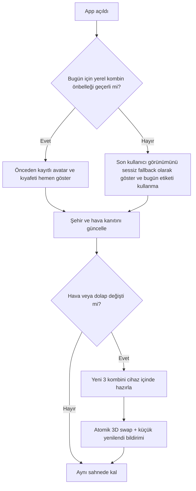

# KABİNSİZ — GOD LEVEL v2.8
## FIGMA-NATIVE EDITORIAL WORLD · EVERY-MORNING READY HOME STUDIO
### Tasarım sistemi, bütün ekranların Figma üretim sözleşmesi, hava/şehir ile yaşayan 3D ana sayfa, SwiftUI ve Claude uygulama anayasası

**Tarih:** 3 Kasım 2026 · **Repo:** `gundogandogancan/kabinsiz` · **Son doğrulanan main SHA:** `30ed2ef9ab38db939ca4faf2b098f83fe256e23a`  
**Durum:** `DESIGN SPEC / NOT FIGMA-CANVAS-IMPLEMENTED / NOT APP-IMPLEMENTED`  
**Bağlı önceki kaynak:** `KABINSIZ_GOD_LEVEL_CLAUDE_MASTER_EXECUTION_CONSTITUTION_v2.7.md`.  
**Yeni karar:** v2.8 yalnız **görsel tasarım, sahne odaklı ana ekran, şehir/hava hazırlığı ve sabah teslim davranışı** konularında v2.7/v2.6/v2.2 üzerine yazılır. Güvenlik, veri doğruluğu, fiziksel beden uyumu ve hukuki kısıtlar hiçbir şekilde gevşetilmez.

> **KULLANICI HEDEFİ — tek cümle:** “Sabah Kabinsiz'i açtığımda kendi yüzümü/saçımı ve 360° modelimi, bulunduğum şehre uygun doğal bir 3D sokakta, gerçek hava durumuna göre önerilmiş bugünün kombini üzerinde hazır görmeliyim; kıyafete dokunup tek hareketle değiştirebilmeli, arayüzün sadeliği moda stüdyosunun kalitesini hissettirmeli.”

## 00 — ÖNEMLİ GERÇEKLİK & AÇIK KAPILAR

- Kullanıcının **Figma hesabı henüz bu konuşmada bağlı değil.** Bu teslimatta gerçek bir `.fig` veya Figma bulut dosyası oluşturulduğu iddia edilmiyor. Dosya, Figma MCP bağlandıktan sonra gerçek frame, layer, variable, component ve prototype bağlantısı oluşturulması için üretim reçetesidir.
- **Figma değil, çalışan uygulama nihai üründür.** Figma'daki fotoğraf veya statik render, gerçek 3D avatar / gerçek-time hava demek değildir. Arayüz Figma'da tasarlanır; 3D sahne RealityKit/Metal ile gerçek iPhone'da oluşturulur.
- iOS **her gün tam 06:00'da background task çalıştırmayı garanti etmez**. Önceki günün geçerli gardırobu üzerinde olası bugünün kombinlerini önceden cihazda hesapla, BGTaskScheduler fırsat bulursa yenile, ilk açılışta cache'i göster + gerçek havayı güncelle. Uygulamayı her sabah boş modelle açma.
- Kullanıcıya GPS izni zorunlu değil. Manuel şehir seçimi her zaman kalır; yaklaşık şehir merkezine dayalı hava / sahne ile çalışılır. Konum izni tercihen `When In Use`.
- `BLENDER` asset üretim aracıdır; gerçek zamanlı render motoru değildir. iOS runtime: `SwiftUI + RealityKit + Metal`. Unity ancak kayıtlı performans/özellik farkı kanıtlanırsa ADR ile tekrar değerlendirilir.

## 01 — MARKA YÖNÜ: QUIET ATELIER MEETS LIVING WORLD

**Temel estetik:** couture atelier, doğal şehir, modern mimarlık, editorial luxury, sıcak materyaller; “oyun gibi canlı” ama **oyuncak/low-poly oyun hissi yok**. Moda ürünü asla neon AI laboratuvarına dönmeyecek. Teknoloji insanı perde arkasından destekler.

**İlk 2 saniyede kullanıcı ne algılamalı?** 1) Bu benim modelim. 2) Bugün bunu giyeceğim. 3) Beğenmezsem değiştirebilirim. Başka hiçbir yazı veya karmaşık KPI buna rakip olamaz.

### Görsel imza
- Arka plan: gerçekten modellemeli, optimize edilmiş İstanbul Galata / Barcelona şehir sahnesi; mevsime ve güne göre doğal ışık, gölge, yağmur/ıslak zemin. 2D fotoğrafı gerçek 3D sahne diye sunma.
- Ön plan: gerçek insana benzeyen, doğal pozlu kişisel avatar; yüzü, saçı ve üstündeki giysi görünür; ilk kadraj **önden 3/4**.
- Ara yüz: sahne üzerine en fazla iki sabit güçlü kontrol; giysi seçenekleri **sadece dokunulduğunda** açılan alt sheet.
- Tipografi: başlıklarda New York / uygun serif; düğme, mikro metin, ürün bilgisi ve erişilebilirlikte SF Pro. Baskın beyaz serif sözcük yığını ya da bej arka plan üstünde sayısız kart YOK.
- Hissedilen kalite: gerçek ipek/keten/yün/deri PBR malzemeler, kibar hareket, sakin ses/haptik (opt-in), ışık bütünlüğü.

## 02 — YENİ BİLGİ MİMARİSİ (ÇELİŞKİYİ ÇÖZ)

**Önerilen alt navigasyon:** `Bugün | Dolabım | Dene | Ben`. `Dene`, barkod tarama ve Live Mirror'ı tek bir birleşik yolculukta içerir; uygulamada ayrı “Tara” ve “Ayna” sekmeleri yoktur. `Stilist` ana sahnede “Yeni kombin” ve ilgili drawer/alt akışla açılır; bağımsız tab zorunlu değildir. `Seyahat` profilden veya ana sahnenin şehir menüsünden açılır. Bu 4 tab öncelikli öneridir; v2.7'nin mevcut 3 tab yapısıyla farkını Claude `ADR-UI28-NAV` dosyasında kaydetmeli ve cihaz kullanıcı testiyle kanıtlamalı. **Ana ekranın içine ikinci bir araç çubuğu koyma.**

### HOME STUDIO — EKRAN DÜZENİ

| Sol: niyet/öğe | Sağ: görülmesi gereken düzen ve davranış |
|---|---|
| Üst bar | `Kabinsiz` sol üst, sağ üst `İstanbul · 12° · Yağmur` küçük etiket. Altında büyük slogan yok. |
| Hero 3D sahne | Ekranın ana alanı; sokak + gerçek giysili önden 3/4 avatar, okunaklı yüz, zemine düşen gölge; 360° döndürme/zoom. |
| Dokunma | Üst, alt, ceket, ayakkabı, çanta vb. üzerine doğrudan dokun → ilgili bölüm vurgulanır → tek alt sheet. |
| Kalıcı CTA | Alt kenarda `Yeni kombin` (baskın) ve `Dene` (küçük ikincil) veya 4-tab içindeki Dene. Üçüncü CTA gerekçesiz eklenemez. |
| Şeffaflık | Gerçek kombin yoksa `Örnek görünüm / Henüz kıyafet eklenmedi`; hava offline ise `Son bilinen tahmin`. Küçük ve görünür. |
| Alt gezinme | Yalnız dört net ikon; üstteki sahneye taşmaz. |

```text
┌──────────────────────────────────┐
│ Kabinsiz             İstanbul ☔ │
│                                  │
│     DOKUNULABİLİR YAŞAYAN 3D     │
│                                  │
│    Galata sokağı, doğal yağmur   │
│       ┌────────────────┐         │
│       │    BENİM       │         │
│       │   MODELİM      │         │
│       │ (giydirilmiş)  │         │
│       │ 360° / pinch   │         │
│       └────────────────┘         │
│                                  │
│       ┌ Yeni kombin üret ┐       │
│       └──────────────────┘       │
├──────────────────────────────────┤
│  Bugün     Dolabım    Dene   Ben  │
└──────────────────────────────────┘
```

**Bu tasarım bir yerleşim yönergesidir; canlı 3D sahne değildir.** Figma hero alanı için Blender'dan üretilmiş *tekil temsilî kadraj* kullanılır; runtime build aynı görünümü RealityKit render'ı olarak kanıtlamak zorundadır.

## 03 — FİGMA BELGESİNİN BİREBİR SAYFA YAPISI

Figma'da **yalnız PDF, screenshot veya tek düz görüntü oluşturmak yasak**. Her biri düzenlenebilir native frame/component ve Auto Layout ile tasarlanmalı. Pages:

| Page | İçerik | Kabul |
|---|---|---|
| `00 · START / DESIGN DOCTRINE` | Ürün vizyonu, mod değiştirmeyen ilkeler, referans ve gerçekliğin farkı | Her artefaktın design/code/evidence bağı |
| `01 · EDITORIAL BRAND` | Logo, tipografi, palet, ikon ağırlığı, doku/ışık, doğal/yağmurlu şehir | Unisex & erişilebilir |
| `02 · VARIABLES & TOKENS` | Light/Dark; city/weather states; spacing, radius, typography, elevations | Her değer değişken |
| `03 · COMPONENTS / ATOMS` | Buttons, chips, tab, overlay, decision/status, cards, panels, controls, Figma variants | Component reuse ≥%95 |
| `04 · HOME WORLD` | Sabah ana ekran, seçici, varyasyon, yükleniyor, offline, şehir değişimi | 3D hero açıkça merkezi |
| `05 · WARDROBE` | Dolap, fotoğraf izni, local ingest onay kuyruğu, ürün 3D görünümü | gerçek/örnek ayrımı |
| `06 · TARA & DENE` | Barcode/camera/web/product resolver/3D try-on/Live Mirror | tek yolculuk |
| `07 · DIGITAL TWIN` | Yüz-saç, model, ölçü, 360°, gizlilik | kullanıcıya benzerlik onayı |
| `08 · STYLIST & COMMERCE` | Kombin varyantları, eksik parça, şeffaf sponsor | tarafsız öneri |
| `09 · TRAVEL` | şehir/gezi/stil planı | seyahat ana ekranı kaplamaz |
| `10 · ONBOARDING / PRIVACY` | rıza, izin, silme, hata | izin yoksa akış sürer |
| `11 · STATES / FALLBACK` | loading, empty, offline, thermal, data/asset missing, camera denial | 3D dürüstlük |
| `12 · PROTOTYPE` | Clickable flows / interaction links | her ana CTA prototipte işler |
| `13 · DEVELOPER HANDOFF` | SwiftUI component mapping, IDs, token map, contracts, responsive specs | crosslink Figma ↔ code |
| `14 · VISUAL QA / EVIDENCE` | Figma vs Simulator vs iPhone karşılaştırma şablonu | gerçek build referansı |

### Frame ve layer isimlendirme
- Base: `KZ/H01/HomeWorld/Rain/Istanbul/Light/iPhone393`.
- Variants: `KZ/Component/<Name>/<Variant>/<State>`; yetenek/navigasyon adları metin değil state/props.
- iPhone baseline `393 × 852 pt`, ayrıca `402 × 874`, `440 × 956`, erişilebilir metin için yeniden akış; **safe-area** üst ve alt gerçek cihazdan ölçülmeli.
- Figma tüm statik öğeleri editlenebilir layer yapar; Blender sahnesi placeholder `3D_SCENE_RENDER_PLACEHOLDER` olarak kalır, 2D screenshot'ı 3D uygulama varlığı gibi sayma.
- Tap targets en az 44×44 pt. Dynamic Type, VoiceOver, Reduced Motion, dark mode ve contrast modları dahil.

## 04 — TASARIM TOKEN'LARI (BAĞLAYICI TASLAK)

Kaynak: `KABINSIZ_FIGMA_DESIGN_TOKENS_v2.8.json`. Figma koleksiyonuna `KZ-Color` / `KZ-Dimension` / `KZ-Typography` olarak aktarılacak. Renkler değiştirildiğinde sabit RGB yazılmış SwiftUI kodu arayüzde kalmamalı.

| Role | Light | Dark | Kullanım |
|---|---|---|---|
| `canvas` | `#F8F6F1` | `#17130F` | Semantik rol; sahne için otomatik okunur overlay gerekir |
| `surface` | `#FFFCF8` | `#27201B` | Semantik rol; sahne için otomatik okunur overlay gerekir |
| `sand` | `#E9DED0` | `#3A3028` | Semantik rol; sahne için otomatik okunur overlay gerekir |
| `stone` | `#D7C6B4` | `#54463B` | Semantik rol; sahne için otomatik okunur overlay gerekir |
| `ink` | `#2B211B` | `#F6F0E9` | Semantik rol; sahne için otomatik okunur overlay gerekir |
| `secondaryInk` | `#65584E` | `#D1C3B7` | Semantik rol; sahne için otomatik okunur overlay gerekir |
| `espresso` | `#654632` | `#C89A76` | Semantik rol; sahne için otomatik okunur overlay gerekir |
| `olive` | `#686D4F` | `#A9AE8F` | Semantik rol; sahne için otomatik okunur overlay gerekir |
| `copper` | `#A76D49` | `#D89A70` | Semantik rol; sahne için otomatik okunur overlay gerekir |
| `hairline` | `#E6DCD1` | `#4A3E35` | Semantik rol; sahne için otomatik okunur overlay gerekir |
| `scrim` | `#221913` | `#221913` | Semantik rol; sahne için otomatik okunur overlay gerekir |
| `success` | `#43694B` | `#A3C6A7` | Semantik rol; sahne için otomatik okunur overlay gerekir |
| `warning` | `#926328` | `#F0C187` | Semantik rol; sahne için otomatik okunur overlay gerekir |
| `danger` | `#9D4238` | `#EDAA9E` | Semantik rol; sahne için otomatik okunur overlay gerekir |

| Text role | Font | Boyut / satır | Kural |
|---|---|---|---|
| Display | New York / system serif | 36 / 42 pt | Sadece özel başlık / onboarding |
| Section title | New York / system serif | 27 / 34 pt | Ürün/arka planla yarışmayacak |
| Main CTA | SF Pro Semibold | 16 / 22 pt | Tek bakışta anlaşılır |
| Body | SF Pro | 16 / 24 pt | Kullanıcı eylem metni |
| Secondary | SF Pro | 14 / 20 pt | İkincil açıklama |
| Status/caption | SF Pro | 12 / 17 pt | “Tahmini 3D” gibi kritik etiketler 

**Kontrast:** Sahnenin renkleri değiştikçe metni doğrudan resim üstüne yazma. Zorunlu durumlarda içeriğin altında mat, gradyanlı, optik olarak denetlenen scrim kullan. Beyaz yazı ve saydam beyaz glass card üst üste yasak; kontrastı otomatik audit et. Alanın fotoğrafik parlaklığı tek başına tasarımı bozabilir.

### Temel bileşen sözleşmeleri
| Component | Variant'lar | SwiftUI eşlemesi | Kritik davranış |
|---|---|---|---|
| `WorldStage` | city/season/weather/deviceTier | `WorldStageView` + RealityKit | scene lifecycle/performance |
| `LivingAvatar` | standin/personal/rigged/fallback | `LivingAvatarView` | yüz/saç gerçeklik etiketi |
| `WeatherCityChip` | live/cached/manual/noData | `WeatherCityChip` | provenance/time |
| `OutfitSwapSheet` | top/bottom/outerwear/shoes/bag/belt/accessory | `OutfitSwapSheet` | mesh'e dokunma |
| `OutfitActionBar` | default/working/disabled | `OutfitActionBar` | mevcut model örtülmez |
| `GarmentTile3D` | verified/estimated/unavailable | `GarmentTile3D` | asset label |
| `ProductEvidenceTag` | source/unknown/partial | `ProductEvidenceTag` | fit ile görsel güven ayrılır |
| `UnifiedTryOnSwitch` | avatar/localCamera/cloudCamera | `UnifiedTryOnSwitch` | state+privacy |
| `AtelierBottomSheet` | collapsed/half/full | `AtelierBottomSheet` | pan/VoiceOver |
| `QuietTabBar` | 4 destinations | `AtelierTabScaffoldV2` | 4-tab ADR |
| `PrivacyConsentCard` | granted/denied/revoked | `PrivacyConsentCard` | cloud fail-closed |
| `SceneLoadingSkeleton` | cold/warm/offline | `SceneLoadingSkeleton` | no empty scene |

## 05 — SABAH HAZIR OLMA MİMARİSİ (ASIL ÜRÜN SÖZÜ)

**Amaç:** Kullanıcı “Bugün” tab'ına girdiğinde önce kurulum spinner'ı değil, o günün yerel koşullara göre hazırlanmış görünümünü görsün. Bunu “her gün 06:00'da kesin hesaplanır” diye yanlış açıklama yapmadan başarmalıyız.

### On-device katmanlar

1. `DailyOutfitPlanner`: dolap revizyonu, kişisel stil, cihaz saat dilimi, seçilen şehir, etkinlik, hava, son giyilenler, bakım durumu ve kullanıcının kararı ile **3 alternatif** aday üretir.
2. `OutfitCache`: mevcut gün için `cityID + localDate + timezone + wardrobeRevision + avatarRevision + preferencesRevision + weatherEvidence/TTL + modelVersion` anahtarıyla atomik kalıcı kayıt.
3. `WarmSceneAssetCache`: avatar ve aday kıyafetlerin G1/G2 sahne varlıkları önceden disk önbelleğinde; cihaz RAM/bellek sınırı ile denetlenir.
4. `WeatherGateway`: açık izinli Apple WeatherKit / seçili şehir; son tahmini ve güncelleme zamanını saklar; veri yoksa gerçek hava olduğuna dair görsel iddiada bulunmaz.
5. `SceneStateResolver`: güneş açısı, gün saati, gerçek hava ve cihaz tier -> sahne `clear/overcast/rain/snow/unknown`, ışık, zemin wetness ve yağmur emitters. Oyun motoru **ağır yağmur efekti yüzünden ısınmamalı**.
6. `OutfitReconciler`: yeni hava veya şehir değişiminde kombini aniden silmez; önce mevcut görünümü tutar, yeni alternatif hazırlanınca görsel geçiş. Önceki kullanıcı manuel kombin kilidi varsa onu zorla değiştirme.
7. `BGAppRefreshTask`: fırsat varsa kısa veri güncelleme; `BGProcessingTask` ise sistemin izin verdiği koşullarda daha ağır yerel hazırlık, **garanti saat yok**.
8. `ForegroundWarmStart`: açılışta cached frame'i hemen getirir; 3D scene + weather + outfit invalidation paralel ama sınırlandırılmış işler olarak güncellenir.

### Anında açılış protokolü



### Her sabah anında hazır algısı için hedefler
- Cached home viewport visible: **p95 ≤ 1 saniye** (HEDEF; gerçek iPhone ölçümü yok).
- First clothed avatar on cached asset: **p95 ≤ 1.5 saniye** (HEDEF; test gerektirir).
- Cached outfit replacement: **p95 ≤ 0.7 saniye** (HEDEF; 3D asset bellekteyse, cihaz türüne göre).
- Hava ve kombin tazelenmesi: bağlantı varsa mümkün olduğunca hızlı ve **asla ilk viewport'ı bloklamadan**. Tek bir sabit süre veya her cihazda anında garanti verilmez.
- Saat dilimi değişimi, şehir değişimi, kullanıcı kilitli kombin, kıyafet silme, cache bozulması, hava TTL bitmesi, güç modu, offline ve app force-quit ayrı testler.

### Hava ve şehir senaryoları

| Şehir | Hava | Sahne | Kombin | Veri dürüstlüğü |
|---|---|---|---|---|
| İstanbul / Galata | Yağmurlu | Yalnız **gerçek tahmin varsa** PBR wetness, emissive droplets, rain particles | Sıcak katman + uygun ayakkabı için seçim | Güncelliği göster |
| İstanbul / Galata | Açık | Sabah güneş açısı, sıcak taş, doğal gölge | Havanın saatlik değişimine göre katman | Tarih/saat |
| Barcelona | Açık/sıcak | Günlük Barcelona sokağı, doğal Akdeniz ışığı | Nefes alabilen kumaşlar yalnız kaynaktan | Şehir manuel olabilir |
| Bilinmeyen şehir | noData | Evrensel doğal stüdyo | Mevcut dolaptan nötr öneri, hava iddiası yok | “Hava verisi yok” |

**Sahne veri kullanımı:** gerçek koordinatlar dünya içinde karakterin nerede gezdiği anlamına gelmez; kullanıcı istemedikçe hassas GPS alınmaz. Şehir/temsili sokak görüntüsü yalnız bağlamdır. Şehir mekânları özgün/lisanslı asset olmalıdır.

## 06 — 3D SAHNE + UI ETKİLEŞİM KURALLARI

1. Avatar başlangıç açısı önden 20–35°; arkası ekrana dönük başlamaz.
2. Avatar baştan ayağa görünür; yüz küçük kalmayacak kadar kamera/zoom dengesi; ekran kalabalıklaşıyorsa bağlama göre avatar pozunu optimize et.
3. **Tap vs pan**: mesh raycast ile giysi tap; 10pt üzeri finger travel drag döndürme; VoiceOver slot picker alternatif erişim.
4. Kıyafete dokununca seçim bölgesi kısa bir overlay çizgisiyle işaretlenir; alt drawer `top,bottom,outerwear,shoes,bag,belt,accessory` slotlarını destekler. Avatarın yüzü/dizleri drawer arkasında kaybolmaz: kamera framelerini yeniden ayarla.
5. Model 360° dönerken hareket fiziği kesintisiz; 180° arka görünüm doğal; saç, çanta askısı, dış giyim rig en az birim test.
6. `Yeni kombin üret`: **yeni fotoğraf değil, yeni giydirilmiş 3D mesh**. 3 cached alternatif öncelikli; kullanıcı birebir görünüm seçimini geri alabilir.
7. Her ürün seçimi `assetRevision, productVariant, wardrobeRevision, fitEvidence` ile atomik; stale data frame render edilmez.
8. Yağmur/zemin: fragment shader + düşük maliyetli droplets/splash decals; fps ve termal governor ile LOD. Düz resim üzerinde loop gif ile sahte animasyon YOK.
9. Sahne 3D render ederken iOS text/controls SwiftUI overlay; tasarım Figma spec referansı. Unity ancak performans benchmark ile.
10. Face/hair/skin consent: kişisel görüntüler varsayılan cihaz içi şifreli kasa; paylaşım/Cloud VTON opt-in kapısı.

---

## 07 — TÜM EKRANLARIN TEK TEK FİGMA ÇİZİM SÖZLEŞMELERİ

**Figma'da her satır minimum bir editlenebilir ana frame ve belirtilen durumlara ait variants üretir.** Hangi ekranın nasıl çalışacağı açıklamalarını Frame description/annotation olarak bağla. `G2` ürün yoksa gerçek ürün görselini sunma; hatayı güzellik için gizleme.

### H01 — Bugün · Yaşayan Ana Sahne

| Başlık | Tasarım sözleşmesi |
|---|---|
| **Konum** | Ana ekran |
| **Görsel kompozisyon** | Model önden/3⁄4 görünür, üzerinde bugünün kombini; arkada kullanıcının seçtiği/izin verdiği şehir için gerçek zamanlı 3D sahne; hava chip’i; sessiz marka başlığı. Alt kenarda yalnız Yeni Kombin ve Dene. |
| **Gerçek veri** | Model, sahne, hava |
| **Etkileşim** | Model hit-test; tek parça seçimi alt sheet; 360° drag; pinch zoom; yeni kombin önbellekten; şehir/hava ayrıntısına dokun. |
| **Zorunlu durumlar** | Güncel veri, son tahmin, çevrimdışı, sahne yükleniyor, avatar yok |
| **Denetim ilkesi** | Bugün, şehir, hava, ürün doğruluğu |

**Figma görevleri:** `KZ/H01/Bugn/Default` ana frame; gerekirse durum varyasyonları, Auto Layout, semantic layer names, safe area, component instances, bağlantı okları. **Uygulama kanıtı:** screenshot + çalışan eylem + ilgili veri kanıtı.

### H02 — Parçaya Dokun · Mini Seçici

| Başlık | Tasarım sözleşmesi |
|---|---|
| **Konum** | Ana ekran durum |
| **Görsel kompozisyon** | Avatarın giydiği ceket seçilince yalnız ceket bölgesi zarif outline ile işaretlenir, alttan 1/3 boy sheet açılır; dolabım/mağazalar filtreleri ve 3 alternatif. |
| **Gerçek veri** | Seçili slot, outfit revision |
| **Etkileşim** | Kıyafet seçilince 3D model atomic swap; geri al; gizli slotlarda parça picker |
| **Zorunlu durumlar** | Asset yok, beden bilinmiyor, sonuç az |
| **Denetim ilkesi** | Avatar açık kalır |

**Figma görevleri:** `KZ/H02/ParayaDokun/Default` ana frame; gerekirse durum varyasyonları, Auto Layout, semantic layer names, safe area, component instances, bağlantı okları. **Uygulama kanıtı:** screenshot + çalışan eylem + ilgili veri kanıtı.

### H03 — Yeni Kombin · Anında Yenile

| Başlık | Tasarım sözleşmesi |
|---|---|
| **Konum** | Ana ekran durum |
| **Görsel kompozisyon** | Buton tıklanır, mevcut avatar yerinde kalır, önceden hazırlanmış alternatif parçalar akıcı ve kısa bir geçişle değişir. |
| **Gerçek veri** | Aday kombinler, kişisel stil |
| **Etkileşim** | Tek dokunuşla sıradaki aday; önce/sonra; geri al; nedenini gör |
| **Zorunlu durumlar** | Aday yok, eski kombin geçerli |
| **Denetim ilkesi** | Hızlı algı |

**Figma görevleri:** `KZ/H03/YeniKombin/Default` ana frame; gerekirse durum varyasyonları, Auto Layout, semantic layer names, safe area, component instances, bağlantı okları. **Uygulama kanıtı:** screenshot + çalışan eylem + ilgili veri kanıtı.

### H04 — Şehir ve Hava · Sahne Tercihi

| Başlık | Tasarım sözleşmesi |
|---|---|
| **Konum** | Ana ekran durum |
| **Görsel kompozisyon** | Minimal sheet: otomatik konum yerine şehir seç, İstanbul/Barcelona pilot 3D sahneleri; hangi hava verisi, son güncelleme. |
| **Gerçek veri** | Şehir tercihi, local time, WeatherSnapshot |
| **Etkileşim** | Şehri seç; yalnız uygulama kullanılırken konum izni; şehir belleğe kaydet |
| **Zorunlu durumlar** | Konum reddi, belirsiz tahmin, offline |
| **Denetim ilkesi** | Mahremiyet |

**Figma görevleri:** `KZ/H04/ehirveHava/Default` ana frame; gerekirse durum varyasyonları, Auto Layout, semantic layer names, safe area, component instances, bağlantı okları. **Uygulama kanıtı:** screenshot + çalışan eylem + ilgili veri kanıtı.

### H05 — Hava Yenileniyor / Çevrimdışı

| Başlık | Tasarım sözleşmesi |
|---|---|
| **Konum** | Ana ekran durum |
| **Görsel kompozisyon** | Avatar ve son geçerli sahne kalır; küçük etiket “Son bilinen tahmin”. Uydurma yağmur/ısı yok. |
| **Gerçek veri** | Cache staleness TTL |
| **Etkileşim** | Sessiz refresh; gecikince manuel yenile |
| **Zorunlu durumlar** | Offline, eski hava, yavaş işlem |
| **Denetim ilkesi** | Doğruluk |

**Figma görevleri:** `KZ/H05/HavaYenileniyorevrimd/Default` ana frame; gerekirse durum varyasyonları, Auto Layout, semantic layer names, safe area, component instances, bağlantı okları. **Uygulama kanıtı:** screenshot + çalışan eylem + ilgili veri kanıtı.

### W01 — Dolabım · Görsel 3D Raf

| Başlık | Tasarım sözleşmesi |
|---|---|
| **Konum** | Gardırop |
| **Görsel kompozisyon** | Gerçek onaylanmış ürünler fotoğraf galerisi değil, kategoriye göre 3D thumbnail/canlı minyatür; güçlü boş durum CTA. |
| **Gerçek veri** | Wardrobe, garment assets |
| **Etkileşim** | Ara, filtrele, 360° önizleme, ekle, arşivle |
| **Zorunlu durumlar** | Boş, asset üretilmedi, örnek veri |
| **Denetim ilkesi** | Dijital dolap |

**Figma görevleri:** `KZ/W01/Dolabm/Default` ana frame; gerekirse durum varyasyonları, Auto Layout, semantic layer names, safe area, component instances, bağlantı okları. **Uygulama kanıtı:** screenshot + çalışan eylem + ilgili veri kanıtı.

### W02 — Fotoğraflardan Bul · İzin

| Başlık | Tasarım sözleşmesi |
|---|---|
| **Konum** | Gardırop |
| **Görsel kompozisyon** | Seçili fotoğraflar/albüm; tek seferlik sistem picker; veri dışarı gönderilmez. |
| **Gerçek veri** | Photos picker permission |
| **Etkileşim** | Örnek önizleme ve rıza; iptal |
| **Zorunlu durumlar** | Sınırlı erişim, izin reddi |
| **Denetim ilkesi** | Güven |

**Figma görevleri:** `KZ/W02/FotoraflardanBul/Default` ana frame; gerekirse durum varyasyonları, Auto Layout, semantic layer names, safe area, component instances, bağlantı okları. **Uygulama kanıtı:** screenshot + çalışan eylem + ilgili veri kanıtı.

### W03 — Kıyafet Algılama · Onay Kuyruğu

| Başlık | Tasarım sözleşmesi |
|---|---|
| **Konum** | Gardırop |
| **Görsel kompozisyon** | Her kesilmiş kıyafet için tahmini sınıf, renk, olası aynı ürün, kaynak; onayla/düzenle/sil. |
| **Gerçek veri** | Local CV inference |
| **Etkileşim** | Birleştir, yanlış sınıfı düzelt, kaynak bak |
| **Zorunlu durumlar** | Düşük güven, yüz var, hassas görüntü |
| **Denetim ilkesi** | Doğrulama |

**Figma görevleri:** `KZ/W03/KyafetAlglama/Default` ana frame; gerekirse durum varyasyonları, Auto Layout, semantic layer names, safe area, component instances, bağlantı okları. **Uygulama kanıtı:** screenshot + çalışan eylem + ilgili veri kanıtı.

### W04 — Kıyafet Detayı · 3D Nesne

| Başlık | Tasarım sözleşmesi |
|---|---|
| **Konum** | Gardırop |
| **Görsel kompozisyon** | Kıyafet kendi ışık/stüdyosunda döndürülebilir mesh; kumaş, beden, logo, kıvrımın kaynak etiketi; ilgili kombinler. |
| **Gerçek veri** | Garment G0/G1/G2 |
| **Etkileşim** | Döndür, avatar üstünde dene, düzenle, sil |
| **Zorunlu durumlar** | Mesh yok; tahmini 3D; gerçek CAD var |
| **Denetim ilkesi** | 3D doğruluk |

**Figma görevleri:** `KZ/W04/KyafetDetay/Default` ana frame; gerekirse durum varyasyonları, Auto Layout, semantic layer names, safe area, component instances, bağlantı okları. **Uygulama kanıtı:** screenshot + çalışan eylem + ilgili veri kanıtı.

### W05 — Kıyafeti Ekle · Kamera / Dosya

| Başlık | Tasarım sözleşmesi |
|---|---|
| **Konum** | Gardırop |
| **Görsel kompozisyon** | Kıyafet askıda, düz serilmiş veya kullanıcı fotoğrafından; ürün kodu da eklenebilir. |
| **Gerçek veri** | UIImage / Photos picker |
| **Etkileşim** | Foto çek; arka açıyı ekle; kaynağı kaydet |
| **Zorunlu durumlar** | Yetersiz görünüm |
| **Denetim ilkesi** | Giriş |

**Figma görevleri:** `KZ/W05/KyafetiEkle/Default` ana frame; gerekirse durum varyasyonları, Auto Layout, semantic layer names, safe area, component instances, bağlantı okları. **Uygulama kanıtı:** screenshot + çalışan eylem + ilgili veri kanıtı.

### D01 — Dene · Tek Giriş

| Başlık | Tasarım sözleşmesi |
|---|---|
| **Konum** | Tara ve Dene |
| **Görsel kompozisyon** | Tek alan: “Ürünü tara veya seç” üzerinde kamera; alt kaynaklar barkod, fotoğraf, web bağlantısı, dolabımdan. Aynı yolculukta model ve kamera modu geçişi. |
| **Gerçek veri** | ProductResolver |
| **Etkileşim** | Kaynak seç; ürün kimliği çöz; uygulama içinde kal |
| **Zorunlu durumlar** | Kamera yok, offline |
| **Denetim ilkesi** | Tek yolculuk |

**Figma görevleri:** `KZ/D01/Dene/Default` ana frame; gerekirse durum varyasyonları, Auto Layout, semantic layer names, safe area, component instances, bağlantı okları. **Uygulama kanıtı:** screenshot + çalışan eylem + ilgili veri kanıtı.

### D02 — Barkod / QR Tarama

| Başlık | Tasarım sözleşmesi |
|---|---|
| **Konum** | Tara ve Dene |
| **Görsel kompozisyon** | Tam kamera önizlemesi, odak çerçevesi, küçük ışık kontrolü, yanıt halinde alt ürün kartı. |
| **Gerçek veri** | VisionKit/DataScanner/AVFoundation |
| **Etkileşim** | GTIN/SKU doğrula, varyant seç; manuel girişi yalnız fallback |
| **Zorunlu durumlar** | Bulanık, aynı GTIN farklı beden |
| **Denetim ilkesi** | Doğru ürün |

**Figma görevleri:** `KZ/D02/BarkodQRTarama/Default` ana frame; gerekirse durum varyasyonları, Auto Layout, semantic layer names, safe area, component instances, bağlantı okları. **Uygulama kanıtı:** screenshot + çalışan eylem + ilgili veri kanıtı.

### D03 — Fotoğrafla Ürün Bul

| Başlık | Tasarım sözleşmesi |
|---|---|
| **Konum** | Tara ve Dene |
| **Görsel kompozisyon** | Ürünü veya etiketi göster, tek foto/çoklu açı, OCR ayrımı. |
| **Gerçek veri** | Vision/Core ML, OCR |
| **Etkileşim** | Ürün adaylarını göster; emin değilse onay sor |
| **Zorunlu durumlar** | Logo belirsiz, marka yok |
| **Denetim ilkesi** | Güven |

**Figma görevleri:** `KZ/D03/FotoraflarnBul/Default` ana frame; gerekirse durum varyasyonları, Auto Layout, semantic layer names, safe area, component instances, bağlantı okları. **Uygulama kanıtı:** screenshot + çalışan eylem + ilgili veri kanıtı.

### D04 — Web Ürün Linki Ekle

| Başlık | Tasarım sözleşmesi |
|---|---|
| **Konum** | Tara ve Dene |
| **Görsel kompozisyon** | Link paylaşımı; marka, ürün, varyant, hak durumu; yalnız izinli katalog bağlantısı. |
| **Gerçek veri** | Share extension + partner feed |
| **Etkileşim** | Önizleme doğrula, ürün rengi/bedeni seç |
| **Zorunlu durumlar** | Engelli URL, veri hakkı yok |
| **Denetim ilkesi** | Doğruluk |

**Figma görevleri:** `KZ/D04/WebrnLinkiEkle/Default` ana frame; gerekirse durum varyasyonları, Auto Layout, semantic layer names, safe area, component instances, bağlantı okları. **Uygulama kanıtı:** screenshot + çalışan eylem + ilgili veri kanıtı.

### D05 — Ürün Bulundu · Kaynak Kartı

| Başlık | Tasarım sözleşmesi |
|---|---|
| **Konum** | Tara ve Dene |
| **Görsel kompozisyon** | Minimal ürün görseli, marka/model/varyant/beden, kaynak durumu; iki sekme: 3D Modelimde, Canlı Ayna. |
| **Gerçek veri** | Identity+assets+fit |
| **Etkileşim** | 3D veya ayna modu seç |
| **Zorunlu durumlar** | G1 approximate, G2 verified, no asset |
| **Denetim ilkesi** | Şeffaflık |

**Figma görevleri:** `KZ/D05/rnBulundu/Default` ana frame; gerekirse durum varyasyonları, Auto Layout, semantic layer names, safe area, component instances, bağlantı okları. **Uygulama kanıtı:** screenshot + çalışan eylem + ilgili veri kanıtı.

### D06 — 3D Modelimde Dene

| Başlık | Tasarım sözleşmesi |
|---|---|
| **Konum** | Tara ve Dene |
| **Görsel kompozisyon** | Kişinin ön 3/4 açısı, kıyafet 3D mesh, raycast; oran/kalıp belirsizliği küçük bilgi alanı. |
| **Gerçek veri** | Avatar+garment |
| **Etkileşim** | 360° çevir; beden değiştir; kendi dolabıyla kombinle |
| **Zorunlu durumlar** | No verified fit, occlusion |
| **Denetim ilkesi** | 3D prova |

**Figma görevleri:** `KZ/D06/3DModelimdeDene/Default` ana frame; gerekirse durum varyasyonları, Auto Layout, semantic layer names, safe area, component instances, bağlantı okları. **Uygulama kanıtı:** screenshot + çalışan eylem + ilgili veri kanıtı.

### D07 — Canlı Ayna · Yerel

| Başlık | Tasarım sözleşmesi |
|---|---|
| **Konum** | Tara ve Dene |
| **Görsel kompozisyon** | Kullanıcı gerçek kamerada hareket eder, işlenmiş giysi overlay; gecikme göstergesi ve doğruluk notu, tek kapatma. |
| **Gerçek veri** | AVFoundation+Vision+Metal |
| **Etkileşim** | Kamerayı aç; ürün değiştir; görüntü düzeyi bilgisi |
| **Zorunlu durumlar** | Tracking kaybı; çarpışma |
| **Denetim ilkesi** | Yerel |

**Figma görevleri:** `KZ/D07/CanlAyna/Default` ana frame; gerekirse durum varyasyonları, Auto Layout, semantic layer names, safe area, component instances, bağlantı okları. **Uygulama kanıtı:** screenshot + çalışan eylem + ilgili veri kanıtı.

### D08 — Canlı Ayna · Bulut İzin

| Başlık | Tasarım sözleşmesi |
|---|---|
| **Konum** | Tara ve Dene |
| **Görsel kompozisyon** | Bir sayfada yüz/beden videosunun nereye aktarılacağı, saklama, maliyet, oturum süresi; açık onay. |
| **Gerçek veri** | CitadelGate+consent |
| **Etkileşim** | Açık onay, iptal, fiyat sınırı |
| **Zorunlu durumlar** | Sözleşme yok / disabled |
| **Denetim ilkesi** | Gizlilik |

**Figma görevleri:** `KZ/D08/CanlAyna/Default` ana frame; gerekirse durum varyasyonları, Auto Layout, semantic layer names, safe area, component instances, bağlantı okları. **Uygulama kanıtı:** screenshot + çalışan eylem + ilgili veri kanıtı.

### D09 — Canlı Ayna · AI Video

| Başlık | Tasarım sözleşmesi |
|---|---|
| **Konum** | Tara ve Dene |
| **Görsel kompozisyon** | Kamera ve kıyafet dönüşümü; “AI video görünümü” etiketi, varyant bilgisi; durdur düğmesi. |
| **Gerçek veri** | Decart after legal gates |
| **Etkileşim** | Poz değişimi; farkı göster; kes, durdur |
| **Zorunlu durumlar** | Network poor, latency, cost cap |
| **Denetim ilkesi** | Cloud opt-in |

**Figma görevleri:** `KZ/D09/CanlAyna/Default` ana frame; gerekirse durum varyasyonları, Auto Layout, semantic layer names, safe area, component instances, bağlantı okları. **Uygulama kanıtı:** screenshot + çalışan eylem + ilgili veri kanıtı.

### D10 — Beden Uygunluğu · Bölgesel

| Başlık | Tasarım sözleşmesi |
|---|---|
| **Konum** | Tara ve Dene |
| **Görsel kompozisyon** | Önerilen beden tek iddia değil: omuz/göğüs/bel/kalça/kol bölgeleri; kaynak verileri; abstain. |
| **Gerçek veri** | Fit Passport+measurement |
| **Etkileşim** | Ölçü düzelt, beden alternatifleri gör |
| **Zorunlu durumlar** | Ölçü eksik |
| **Denetim ilkesi** | Dürüst fit |

**Figma görevleri:** `KZ/D10/BedenUygunluu/Default` ana frame; gerekirse durum varyasyonları, Auto Layout, semantic layer names, safe area, component instances, bağlantı okları. **Uygulama kanıtı:** screenshot + çalışan eylem + ilgili veri kanıtı.

### A01 — Ben · Modelim / Dijital İkiz

| Başlık | Tasarım sözleşmesi |
|---|---|
| **Konum** | Avatar |
| **Görsel kompozisyon** | Dijital ikiz tam boy, 360° ön/yan/arka; yüz ve saç; 3D düzenleme alanı; gizlilik ayrı alt bölüm. |
| **Gerçek veri** | BodyProfileV2, geometry, vault |
| **Etkileşim** | Modelim, yüz/saç, ölçü, sil, gizlilik |
| **Zorunlu durumlar** | Nötr model, düşük fidelity |
| **Denetim ilkesi** | Kişiselleştirme |

**Figma görevleri:** `KZ/A01/Ben/Default` ana frame; gerekirse durum varyasyonları, Auto Layout, semantic layer names, safe area, component instances, bağlantı okları. **Uygulama kanıtı:** screenshot + çalışan eylem + ilgili veri kanıtı.

### A02 — Yüz ve Saç · Benzerlik

| Başlık | Tasarım sözleşmesi |
|---|---|
| **Konum** | Avatar |
| **Görsel kompozisyon** | Kullanıcı açık izinle yüz fotoğraflarını seçer; ince ayar: saç tipi/ton, yüz geometrisi, “bana benziyor mu?” |
| **Gerçek veri** | On-device inference |
| **Etkileşim** | Benzerlik onayı, düzeltme |
| **Zorunlu durumlar** | Fotoğraf istemiyor, belirsiz |
| **Denetim ilkesi** | Özerklik |

**Figma görevleri:** `KZ/A02/YzveSa/Default` ana frame; gerekirse durum varyasyonları, Auto Layout, semantic layer names, safe area, component instances, bağlantı okları. **Uygulama kanıtı:** screenshot + çalışan eylem + ilgili veri kanıtı.

### A03 — Ölçüler · Model Uyum

| Başlık | Tasarım sözleşmesi |
|---|---|
| **Konum** | Avatar |
| **Görsel kompozisyon** | Gövde sahnesi solda/büyük, ölçüler sheet; yüz asla beden verisi yerine geçmez. |
| **Gerçek veri** | Measurement provenance |
| **Etkileşim** | Ölçü gir, yüzde değil cm |
| **Zorunlu durumlar** | Manuel data yok |
| **Denetim ilkesi** | Metrologi |

**Figma görevleri:** `KZ/A03/ller/Default` ana frame; gerekirse durum varyasyonları, Auto Layout, semantic layer names, safe area, component instances, bağlantı okları. **Uygulama kanıtı:** screenshot + çalışan eylem + ilgili veri kanıtı.

### S01 — Stilist · Üç Farklı Yön

| Başlık | Tasarım sözleşmesi |
|---|---|
| **Konum** | Stilist |
| **Görsel kompozisyon** | Kullanıcının mevcut avatarda seçilebilir üç görünümü: sade, karakterli, cesur. Açıklama kısa. |
| **Gerçek veri** | Style DNA + wardrobe |
| **Etkileşim** | Tek dokunuşta Home Studio uygula; edit |
| **Zorunlu durumlar** | Öneri verisi yetersiz |
| **Denetim ilkesi** | Moda zekâsı |

**Figma görevleri:** `KZ/S01/Stilist/Default` ana frame; gerekirse durum varyasyonları, Auto Layout, semantic layer names, safe area, component instances, bağlantı okları. **Uygulama kanıtı:** screenshot + çalışan eylem + ilgili veri kanıtı.

### S02 — Eksik Parça / Alışveriş

| Başlık | Tasarım sözleşmesi |
|---|---|
| **Konum** | Stilist |
| **Görsel kompozisyon** | Önce dolabından çözümler; eksik parça gerçekten gerekirse ayrı ticari modül; sponsor açıkça etiketli. |
| **Gerçek veri** | Commerce rights |
| **Etkileşim** | Bütçe, mağaza, beden filtrele |
| **Zorunlu durumlar** | Stok bilinmiyor |
| **Denetim ilkesi** | Ticari şeffaflık |

**Figma görevleri:** `KZ/S02/EksikParaAlveri/Default` ana frame; gerekirse durum varyasyonları, Auto Layout, semantic layer names, safe area, component instances, bağlantı okları. **Uygulama kanıtı:** screenshot + çalışan eylem + ilgili veri kanıtı.

### T01 — Seyahat · Şehir Değiştir

| Başlık | Tasarım sözleşmesi |
|---|---|
| **Konum** | Seyahat |
| **Görsel kompozisyon** | Seyahatte farklı şehir, hava ve 3-5 günlük kombin; ana dünya isteğe bağlı seyahat şehrine geçer. |
| **Gerçek veri** | TravelEngine |
| **Etkileşim** | Şehir ve tarih seç |
| **Zorunlu durumlar** | Forecast yok |
| **Denetim ilkesi** | Bağlam |

**Figma görevleri:** `KZ/T01/Seyahat/Default` ana frame; gerekirse durum varyasyonları, Auto Layout, semantic layer names, safe area, component instances, bağlantı okları. **Uygulama kanıtı:** screenshot + çalışan eylem + ilgili veri kanıtı.

### P01 — Gizlilik · İzin ve Silme

| Başlık | Tasarım sözleşmesi |
|---|---|
| **Konum** | Profil |
| **Görsel kompozisyon** | Fotoğraf, kamera, konum, bulut VTON ve veriler ayrı ayrı; veri silme açık. |
| **Gerçek veri** | Vault+Citadel |
| **Etkileşim** | İzinleri yönet, tüm veriyi sil |
| **Zorunlu durumlar** | Cloud disabled |
| **Denetim ilkesi** | Mahremiyet |

**Figma görevleri:** `KZ/P01/Gizlilik/Default` ana frame; gerekirse durum varyasyonları, Auto Layout, semantic layer names, safe area, component instances, bağlantı okları. **Uygulama kanıtı:** screenshot + çalışan eylem + ilgili veri kanıtı.

### E01 — Yükleme / İlk Kurulum

| Başlık | Tasarım sözleşmesi |
|---|---|
| **Konum** | Sistem durumu |
| **Görsel kompozisyon** | Sahne boş kalmaz; nötr avatarın önceden hazırlanmış stüdyo sahnesi, on-boarding CTA. |
| **Gerçek veri** | Cache+asset |
| **Etkileşim** | Kendi modelini oluştur |
| **Zorunlu durumlar** | Asset eksik |
| **Denetim ilkesi** | Tamamlanmışlık |

**Figma görevleri:** `KZ/E01/YklemelkKurulum/Default` ana frame; gerekirse durum varyasyonları, Auto Layout, semantic layer names, safe area, component instances, bağlantı okları. **Uygulama kanıtı:** screenshot + çalışan eylem + ilgili veri kanıtı.

### E02 — Hata / Yavaş Cihaz

| Başlık | Tasarım sözleşmesi |
|---|---|
| **Konum** | Sistem durumu |
| **Görsel kompozisyon** | 3D kalite düşebilir; aynı işlevler kalır; net sınırlama. |
| **Gerçek veri** | DeviceBudget |
| **Etkileşim** | Yerel düşük yük modu |
| **Zorunlu durumlar** | Termal, düşük pil, offline |
| **Denetim ilkesi** | Dayanıklılık |

**Figma görevleri:** `KZ/E02/HataYavaCihaz/Default` ana frame; gerekirse durum varyasyonları, Auto Layout, semantic layer names, safe area, component instances, bağlantı okları. **Uygulama kanıtı:** screenshot + çalışan eylem + ilgili veri kanıtı.


## 08 — FİGMA ETKİLEŞİM PROTOTİPİ (SAHTE BUTON YOK)

- Akış A / Sabah: onboarding tamam → H01 → model üstüne dokun → H02 → kıyafet seç → H01; yeni kombin → H03 → H01; şehir chip → H04 → H01.
- Akış B / Fotoğraflar: W01 → W02 → W03 → W04 → D06 → H01.
- Akış C / Mağaza: D01 → D02 veya D03 → D05 → D06 / D07; cloud seçilirse D08 ve yetkili mod açılınca D09.
- Akış D / Profil: A01 → A02/A03 → A01 → H01; silme P01.
- Akış E / Offline: E01 → H05 → H01; kritik termal E02 fallback.
- Her variant'ın **back**, **close**, **voiceOver alternative**, **cancel** bağlantısı olmalı.

## 09 — FIGMA MCP, SKILL VE DEVELOPMENT ENTEGRASYONU

**Önemli:** Figma MCP Figma tasarım dosyası oluşturup düzenlemek için geliştirme aracıdır; uygulamada 3D model çalıştırmaz. Gerçek iPhone engine için `Blender → USDZ/asset → RealityKit/Metal` gerekir.

**Resmî Figma remote MCP:** `https://mcp.figma.com/mcp`. Figma hesabı ve uygun plan/koltuk/izin gerekli; bu konuşmada bağlantı onaylanmadığından kurulmuş sayma. Figma dokümanına göre `create_new_file`, `use_figma`, `get_design_context`, `get_metadata`, `get_screenshot`, `get_code_connect_map`, `upload_assets` gibi araçlar ve `figma-use`, `figma-code-connect` skill akışları ilgili istemcide desteklenirse çalıştırılmalı. Yalnız listede gördüğün araçları kullan; çağrı isimlerini tahmin ederek başarı yazma.

**Claude Code eylem sırası:**
1. Kendi Figma bağlantısını / yetkilerini doğrula; `CODED_ONLY` vs `FIGMA_FILE_CREATED` ayrımı.
2. Figma dosyası oluştur: `KABINSIZ / QUIET ATELIER / LIVING WORLD / v2.8`.
3. `KABINSIZ_FIGMA_DESIGN_TOKENS_v2.8.json` içindeki renk/dimension/style token'larını variables olarak koy.
4. Her temel component'ı Figma variant'larıyla kur; accessibility/contrast kontrolü.
5. Yukarıdaki her ekranın **gerçek editlenebilir frame'ini** ve prototip bağlantısını oluştur; sadece mermaid çizimi veya PNG yapma.
6. Figma component-to-code eşlemesini SwiftUI view'leriyle çıkar; `Code Connect` mevcut istemci destekliyorsa kullan, yoksa açık mapping JSON sun.
7. Her ekran için Figma export, simülatör ve gerçek cihaz görüntüsünü aynı resolution'da karşılaştır; heatmap/diff ve kullanıcı inceleme notu ekle.

## 10 — MİMARİ KANIT / GITHUB DOSYALARI

**Repo son doğrulanan SHA:** `30ed2ef9` (iş başında yeniden bak). Mevcut `TodayView.swift` yaşayan avatar gövdesini gösteriyor ancak günlük outfit engine hâlâ mevcut değil; `RootView` yalnız `Bugün / Dolabım / Ben` 3 tab. `ScanView` kamera yerine manuel sentetik ürün kodu giriyor. `LiveMirror` modülünde session/state contracts bulunuyor; gerçek camera provider/try-on sistemi ayrı. **v2.8 bunların üstüne eklenecek, mevcut kasayı veya güvenlik kontrollerini silmeyecek.**

| Alan | Repo hedefi / yapılacak değişiklik |
|---|---|
| `apps/ios/Kabinsiz/Features/Today/TodayView.swift` | `WorldHomeView`, `WorldStageView`, `OutfitSwapSheet` ve minimal CTA düzenine aktar |
| `apps/ios/Kabinsiz/App/KabinsizApp.swift` | `Bugün Dolabım Dene Ben` navigasyon ADR; ayrı ayna/tara kopyasını kaldır |
| `apps/ios/Kabinsiz/DesignSystem/...` | Tokens + SwiftUI reusable components Figma ile senkron |
| `Packages/KabinsizCore/Sources/...` | `DailyOutfitPlanner`, `DailyCache`, `SceneWeatherResolver`, `OutfitSwap` modüllerini mevcut `Octopus` sözleşmesine bağla |
| `apps/ios/Kabinsiz/Features/Wardrobe/...` | fotoğraftan girdi, local AI öneri ve 3D görünümü |
| `apps/ios/Kabinsiz/Features/Scan/ScanView.swift` | `TryOnHubView`, kamera barcode/URL, Mirror shared product context |
| `Packages/KabinsizCore/Sources/LiveMirror/...` | adapter / camera lifecycle, yalnız izinli cloud |
| `docs/evidence/UI28-*` | Figma frame linki, commit, build log, screenshot, cihaz fps ve test sonucu |

## 11 — CLAUDE İŞ PAKETLERİ (BAĞIMLILIK SIRASI)

| WP | Öncelik | İş | PASS kanıtı |
|---|---|---|---|
| UI28-00 | P0 | Güncel kod / ekran denetimi, Figma bağlantısı, plan/ADR, screenshot baseline | kaynaklı audit |
| UI28-01 | P0 | Figma pages, variables, components, types, prototype backbone | editlenebilir Figma file URL |
| UI28-02 | P0 | `WorldHome` 3D kadraj ve kontrollere göre layout | Figma frame + simulator video |
| UI28-03 | P0 | `DailyOutfitPlanner` + cache + date/timezone invalidation | unit test & cold-start |
| UI28-04 | P0 | `WeatherGateway` city/manual/forecast TTL + scene state | offline test |
| UI28-05 | P0 | Scene İstanbul/Barcelona lighting/rain/wetness LOD | gerçek cihaz fps |
| UI28-06 | P0 | 3D avatar garment slot hit-test + sheet + undo | UI interaction + video |
| UI28-07 | P0 | 3 outfit candidates preload + atomic swap | measured latency |
| UI28-08 | P0 | 4-tab Dene merge + camera/manual fallback | navigational UI test |
| UI28-09 | P0 | Wardrobe photo ingest and garments 3D state UI | permission/security tests |
| UI28-10 | P1 | Model face hair similarity/edit screens | user consent + review |
| UI28-11 | P1 | Try-On local camera flow + truth labels | device video evidence |
| UI28-12 | P1 | Cloud VTON opt-in legal gate (disabled until approved) | fail-closed tests |
| UI28-13 | P1 | Stylist, shopping, trip + privacy screens Figma/SwiftUI | screenshots & flow tests |
| UI28-14 | P0 | Accessibility, Dynamic Type, reduced motion, dark mode | audits |
| UI28-15 | P0 | Visual compare, independent design red-team, perf + thermals | evidence bundle |
| UI28-16 | P0 | Canonical docs update, no orphaned v2.7 instructions | documentation tests |

## 12 — ZORUNLU KABUL TESTLERİ (v2.8)

- [ ] `UI28-T001` — B01: İlk açılışta vücut/şehir sahnesi ile birlikte boş ekran yerine anlamlı viewport.
- [ ] `UI28-T002` — B02: Günün doğru localDate’i ve şehir timezone kullanılır.
- [ ] `UI28-T003` — B03: Önceki geceden geçerli cache varsa görsel ilk render hızlı açılır; süre cihazda ölçülür.
- [ ] `UI28-T004` — B04: BGTaskScheduler hiç çalışmazsa ön planda otomatik toparlama olur; sabah garanti iddiası yok.
- [ ] `UI28-T005` — B05: Cache corruption güvenli fallback ve açık durum etiketi.
- [ ] `UI28-T006` — B06: Kullanıcının kilitlediği kombini hava güncellemesi zorla değiştiremez.
- [ ] `UI28-T007` — B07: Şehir manuel seçilirse GPS istemez, seçilen şehir sahnesi kalır.
- [ ] `UI28-T008` — B08: Geçerli hava yokken yağmur gerçek hava olarak gösterilmez.
- [ ] `UI28-T009` — B09: Hava verisi eskise “Son bilinen” etiketi ve zaman var.
- [ ] `UI28-T010` — B10: Weather değişince ön plandaki avatar çıplak/hatalı frame göstermeden outfit güncellenir.
- [ ] `UI28-T011` — H01: Avatar ilk kadrajda önden/üç çeyrek görünür; tam ters dönük açılmaz.
- [ ] `UI28-T012` — H02: Kullanıcının yüzü ve saçı avatar içinde görünür; onaylanmış model yoksa durum açık.
- [ ] `UI28-T013` — H03: Giysiye tap doğru slot'u seçer, sürükleme döndürme olur.
- [ ] `UI28-T014` — H04: Sheet açılınca modelin kritik gövde bölgeleri kesilmez.
- [ ] `UI28-T015` — H05: Ana sahnede sürekli kemer/çanta vs büyük buton listesi yoktur.
- [ ] `UI28-T016` — H06: Yeni kombin tuşu aynı 3D model üstünde yeni giysi yaratır (fotoğraf değiştirme değil).
- [ ] `UI28-T017` — H07: Aynı ürün, farklı beden varyantlarında doğru revision ile görünür.
- [ ] `UI28-T018` — H08: Alternatif yoksa kullanıcıya çalışmayan “yeni kombin” butonu gösterilmez.
- [ ] `UI28-T019` — H09: 360° dönüş; yan/arka, pinch, VoiceOver alternatifleri.
- [ ] `UI28-T020` — H10: Stüdyo/şehir ışığı model ve kıyafeti ortak etkiler.
- [ ] `UI28-T021` — H11: Yağmur zemine çarpar; wetness ve shader güncellenir; LOD kalite maliyetini yönetir.
- [ ] `UI28-T022` — H12: Reduced Motion açıkken gereksiz hareket/yağmur gösterim şiddeti azaltılır.
- [ ] `UI28-T023` — F01: Her ana Figma ekranı editlenebilir frame/Auto Layout'tur, PNG değildir.
- [ ] `UI28-T024` — F02: Figma Light/Dark variable ve typography mapping vardır.
- [ ] `UI28-T025` — F03: 393x852, 402x874, 440x956 frame safe area taşması yok.
- [ ] `UI28-T026` — F04: 200% Dynamic Type kritik kontrolleri erişilebilir kılar.
- [ ] `UI28-T027` — F05: 44pt minimum dokunma alanı sağlanır.
- [ ] `UI28-T028` — F06: Ekran üstü metin kontrastı tüm hava/şehir arka planında okunabilir.
- [ ] `UI28-T029` — F07: Figma prototipinin tüm görünür CTA hedefleri tıklanabilir.
- [ ] `UI28-T030` — F08: Figma ile SwiftUI tasarım tokenları kod eşleme testinde tutarlıdır.
- [ ] `UI28-T031` — D01: Dene barkod/fotoğraf/URL tek akıştadır, iki ayrı bağımsız ürün silo'su yoktur.
- [ ] `UI28-T032` — D02: Ürün varyantı belirsizse kullanıcı seçmeden kesin prova yok.
- [ ] `UI28-T033` — D03: Ürüne özel olmayan 3D “tahmini” olarak işaretlenir.
- [ ] `UI28-T034` — D04: Canlı Ayna kamera izin reddinde düzgün fallback.
- [ ] `UI28-T035` — D05: Cloud VTON açık rıza ve sözleşme yoksa fail-closed.
- [ ] `UI28-T036` — D06: Kameranın sonlandırılması arka plan/ekran kilidi/termal/hata halinde doğrulanır.
- [ ] `UI28-T037` — D07: Beden uygunluğu görsel görünüşten çıkarılmaz.
- [ ] `UI28-T038` — W01: Photo picker sınırlı izin destekler; arşiv tümden taranmadan seçili kapsam.
- [ ] `UI28-T039` — W02: Fotoğraftan kıyafet tanıma onay kuyruğu ve duplicate merge.
- [ ] `UI28-T040` — W03: Kıyafet gerçek 3D yoksa uydurma model yerine seviyesini gösterir.
- [ ] `UI28-T041` — W04: Sponsor öneriler gerçek kullanıcı yararı skorunu aşamaz.
- [ ] `UI28-T042` — S01: Stilist üç farklı stili yalnız kullanıcının izinli verileriyle üretir.
- [ ] `UI28-T043` — S02: Giyilen kumaşın türü etiket/marka kanıtından geliyorsa belirtilir.
- [ ] `UI28-T044` — P01: Fotoğraf, yüz, konum ve VTON izinleri ayrı ayrı geri alınabilir.
- [ ] `UI28-T045` — P02: Kullanıcının tüm model ve dolap verileri şifreli vault silmesiyle gider.
- [ ] `UI28-T046` — P03: Cihaz ısınınca 3D degrade ama temel seçme akışı sürer.
- [ ] `UI28-T047` — P04: Çok düşük güçte sade stüdyo fallback'i var.
- [ ] `UI28-T048` — P05: Karanlık modda içerik ve kontrol kontrastı geçer.
- [ ] `UI28-T049` — P06: iPhone üzerinde gerçek perf, termal, memory ve uygulama kapanma ölçümü.
- [ ] `UI28-T050` — P07: Gerçek ekran videosu yokken “VISUAL_VERIFIED” yazılmaz.
- [ ] `UI28-T051` — P08: A/B human usability test: 5 kişi kıyafet değiştirmeyi yardımsız bulabilir mi?

## 13 — UZMAN EŞLEŞMESİ (TASARIM + MÜHENDİSLİK)

| Alan | Uzman | Yükümlülük |
|---|---|---|
| 3D moda | Fashion Creative Director + Garment Modelist | couture kalite / kalıp doğruluğu için insan QA |
| iOS tasarım | Figma Product Designer / Design Systems Engineer | responsive native frames + tokens |
| Render | RealityKit/Metal 3D Graphics Engineer | shader/lighting/gesture/perf |
| Çevre | Environment Artist + Technical Artist | İstanbul/Barcelona scene rigging / LOD |
| Hava | Weather Evidence Engineer | kaynak, tarih, TTL, şehir mantığı |
| Sabah önbellek | iOS Background Tasks/Performance Engineer | scheduler garanti yapmadan warm start |
| Stil | Personal Stylist + Wardrobe Data Engineer | kombin doğruluğu, sürdürülebilir kullanım |
| UX | Human Factors / Accessibility Auditor | tek bakışta model, accessible interaction |
| Güvenlik | Privacy / AppSec Red Team | konum, yüz fotoğrafı, local vault, egress |
| Test | QA + Screenshot/Visual Regression Engineer | gerçeğe dayalı karşılaştırmalar |

**Ajanlık ≠ çok ayrı model**. Bu uzmanlar geliştirme ve review sorumluluğudur; runtime'da gereksiz çoklu büyük model ile cihazı ısıtma. Her işin bağımsız reviewer'ı, test kanıtı ve maliyet bütçesi olmalı.

## 14 — CLAUDE'A İLK GÖREV / BİTMİŞLİK TANIMI

1. `gundogandogancan/kabinsiz` son HEAD'i oku. `CLAUDE.md` içinde hâlâ v2.1 kanonik yazılıysa sürüm kararını ADR ile güncelle.
2. **Önce Figma tasarımını** oluştur: tüm pages, tokens, komponentler, 29 ana/alt ekran frame ve states, click-through prototype. Tamamlanmadan mevcut uygulama ekranlarını rastgele CSS/SwiftUI ile boyama.
3. **Çalışan dikey slice:** H01 İstanbul `Rain` + gerçek/referanslı şehir scene + avatar ön 3/4 + mevcut 3D giysi + H02 tek slot swap + H03 yeni kombin + H04 şehir değişim + H05 no-weather fallback.
4. **Sabah hazır slice:** localDate'den günlük cache + outfit candidate generator + weather TTL + BGTaskScheduler opportunistic + measured cold start.
5. **UI kalite ölçümü:** Figma referansı ve iOS Simulator + iPhone yan yana, her overlay taşma/okunurluk/görsel bütünlük, manual approval.
6. Sonra W*, D*, A*, S*, T*, P* ekranlarını kodda kapat. Her başlıkta `FIGMA_FILE_CREATED`, `CODED`, `TESTED_SIMULATOR`, `DEVICE_VERIFIED`, `USER_VALIDATED` ayrımı kullan.

**STOP THE LINE:** Figma olmayan PNG'yi native component diye sunma, sahne render'ı olmayan şehir fotoğrafına `3D` deme, data yokken hava/beden iddiası verme, kullanıcının yüzünü izinsiz buluta yollama, arka plan görevini garantili alarm gibi gösterme, App Store / ücretli API / sözleşme için kullanıcı adına yetkisiz işlem yapma.

## 15 — REFERANSLAR

- Figma MCP resmî giriş: `https://developers.figma.com/docs/figma-mcp-server/`
- Figma MCP tools: `https://developers.figma.com/docs/figma-mcp-server/tools-and-prompts/`
- Apple background task: `https://developer.apple.com/documentation/BackgroundTasks/choosing-background-strategies-for-your-app`
- Apple privacy location permissions: `https://developer.apple.com/documentation/CoreLocation/requesting-authorization-to-use-location-services`
- Önceki kanonik Kabinsiz v2.7 master / privacy / fit / true 3D / Decart: bu ZIP içindeki full master üzerinden okunur.
