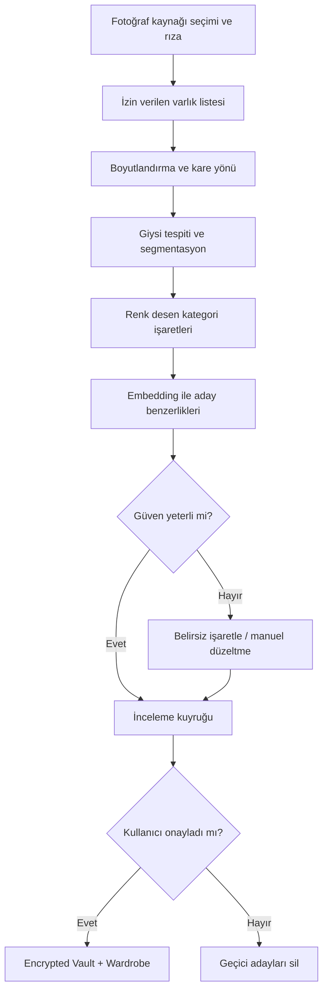

# KABİNSİZ — ON-DEVICE PHOTO-TO-WARDROBE
## Mimari · Uzman Zekâlar · Veri Sözleşmeleri · Mühendislik Planı v2.4

**Tarih:** 2026-11-03  
**Repo:** `gundogandogancan/kabinsiz`  
**İş:** Kullanıcının seçtiği veya açık izin verdiği fotoğraflardan **cihaz içinde** kıyafet adaylarını tespit etme, birleştirme, doğrulatma ve dijital dolaba ekleme.  
**Sınır:** “Fotoğrafta görünen kıyafet” mutlaka kişinin sahip olduğu kıyafet değildir. **Sahiplik yalnız kullanıcı onayıyla** kurulur. Asla otomatik biçimde kimlik, ten rengi, vücut ölçüsü, din, cinsiyet veya kişilik çıkarmayı amaçlama.

## 0. Mevcut durum ve ilk değişiklik

GitHub önceki incelemesinde `WardrobeDomain`, `Garment`, `ShoppingCopilot`, `FitPassport`, `SystemContracts`, `Vault`, `Octopus`, `BodyGeometry`, `BodyStudioView` ve kamera yerine manuel kod kullanan `ScanView` saptanmıştı. Bu dosya **plan ve uygulama gereksinimidir; şu an çalışan fotoğraf taraması kanıtı değildir**. Claude işe başlamadan `main` SHA, dosya gerçekliği, derleme ve testleri tekrar denetleyecek.

**Doğru hedef:** fotoğrafları tek tek başka bir servise göndermek değil; PhotoKit üzerinden sınırlı boyutlu görüntüleri yerel olarak okuyup Core ML / Vision ile kıyafet adayları çıkararak, kullanıcının onayından sonra mevcut `Wardrobe` ve `Vault` içine eklemek.

---

## 1. Mahremiyetin uygulama davranışı

Üç kaynak modu ayrı olacaktır:

1. **Yalnız seçtiğim fotoğraflar** — SwiftUI `PhotosPicker` / sistem seçicisi; kitaplığın tümünü taramaz.
2. **İzin verdiğim fotoğraf arşivi** — PhotoKit erişim izni ve iOS'un `limited` / `authorized` durumlarına saygı; sınırlı erişim sadece sunulan varlıklarda çalışır.
3. **Kamera ile dolabıma ekle** — kameradan çekilen tek parçayı yerel analiz; ayrı kamera izni.

Tam erişim talebi ilk açılışta zorunlu gösterilmez. Arşivin geniş taraması için ek bir açık onay; varsayılan olarak seçili fotoğraf modu. Veri minimizasyonu: fotoğraflar `PHAsset` / `PhotosPickerItem` üzerinden küçük önizleme çözünürlüğünde işlenir; analizden sonra orijinal byte, yüz alanı, GPS metadata ve kişi görüntüleri uygulamanın kalıcı deposuna yazılmaz. İzin verilmediğinde uygulama çalışmayı sürdürür; elle ekleme, albüm seçimi ya da kamera seçeneği sunar. Silme, model cache, embedding, review queue ve küçük resim kopyalarını da kapsar.

> Fotoğraflarda başka insanlar bulunabilir. Sistem kıyafeti ayırır, yüz tanıma veya kişi kimliği izleme yapmaz; birden fazla kıyafetin kime ait olduğu belirsizse kararı kullanıcıya bırakır.

## 2. 8 adımlı iş hattı ve asenkron kaynak yönetimi



**Task orchestration:** `PhotosWardrobeOrchestrator` Swift actor; bounded task queue, cancellation, revisions, dedup; `DeviceGovernor` ısınma/Low Power Mode altında batch'i küçültür; `CitadelGate` fotoğraf giden ağ isteğini reddeder. Kullanıcı taramayı durdurabilir ve kaldığı yerden kontrol ederek devam edebilir. iOS'un arka plan süre kısıtları nedeniyle arşivin tamamını uygulama kapalıyken sınırsız tarama vaadi verilmez. Önce küçük batch, görünür ilerleme ve birinci çalışan dikey akış.

## 3. Uzman modül sözleşmeleri

| Modül | Girdi → çıktı | Veri erişimi | Karar / hata davranışı |
|---|---|---|---|
| `PhotoPermissionGate` | Kullanıcı seçimi → izinli kaynak kümesi | PhotoKit / PhotosPicker | İzin yoksa fail-closed |
| `ThumbnailDecoder` | Yetkili foto varlığı → oryante küçük bitmap | Bellekte, geçici | Bozuk, aşırı büyük, HEIC/JPEG farkına dayanıklı |
| `GarmentDetector` | bitmap → giysi bounding boxes | Core ML / Vision | Kategori düşük güven: belirsiz |
| `GarmentSegmenter` | box + bitmap → kıyafet maskesi | yalnız yerel | Kısmi örtülme: kalite uyarısı |
| `ColorPatternInterpreter` | maskeli kumaş → temel renk/desen | Core ML/deterministik | Işık kaynaklı renk hatası için tolerans |
| `LogoSignalInterpreter` | giysi kırpımı → görünen yazı/logo işareti | OCR/Vision | Asla tek işaretten kesin marka/model uydurma |
| `MaterialEvidenceGuard` | görüntü + etiket OCR → bileşim iddiası | yalnız yerel | Lif yüzdesi ancak etikette doğrulanır |
| `GarmentEmbeddingIndex` | crop → local embedding | encrypted local | Sadece benzerlik; sahiplik kanıtı değil |
| `DuplicateClusterer` | embedding+kategori+renk → grup | local index | Yanlış birleştirme potansiyelini kullanıcı çözer |
| `WardrobeReviewQueue` | aday grupları → kullanıcı onayları | Vault | Onaysız kalıcı dolaba ekleme yok |
| `WardrobeCommitter` | onay → `Garment` + provenance | Vault, WardrobeDomain | işlem atomik; geri al / sil |
| `PhotoBatchGovernor` | pil/ısı/bellek → batch/bütçe | DeviceBudget | pause/resume ve görünür fallback |
| `EvidenceAndPrivacyAudit` | karar → kanıt/izin kayıtları | teknik metadata, görsel değil | rızasız ağ / hassas log reddi |

Her birinin **tek sahibi, imzalı model/skill sürümü, test seti, masraf limiti ve fallback** olacak. İş paketleri yazılımdaki sorumluluklarıdır; her biri ayrı pahalı LLM çalıştırmayacak.

## 4. Kaynak, model ve lisans stratejisi

- **Apple PhotosPicker / PhotoKit**: kullanıcı tarafından seçilmiş veya erişim izni verilmiş görsel kaynakları.
- **Vision**: OCR / kontur ve mevcut desteklenen görüntü analizi API'leri. Giysi segmentasyonunu otomatik olarak karşılayacağı varsayılmayacak.
- **Core ML**: cihazda derlenen, ticari kullanımı lisanslı giysi tespit / segmentasyon / özellik modeli; örnek model adayları performans + lisans denetiminden sonra seçilecek.
- **Core Image / Accelerate / vImage**: oryantasyon, yeniden boyutlandırma, normalize ve renk örnekleme.
- **CryptoKit + mevcut Vault**: embedding index, thumbnail cache, review queue, silme; Keychain korunan anahtarlar.
- **BackgroundTasks** (yalnız izinli ve sistemin gerçekten verdiği zamanlarda): durum güncellemeleri; sınırsız arka plan taraması yok.
- **Swift Testing / XCTest / Instruments**: doğru sınıflandırma, gizlilik ve cihaz yük testleri.

### Model seçim kapısı

Üç aday sınıfı kıyaslanır: (a) hafif object detection + garment segmentation, (b) görsel embedding/similarity, (c) OCR. Değerlendirme matrisi: işletilebilir Core ML sürümü, model ağırlığı, lisans, iOS 18 çalışması, CPU/Neural Engine/GPU performansı, küçük iPhone bellek sınırları, az ışık, farklı cilt/giyim ve kamera koşullarında sapma. Seçilen checkpoint / kaynak / hash / lisans dosyaya işlenmeden model ana app'e bağlanmaz.

## 5. Kanonik veri tipleri ve kalıcılık

```swift
struct GarmentCandidate: Codable, Sendable, Identifiable {
    let id: UUID
    let sourceAssetOpaqueID: String // cihaz içi, dışarı çıkmayan başvuru
    let category: GarmentCategory?
    let colorName: String?
    let pattern: String?
    let visibleBrandSignal: String?
    let labelText: String?
    let segmentQuality: CandidateQuality
    let duplicateGroupID: UUID?
    let source: CandidateSource // selectedPhoto, allowedLibrary, camera
    let provenance: Provenance // generated candidate / user confirmed
    let reviewed: Bool
}
```

**Önemli:** Bu tip örnektir; mevcut `DomainContracts` içindeki isimleri taramadan yeni duplicate domain oluşturmayın. Değişikliklerden önce ADR ve şema uyumluluk testi zorunlu. Kullanıcı onayı sonrası `Garment` bilgisi: `id`, `category`, `colorName`, `materialClaims` (yalnız kanıtlı), `condition = UNKNOWN`, `provenance = USER_CONFIRMED_FROM_PHOTO`. Gerçekten dolapta bulunup bulunmadığı fotoğrafa bakarak otomatik `owned=true` yapılmaz. `PhotoImportReceipt` hangi görselin işlendiğini ve silme talebinin sonucunu hassas foto metadata'sı olmadan kaydeder.

## 6. De-dup / sahiplik / kategori semantiği

- Aynı kıyafetin farklı giyildiği günlerde çekilmiş fotoğrafları **olası aynı ürün** olarak grupla.
- Aynı renkte iki farklı gömleği **zorla birleştirme**; eşleştirme eşiği cihaz/doğruluk veri setinde belirlenir.
- Model üzerindeki ürünleri dolaba eklemek için kullanıcı onayı gerektir; sadece Instagram/screenshot içinde görülen ürün otomatik dolap öğesi yapılmaz.
- Bir giysi kombin içinde kirli/temiz statüsünü fotoğraf tarihinden kesin çıkarma; kullanıcı düzeltmesi gerekir.

## 7. UI ekranları — kod ve servis eşleşmesi

### WD-01 — Fotoğraf kaynağı seç

```text
┌──────────────────────────────────┐
│ Dolabını tanıyalım               │
│ Tek tek eklemek zorunda değilsin │
│                                  │
│ [ Seçtiğim Fotoğraflar ]         │
│ [ İzin Verdiğim Arşivi Tara ]    │
│ [ Kamera ile Ekle ]              │
│                                  │
│ Fotoğrafların cihazında işlenir. │
└──────────────────────────────────┘
```

### WD-02 — Tarama ilerlemesi

```text
┌──────────────────────────────────┐
│ Kıyafet adaylarını buluyoruz     │
│ [123 / 500 izinli görsel]       │
│                                  │
│ İncelenen: 123  Aday: 38         │
│ Belirsiz: 7    Birleşebilir: 11  │
│                                  │
│ [Duraklat] [İptal]              │
│ Cihaz ısınırsa hız azalabilir.   │
└──────────────────────────────────┘
```

### WD-03 — İnceleme kuyruğu

```text
┌──────────────────────────────────┐
│ Bulduğumuz kıyafetler            │
│ [foto kırpımı] Gömlek · Krem     │
│ [Ekle] [Düzelt] [Benzerlerini gör]│
│ [foto kırpımı] Pantolon · Siyah  │
│ [Ekle] [Düzelt] [Benzerlerini gör]│
│                                  │
│ [12 onaylanmış parçayı dolaba ekle]│
└──────────────────────────────────┘
```

### WD-04 — İşlem bitti / mahremiyet

Onaylananlar `Dolabım` sayfasına gider. Kullanıcı “Öneri fotoğraflarını sil”, “Bu oturumun sonucunu sil”, “Tüm Wardrobe AI verilerini sil” seçeneklerini görür; silme yalnız liste öğesini değil cache/embedding/review queue kayıtlarını da kapsar.

## 8. Swift/SwiftUI önerilen dosya sahipliği

```text
Packages/KabinsizCore/Sources/
  PhotoWardrobeContracts/      Candidate, ImportReceipt, ReviewDecision
  PhotoWardrobePipeline/       JobQueue, Dedup, Policy, MaterialGuard
  WardrobeDomain/              Var olan Garment/Wardrobe ile entegrasyon
  SystemContracts/             WorkOrder/DecisionEnvelope/EgressIntent
  Vault/                       Şifreli aday, index ve öğe saklama
apps/ios/Kabinsiz/
  Features/WardrobeImport/     Picker, ScanProgress, ReviewGrid, Confirm
  Services/PhotosLibrary/     PhotoKit/PhotosPicker adapters
  Services/OnDeviceVision/    Core ML/Vision adapters
  Services/Device/            Budget/governor adaptörü
Tests/
  PhotoWardrobeTests/         local fixture, cancellation, duplicate, consent
```

Repo klasör yapısı ve target bağımlılıkları test edilmeden birebir klasör üretmek zorunlu değildir; mevcut yapı korunarak eşdeğer ayrıştırma yapılabilir.

## 9. Kademeli kanıt yolculuğu

- **WD-WP01:** izin/rıza/yalnız seçilen foto erişimi, fixture ile.
- **WD-WP02:** tek görüntüde kıyafet crop ve kategori, fallback.
- **WD-WP03:** 20–50 görsellik batch + iptal + cihaz kaynak bütçesi.
- **WD-WP04:** embedding tabanlı olası tekrar grupları + yanlış birleşme testleri.
- **WD-WP05:** inceleme kuyruğu + onay ve düzenleme + encrypted Vault.
- **WD-WP06:** mevcut `ShoppingCopilot`, `Today Outfit Engine`, 360° avatar ile entegrasyon.
- **WD-WP07:** UI snapshot, performans, erişilebilirlik, gerçek iPhone testi; sonuç raporu.

## 10. Negatif testler ve kabul kapıları

| ID | Test | Başarı ölçütü |
|---|---|---|
| WD-T01 | Foto izni verilmeden tarama | 0 okunmuş kullanıcı görseli |
| WD-T02 | Sadece 3 seçilmiş görsel | Dördüncü dosya erişilemez |
| WD-T03 | `limited` PhotoKit | Yalnız izinli kapsam, izin genişletme ayrı |
| WD-T04 | Kullanıcı taramayı iptal eder | Kuyruk durur, onaysız geçici adaylar temizlenir |
| WD-T05 | Fotoğrafta iki insan var | Yanlış sahiplik/saptama kesinleştirilmez |
| WD-T06 | Kıyafetin bir kısmı görünür | Belirsizlik gösterilir |
| WD-T07 | Aynı gömlek 20 farklı fotoğrafta | Olası tekrar grubu, tek ürün olarak zorla kaydetme yok |
| WD-T08 | İki benzer gömlek | Kullanıcı ayrı tutabilir |
| WD-T09 | Logo görünmüyor | Marka bilinmiyor olarak kalır |
| WD-T10 | Kumaş bileşimi fotoğraftan bilinmiyor | Yüzde yazılmaz |
| WD-T11 | Etikette `30°C` | Bakım sıcaklığı giyim sıcaklığına dönüşmez |
| WD-T12 | Screenshot'taki kıyafet | “Dolabımda var” otomatik yazılmaz |
| WD-T13 | HEIC yön problemi | Crop oryantasyonu doğru |
| WD-T14 | Büyük foto/video/Live Photo | Bellek taşmaz; uygun önizleme |
| WD-T15 | Offline | Seçili görsel analizi desteklendiği ölçüde yerel |
| WD-T16 | Egress yakalama | Görsel/embedding/foto metadata dışarı çıkmaz |
| WD-T17 | Termal seviye ciddi | Batch küçülür veya bekler |
| WD-T18 | Low Power Mode | İşlem ve animasyon sınırlı; kullanıcı bilgilendirilir |
| WD-T19 | Veri silme | Review queue + embedding + thumbnail cache + Vault temizlenir |
| WD-T20 | App yeniden başlatma | Onaylı veri korunur, onaysız işlem dürüst görünür |
| WD-T21 | iPhone 13 Pro Max ve 16 Pro (örnek) | Cihaz türüne göre süre/RAM/batarya raporlanır |
| WD-T22 | Aynı albüm tekrar taranır | Kullanıcı kontrollü dedup; aşırı veri kopyası yok |
| WD-T23 | Kullanıcı 100 görselde onay vermeden çıkar | Dolap sessizce dolmaz |
| WD-T24 | Kamera izni reddedilmiş | Dosyadan ekleme ve elle giriş çalışır |
| WD-T25 | VoiceOver + Dynamic Type | Akışlar erişilebilir |

**Kabul seviyesi:** Test fixture'larının geçmesi gerçek kullanıcı arşivinde doğru ürün tanıma iddiası değildir. Gerçek fotoğraf kümesi için açık rızalı değerlendirme, sınıf bazlı precision/recall, yanlış birleştirme, kullanıcı düzeltme oranı ve cihaz başına p50/p95 gecikme raporlanmalı.

## 11. Claude'a denetim ve uygulama sorusu

> Repo HEAD SHA üzerinde eksik `PhotoWardrobe` bileşenleri hangileri? Fotoğraf izinleri ve yerel model lisansları kesinleşmeden neden tüm fotoğrafları tarayacağını iddia edemeyiz? Fotoğraftan çıkardığın ürünleri `WardrobeDomain`, `Vault`, `Octopus`, `DeviceGovernor`, `FitPassport` ve `Home Studio`ya hangi sürümlü sözleşmeler üzerinden bağlayacaksın? Önce tek seçilmiş fotoğraf → kıyafet adayı → kullanıcı onayı → şifreli dolap kaydı dikey dilimini çalıştır; test ve gerçek ekran görüntüsü sun.
