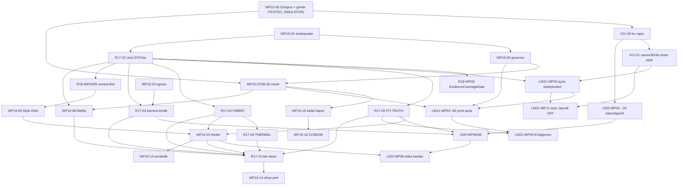

# V19 bağımlılık grafiği (DAG)

Tarih: 2026-11-03 · Commit `f5caa71` · V19-00 ve V19-21 madde 9
Sıra kaynağı: `docs/audit/V21_QUEUE_AND_CONFLICT_MAP.md` §4 (bağlayıcı plan). Bu dosya o sırayı bağımlılık kenarlarıyla ve P-sınıfıyla gösterir; plan değiştirmez. Önerilen değişiklikler §3'te ayrı yazılıdır ve kuyruk sahibi onaylamadan uygulanmaz.
Takvim yok; kenar = "önce bu bitmeli, testli kanıtla" (V19-00).

## 1. Grafik

## 2. Düğüm tablosu

P-sınıfı: P0 = harici onay gerektirmeyen çekirdek doğruluk/güvenlik; P1 = P0 sonrası veya kısmen dış; P2 = cila/araştırma; BLOCKED = dış engel; REJECTED = yapılmayacak.

| Sıra # | Düğüm | P | Bağımlı olduğu | Kabul testi / kanıt | Sahip | Durum | Dış engel |
|---|---|---|---|---|---|---|---|
| 5 | WP15-05 | P0 | 2,3,4 | V15-T-ORC-01..09, BOD-01..10 | AG-03/04 | TESTED_SIMULATOR | — |
| 6 | V21-00 | P0 | 5 | V19-21 1–9 dosyaları | AG-10 | Bu teslim | — |
| 7 | V21-01 | P0 | 6 | ADR-006/007/008 + DECISION_REGISTER | AG-02/09 | Çalışma ağacında | Bulut istisnası kullanıcı kararı |
| 8 | WP15-06 | P0 | 2 | T-KAB-SEC-005, R17-3D-04, V19-T-050/055 | — (AG-11 yok) | SPEC_ONLY | Termal ölçüm cihaz |
| 9 | WP15-07/08 | P0 | 5, 8 | V19-T-023..025, 028; R17-FIT-05; UI20-T-005/013 | AG-04 | SPEC_ONLY | Perf cihaz |
| 10 | R17-02 | P0 | 2 | golden schema, V18-T-001/002/008, T-KAB-FIT-001 | AG-03/08 | SPEC_ONLY | — |
| 11 | R18-WP03 | P0 | 10 | V18-T-003/010/011/015/038, R17-DAT-01..03 | AG-08 | Temel tip var | — |
| 12 | LM21-WP03 | P0 | 7, 10 | Swift Testing, revizyon guard | AG-03 | SPEC_ONLY | — |
| 13 | UI20-WP02→04 | P0 (UI) | 6 | UI20-T-001..003, 006, 007 | AG-02 | SPEC_ONLY | Kontrast cihaz |
| 14 | WP15-18 | P0 | 1–9 | güvenlik negatif, perf, a11y | AG-10/12 | SPEC_ONLY | İnsan reviewer |
| 15 | R17-05 | P0 | 10 | T-KAB-FIT-001..009, R17-FIT-01..06 | — (AG-06 yok) | Abstain kısmı TESTED_SIMULATOR | Gerçek ölçü |
| 16 | R17-04 | P0 | 10 | T-KAB-MAT-001..008, R17-MAT-01..04 | — | SPEC_ONLY | ISO metin lisansı |
| 17 | R17-09 | P1 | 16 | R17-THM-01..03 | — | SPEC_ONLY | WeatherKit PLA |
| 18 | R17-03 | P0 | 10, 3 | T-KAB-PROD-001..007, R17-SKU-01..05 | AG-08/05 | SPEC_ONLY | Kamera cihaz; GS1 |
| 19 | R18-WP04/05 | P1 | 10 | V18-T-012/016/017/024/047 | AG-07 | Kısmi (ShoppingGuard) | — |
| 20 | WP19-09 | P1 | 3, 4, 19 | V19-T-035..038, 044, 045 | AG-07/09 | SPEC_ONLY | — |
| 21 | WP19-10 | P1 | 15, 16, 20 | V19-T-033/034/039..041/046 | AG-07 | SPEC_ONLY | İnsan stil paneli |
| 22 | R18-WP07 | P1 | 10 | sentetik çok marka fixture | AG-08 | SPEC_ONLY | — |
| 23 | UI20-WP05/06 | P1 | 13, 15, 18 | UI20-T-008..012, 015 | AG-02 | SPEC_ONLY | — |
| 24 | LM21-WP04..08 | P0 (LM21) | 8, 9, 12 | LM21-T01/02/07..13/25..30/38/39/41/42/48/50 | AG-04/05 | SPEC_ONLY | `REAL_DEVICE_BLOCKED` |
| 25 | LM21-WP09 | P0 (LM21) | 15, 24 | LM21-T32..34, 44 | — | SPEC_ONLY | — |
| 26 | WP19-08 | P1 | 9, 10 | logo/doku/renk testleri | AG-04 | SPEC_ONLY | Lisanslı asset |
| 27 | UI20-WP08 | P1 | 21, 23 | UI20-T-016/017/025 | AG-02 | SPEC_ONLY | — |
| 28 | R17-10 | P0 (ürün) | 15–18, 21, 26 | R17-E2E-01..02 | AG-03 | KISMEN | 1 iPhone e2e |
| 29 | WP19-14 | P2 | 21 | V19-T-042/043, UI20-T-024 | AG-07 | SPEC_ONLY | — |
| 30 | LM21-WP11 | P1 | 7, 12 | LM21-T14..16, 21, 22, 40 | AG-09 | SPEC_ONLY | — |
| 31 | UI20-WP09 | P2 | 23 | screenshot seti | AG-02 | SPEC_ONLY | — |
| 32 | WP19-13 | P0 kapı | 28 | p50/p95/p99 cihaz artefaktı | — | — | `REAL_DEVICE_BLOCKED` |
| 33 | UI20-WP10 | P1 | 23–31 | UI20-T-021/022 | AG-10 | — | Cihaz |
| 34 | R17-12 / WP19-16 | P1 | 14 | CI yeşil, SBOM | AG-13 | SPEC_ONLY | Actions maliyeti |
| 35 | WP15-09..14 | P1 | 14 | ortak sözleşme | AG-08 | Kısmi v1.3 | Lisanslı katalog |
| 36 | WP15-15 | P1 | 35 | v1.2 travel testleri | AG-07 | TESTED_SIMULATOR | WeatherKit PLA |

### BLOCKED (dış)

R17-07, R17-08 (gerçek), R17-11/LAB-REAL/WP19-12/LM21-WP15, R17-13/LIVE-PILOT/R18-WP14/LM21-WP16, R17-14, R18-WP08..12, R18-WP15, WP19-15, LM21-WP10/12/13/14/17, WP15-16/17/19/20. Engel türleri `V21_QUEUE_AND_CONFLICT_MAP.md` §4 alt tablo.

### REJECTED (bu anayasa altında yapılmaz)

| Öğe | Neden | Kaynak |
|---|---|---|
| SMPL / SMPL-X / LHM gövde modeli | Ticari olmayan lisans | v1.7 §3.2, `docs/research/VTON_LANDSCAPE_2026-11.md` |
| CatVTON, Mobile-VTON ticari dağıtım | CC BY-NC-SA | v2.1 LM21-01, R17-14 |
| Gizli bulut GPU fallback, otomatik mod yükseltme | Rıza ihlali | v1.7 §3.2 G3, LM21-01 |
| Galeri toplu tarama varsayılan ON | V19-12.1 | V19-12 |
| Fotoğraftan ruh hali/kişilik/kültür/din/etnisite çıkarımı | V19-Q25 | V19-07, V19-20 |
| Komisyonun organik sıralamaya girdi olması | V18-03.3, V19-08.3 | v1.8, v1.9 |
| Mikrofon / ses izi (canlı ayna) | LM21-06 | v2.1 |

## 3. Önerilen kenar değişiklikleri (onay bekliyor)

Gerekçe `docs/audit/V19_REALITY_AND_GAP_REPORT.md` §7.

| # | Öneri | Etkilenen düğüm |
|---|---|---|
| E-1 | FIT-04 (+FIT-03 ADR kararı) küçük düzeltmesi V21-01'den hemen sonra, R17-05'ten bağımsız | 15 → yeni düğüm 7a |
| E-2 | WP15-06 → "cihaz duman koşusu" (CRY-06, termal geçiş, egress yakalama) kenarı; U-1 ile 3 eşleşmiş iPhone | 8 → 32'nin bir kısmı öne |
| E-3 | Tarama kartının `OctopusCoordinator` + `DecisionEnvelope` altına alınması R17-02 kapsamında; R17-03 buna bağlı | 10 → 18 |
| E-4 | `SensitiveAttributeGuard` kök genişletmesi (ruh hali, kişilik, kültür, ten tonu) WP19-09'un ön şartı | yeni → 20 |
